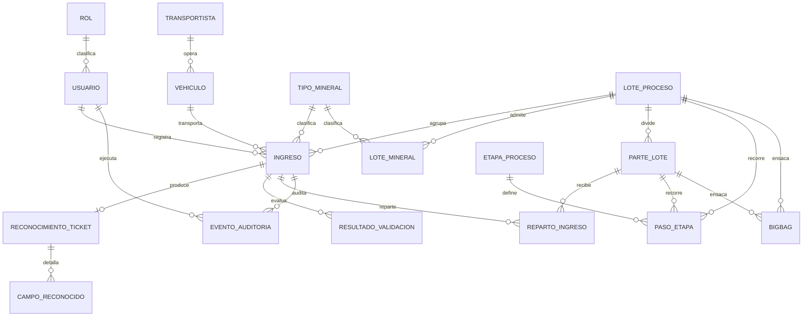

# Modelo de datos — Entidad-Relación

**Versión:** 3.1 · **Estado:** Validado · **Cambio:** versión 2.1 del sistema (DR-11 a DR-31)
**Deriva de:** `../00-tesis/marco_tesis.md` y `../00-tesis/decisiones_reformulacion.md`

**Fuente única.** Todas las entidades del sistema se modelan aquí, sin importar cuántos módulos las
usen. `INGRESO`, por ejemplo, la escribe M03, la leen M07 y M08, la referencian M04, M05 y M06, y la
audita M09: existe una sola definición, y es esta.

Una app del backend solo tiene `models/` si aporta una entidad a este documento (D-10). Si un módulo
necesita persistir algo nuevo, la entidad se añade primero aquí y después al código, nunca al revés.

---

## 1. Diagrama general

Las entidades `CLIENTE`, `SALIDA` y `MOVIMIENTO_STOCK` del modelo anterior se retiran: pertenecen al
alcance que la reformulación dejó fuera.

## 2. Entidades

### USUARIO (M01)

| Campo | Tipo | Notas |
|---|---|---|
| id_usuario | PK | |
| username | varchar(50) | único |
| password_hash | varchar | nunca en texto plano |
| nombres, apellidos | varchar(100) | |
| id_rol | FK → ROL | |
| activo | boolean | la baja es lógica |
| intentos_fallidos | int | soporta el bloqueo temporal |
| ultimo_acceso | datetime | |
| debe_cambiar_clave | boolean | verdadero tras un restablecimiento; obliga a cambiar la contraseña temporal al iniciar sesión (DR-30) |

**Para qué existe.** Atribuir cada operación a una persona. Sin ella, ningún registro es imputable.
**Quién la usa.** La escribe M01; la referencian todos los módulos que persisten algo.

### ROL (M01)

| Campo | Tipo | Notas |
|---|---|---|
| id_rol | PK | |
| nombre | varchar(30) | ADMINISTRADOR, ADMINISTRATIVO, SUPERVISOR |
| descripcion | text | |

### TIPO_MINERAL (M02)

Catálogo único, usado al registrar el ingreso y al consolidar (DR-03).

| Campo | Tipo | Notas |
|---|---|---|
| id_tipo_mineral | PK | |
| codigo | varchar(6) | único; de dos a seis letras o números; no se modifica tras el alta (RN-M02-16). Si el alta se hace desde el registro de un ingreso sin código, lo genera el servidor |
| nombre | varchar(100) | único sin distinguir mayúsculas (RN-M02-15); valores a definir con la empresa |
| unidad_medida | varchar(10) | toneladas |
| activo | boolean | baja lógica: no se elimina si tiene ingresos |

**Para qué existe.** Clasificar qué trajo el volquete y permitir agrupar la producción del mes.
**Quién la usa.** La escribe M02 —también desde el registro de un ingreso, por el Administrativo o
el Administrador—; la leen M03, M06 y M08.

> **Pendiente.** Los valores del catálogo no están definidos. Bloquea la implementación de M02 y la
> forma final del total mensual de M08.

### VEHICULO (M02)

| Campo | Tipo | Notas |
|---|---|---|
| id_vehiculo | PK | |
| placa | varchar(10) | única, formato validado (regla V3) |
| tipo_titularidad | enum | PROPIO / EXTERNO — de aquí se deriva el tipo de vehículo del ingreso (D-06) |
| capacidad_tn | decimal(6,2) | límite de carga que contrasta la regla V4 |
| tara_tn | decimal(8,2) | peso del vehículo vacío, obtenido en el destare de su primer viaje; nulo hasta entonces (DR-10) |
| fecha_destare | datetime | fecha y hora del destare, propuestas con la hora actual y ajustadas por el usuario; no posteriores al registro (RN-M03-23); nulo hasta el destare |
| id_usuario_destare | FK → USUARIO | quien digitó la tara; nulo hasta el destare |
| id_transportista | FK → TRANSPORTISTA | nulo si es propio |
| activo | boolean | |

**Para qué existe.** Que el tipo de vehículo, su capacidad y su tara no se digiten en cada ingreso.
La tara se fija una sola vez, en el destare, y se mantiene por decisión de la Gerencia; solo el
Administrador puede modificarla, con motivo, y el cambio queda en auditoría (D-17).
**Quién la usa.** La escribe M02; la leen M03, M05 y M07.

### TRANSPORTISTA (M02)

| Campo | Tipo | Notas |
|---|---|---|
| id_transportista | PK | |
| razon_social | varchar(150) | |
| ruc | varchar(11) | once dígitos; único (RN-M02-18) |
| activo | boolean | |

### INGRESO (M03) — unidad de registro del sistema

| Campo | Tipo | Notas |
|---|---|---|
| id_ingreso | PK | |
| codigo | varchar(20) | único, asignado por el servidor (D-02), `editable=False` |
| imagen_ticket | varchar(255) | ruta del respaldo (D-14 fija el medio); nula **solo** si el ingreso se registró sin foto |
| sin_respaldo_fotografico | boolean | verdadero en el registro sin foto (DR-13); `editable=False` |
| motivo_sin_respaldo | varchar(60) | obligatorio si `sin_respaldo_fotografico`; lista cerrada de motivos; `editable=False` |
| fecha_hora_pesaje | datetime | fecha reconocida del ticket —o digitada en el registro sin foto— y hora indicada por el usuario sobre la propuesta del sistema con la hora actual (DR-11); corregible antes de confirmar |
| hora_inicio_registro | datetime | asignada por el servidor al recibir la imagen o, en el registro sin foto, al elegir esa opción; `editable=False` |
| hora_fin_registro | datetime | asignada por el servidor al confirmar, también si queda En proceso; `editable=False` |
| id_vehiculo | FK → VEHICULO | si la placa no existe, el vehículo se da de alta en la misma pantalla (DR-05, DR-10) |
| id_tipo_mineral | FK → TIPO_MINERAL | |
| peso_bruto_tn | decimal(8,2) | reconocido del ticket, corregible antes de confirmar |
| tara_tn | decimal(8,2) | tara del vehículo **aplicada** a este ingreso, copiada del catálogo; nula mientras esté En proceso |
| peso_neto_tn | decimal(8,2) | **calculado por el servidor**: `peso_bruto_tn − tara_tn`; `editable=False`; nulo mientras esté En proceso (D-17) |
| id_lote | FK → LOTE_PROCESO | nulo mientras el ingreso no se asigne a un lote; un ingreso pertenece a un lote como máximo |
| id_usuario_registro | FK → USUARIO | `editable=False` |
| estado | enum | EN_PROCESO / REGISTRADO / ANULADO (D-07, D-17) |
| motivo_anulacion | text | obligatorio si estado = ANULADO |

**Para qué existe.** Es la unidad de registro: un volquete que entrega mineral en planta, con su
respaldo fotográfico y las tres marcas de tiempo que describen cómo se registró (D-01). No existe un
número de ticket aparte: el `codigo` identifica el ingreso (DR-12).

**Respaldo.** Una restricción de base exige exactamente una de dos cosas: `imagen_ticket`, o
`sin_respaldo_fotografico` con su motivo (DR-13). El ingreso sin foto no tiene
`RECONOCIMIENTO_TICKET`, pero sí `RESULTADO_VALIDACION`.

**Los siete datos del registro** son la placa —a través de `id_vehiculo`—, `fecha_hora_pesaje`,
`peso_bruto_tn`, `tara_tn`, `peso_neto_tn`, `id_tipo_mineral` y el tipo de vehículo, derivado de
`VEHICULO.tipo_titularidad`. En un ingreso Registrado ninguno admite nulo; en uno En proceso faltan
solo la tara y el peso neto, que llegan con el destare.

**Por qué el peso neto se calcula.** El ticket de balanza imprime un único peso, el bruto (DR-09).
La tara es un atributo del vehículo y el neto es su diferencia. El ingreso guarda la tara que se le
aplicó, en lugar de consultarla en el catálogo cada vez, para que un cambio posterior de la tara de
un vehículo no reescriba el neto de los ingresos ya registrados (D-17).

**Estados.** `EN_PROCESO`: confirmado, con código y marcas de tiempo, pero pendiente del destare del
vehículo; no cuenta en ningún total ni se asigna a un lote. `REGISTRADO`: completo, con neto.
`ANULADO`: retirado de los totales, conservado en el histórico.

**Quién la usa.** La escribe M03; la leen M07 y M08; la referencian M04, M05 y M06; la audita M09.
M06 escribe `id_lote` a través de su servicio.

### RECONOCIMIENTO_TICKET (M04)

Un reconocimiento por ingreso con foto; el ingreso sin foto no tiene ninguno. Conserva qué leyó el
motor, frente a lo que confirmó la persona.

| Campo | Tipo | Notas |
|---|---|---|
| id_reconocimiento | PK | |
| id_ingreso | FK → INGRESO | único: un reconocimiento por ingreso |
| motor | varchar(50) | identificador del motor empleado (D-12) |
| version_motor | varchar(30) | no cambia durante la medición (D-16) |
| fecha_proceso | datetime | |
| umbral_confianza | decimal(3,2) | vigente al procesar; 0,80 por defecto |
| exito | boolean | falso si la imagen resultó ilegible |

### CAMPO_RECONOCIDO (M04)

Tres filas por reconocimiento: placa, fecha y peso bruto, que son los datos que imprime el ticket (DR-09).

| Campo | Tipo | Notas |
|---|---|---|
| id_campo | PK | |
| id_reconocimiento | FK → RECONOCIMIENTO_TICKET | |
| nombre_campo | enum | PLACA / FECHA / PESO_BRUTO |
| valor_reconocido | varchar(50) | nulo si el motor no pudo leerlo |
| valor_confirmado | varchar(50) | lo que el usuario aceptó o corrigió |
| confianza | decimal(4,3) | entre 0 y 1; nulo si no hubo lectura |
| fue_corregido | boolean | derivado: reconocido ≠ confirmado |

**Para qué existe.** Separar la propuesta del dato (D-13). Guardar un solo valor haría imposible
distinguir lo que leyó el motor de lo que escribió la persona, y con ello se perdería la única
evidencia de si el reconocimiento funciona.

**Quién la usa.** La escribe M04 al confirmarse el ingreso; la lee M04 para el detalle comparativo.

### RESULTADO_VALIDACION (M05)

Una fila por regla aplicada a un ingreso.

| Campo | Tipo | Notas |
|---|---|---|
| id_resultado | PK | |
| id_ingreso | FK → INGRESO | |
| regla | enum | V1 / V2 / V3 / V4 / V5 |
| momento | enum | PROPUESTA / CONFIRMACION / DESTARE — las reglas se aplican sobre lo propuesto, sobre lo confirmado y, en el primer viaje, al registrar la tara |
| cumple | boolean | |
| detalle | text | valores concretos que motivaron el incumplimiento |
| resolucion | enum | NO_APLICA / CORREGIDA / JUSTIFICADA |
| justificacion | text | obligatoria si la resolución es JUSTIFICADA; solo las reglas V1 y V4 la admiten |
| fecha_hora | datetime | |

**Para qué existe.** Dejar constancia de qué se revisó y cómo se resolvió. Sin ella no se puede
reconstruir por qué un ingreso se aceptó ni quién justificó una advertencia.
**Quién la usa.** La escribe M05; la lee M09.

### ETAPA_PROCESO (M06)

Catálogo cerrado de cuatro filas: secado, zarandeo, molienda y ensacado. Se carga por migración de
datos y no se administra.

| Campo | Tipo | Notas |
|---|---|---|
| id_etapa | PK | |
| codigo | enum | SECADO / ZARANDEO / MOLIENDA / ENSACADO |
| nombre | varchar(50) | |
| orden | smallint | posición relativa: ordena las etapas dentro de cualquier ruta |

**Rutas (DR-16).** El secado es común a todo el lote. Después la planta decide una de tres rutas: zarandeo
y ensacado; molienda y ensacado; o zarandeo, molienda y ensacado. Los códigos `ZARANDEO`, `MOLIENDA`
y `AMBAS` son una propuesta de nombres para el código. La ruta no es una tabla: es un dominio cerrado en el código que asocia a cada valor sus
etapas en orden. Un lote no recorre necesariamente las cuatro etapas.

### LOTE_PROCESO (M06)

| Campo | Tipo | Notas |
|---|---|---|
| id_lote | PK | |
| codigo | varchar(20) | único, asignado por el servidor |
| nombre | varchar(80) | único; lo indica el usuario |
| id_tipo_mineral | FK → TIPO_MINERAL | tipo con que se abre el lote; los demás están en `LOTE_MINERAL` (DR-27) |
| fecha_apertura | date | |
| fecha_inicio_recorrido | datetime | nula mientras el lote esté Abierto; `editable=False` (DR-19) |
| ruta | enum | ZARANDEO / MOLIENDA / AMBAS; vacía hasta decidirla tras el secado, y vacía si el lote se divide |
| estado | enum | ABIERTO / EN_RECORRIDO / CERRADO (DR-19) |
| destino | enum | VENTA / TRASLADO; obligatorio al cerrar (DR-14) |
| observacion_cierre | text | opcional |
| fecha_cierre | datetime | nula mientras no se cierre; `editable=False` |
| id_usuario_cierre | FK → USUARIO | solo el Administrador; `editable=False` |

**Para qué existe.** El mineral de varios volquetes se mezcla en cancha, de modo que un ingreso no
recorre las etapas por sí solo: lo hace el lote al que pertenece (DR-04). El lote es la indirección
que hace realista la trazabilidad.

**Ciclo de vida (DR-19, DR-29).** `ABIERTO`: reúne ingresos; se pueden asignar, retirar o trasladar.
`EN_RECORRIDO`: desde el inicio del recorrido, que empieza por el secado; admite ingresos tardíos, y
devuelve a cancha un ingreso agregado por error solo mientras su mineral no haya pasado por zarandeo
ni molienda y el lote conserve al menos un ingreso. `CERRADO`: cierre definitivo con destino, solo con todo el mineral
ensacado; no admite ningún cambio.

### LOTE_MINERAL (M06)

Lista de tipos de mineral que admite un lote (DR-27): el de apertura y los agregados después con
«Agregar otro mineral». Un ingreso solo se asigna si su tipo está en la lista.

| Campo | Tipo | Notas |
|---|---|---|
| id_lote | FK → LOTE_PROCESO | único junto con `id_tipo_mineral` |
| id_tipo_mineral | FK → TIPO_MINERAL | |
| autorizacion | text | obligatoria cuando el tipo entra al unificar un ingreso de otro mineral; quién lo autorizó o el motivo |
| fecha_hora | datetime | `editable=False` |
| id_usuario_registro | FK → USUARIO | `editable=False` |

Cada ingreso unificado de otro mineral guarda además su autorización en el evento de auditoría de
la asignación y se presenta marcado «Otro mineral». Un tipo se quita solo si no tiene ingresos en el lote y el lote está Abierto.

### PARTE_LOTE (M06)

Una fila por parte de un lote dividido (DR-18). Un lote se divide una sola vez, en dos a seis partes.

| Campo | Tipo | Notas |
|---|---|---|
| id_parte | PK | |
| id_lote | FK → LOTE_PROCESO | |
| nombre | varchar(80) | |
| numerador | smallint | fracción de la parte |
| denominador | smallint | las fracciones de un lote suman exactamente la unidad |
| ruta | enum | ZARANDEO / MOLIENDA / AMBAS |

**Por qué numerador y denominador.** Con decimales, tres tercios suman 0,999999 y una división
correcta se rechazaría. Las toneladas aproximadas de cada parte no se almacenan: se calculan como
fracción por las toneladas netas del lote, solo para estimar el peso de los bigbags.

### REPARTO_INGRESO (M06)

Porción de un ingreso tardío asignado a un lote ya dividido (DR-20).

| Campo | Tipo | Notas |
|---|---|---|
| id_reparto | PK | |
| id_ingreso | FK → INGRESO | |
| id_parte | FK → PARTE_LOTE | único junto con `id_ingreso` |
| numerador | smallint | |
| denominador | smallint | las porciones de un ingreso suman la unidad; el sistema propone las fracciones del lote |

### PASO_ETAPA (M06)

| Campo | Tipo | Notas |
|---|---|---|
| id_paso | PK | |
| id_lote | FK → LOTE_PROCESO | |
| id_parte | FK → PARTE_LOTE | nula para el secado común y para un lote sin dividir |
| id_ingreso_tardio | FK → INGRESO | solo para el secado propio de un ingreso que llegó después del secado del lote |
| id_etapa | FK → ETAPA_PROCESO | |
| fecha_hora | datetime | no posterior al registro ni anterior a la etapa previa o al inicio del recorrido |
| horas_molienda | decimal(6,2) | opcional, solo en molienda; mayor que cero. Dato descriptivo (DR-15) |
| id_usuario_registro | FK → USUARIO | `editable=False` |
| observacion | text | opcional |

Tres restricciones de unicidad condicionales garantizan un solo paso por etapa para el lote, para
cada parte y para el secado propio de cada ingreso tardío.

### BIGBAG (M06)

Datos descriptivos del ensacado (DR-15). No son inventario de producto terminado ni miden pérdidas.

| Campo | Tipo | Notas |
|---|---|---|
| id_bigbag | PK | registro de un grupo de bigbags, no de cada saco |
| id_lote | FK → LOTE_PROCESO | |
| id_parte | FK → PARTE_LOTE | nula si el lote no está dividido |
| cantidad | int | positiva |
| peso_aproximado_tn | decimal(6,2) | estimado por el sistema, o indicado por el usuario si recalcula |
| recalculado | boolean | verdadero si el peso lo indicó el usuario |
| fecha_hora | datetime | `editable=False` |
| id_usuario_registro | FK → USUARIO | `editable=False` |

**Cómo se determina la trazabilidad de un ingreso.** Un ingreso ha pasado por una etapa cuando su
lote —o la parte a la que se reparte— tiene el `PASO_ETAPA` correspondiente. Las etapas que le
corresponden son las de la ruta de su lote o, si el lote está dividido, la unión de las rutas de sus
partes (DR-21). Un ingreso sin lote no ha recorrido ninguna.

### EVENTO_AUDITORIA (M09)

| Campo | Tipo | Notas |
|---|---|---|
| id_evento | PK | |
| id_usuario | FK → USUARIO | |
| accion | enum | CREAR / MODIFICAR / ANULAR / RECONOCER / CORREGIR_DATO / EXPORTAR / INICIAR_SESION / CERRAR_SESION / ACCESO_RECHAZADO |
| entidad | varchar(50) | nombre de la tabla afectada |
| id_entidad | int | identificador del registro afectado |
| valores_anteriores | jsonb | nulo en creación |
| valores_nuevos | jsonb | nulo en anulación |
| motivo | text | explicación o autorización escrita por el usuario; obligatoria en la corrección de un ingreso y su reversión, la anulación, el cambio de tara de un vehículo y la unificación de un ingreso de otro tipo de mineral a un lote |
| fecha_hora | datetime | |
| direccion_ip | varchar(45) | |
| ingresos_relacionados | int[] | identificadores de los ingresos que afecta un evento de lote; índice GIN. Vacío en los demás eventos |

`RECONOCER` y `CORREGIR_DATO` son las acciones que incorpora el sistema inteligente: la primera
registra que el motor procesó una imagen, la segunda que una persona cambió un valor propuesto.
`CERRAR_SESION` lo exige RS-M01-08 y `ACCESO_RECHAZADO`, la regla de que toda solicitud rechazada
por autorización quede registrada. El dominio vive en `common/eventos.py`, listo para usarse como
`choices`.

**Historial de un ingreso.** Reúne los eventos con `entidad = INGRESO` y ese identificador, y los
eventos de lote cuyo `ingresos_relacionados` lo contiene. Los eventos de usuarios, catálogos y
accesos rechazados no entran en él: lo consultan los tres roles. La auditoría completa del sistema es
solo del Administrador.

El destare no añade una acción: se registra como `MODIFICAR` sobre el vehículo y sobre cada ingreso
que pasa de En proceso a Registrado. El motivo tiene columna propia porque no es un valor del
registro afectado, sino la explicación del cambio.

## 3. Índices

Cada índice se justifica por la consulta que sostiene y por su frecuencia esperada. Se crean desde
la primera migración: añadirlos después cambia las condiciones de trabajo a mitad del periodo.

| Índice | Tabla | Consulta que sostiene | Frecuencia |
|---|---|---|---|
| `idx_ingreso_codigo` | INGRESO(codigo) | Localizar un ingreso por su código. Cubierto por `unique=True` | Alta |
| `idx_ingreso_vehiculo_fecha` | INGRESO(id_vehiculo, fecha_hora_pesaje) | Consulta por placa y fecha de M07, y búsqueda de un ticket duplicado por la regla V1 | Alta |
| `idx_ingreso_fecha_mineral` | INGRESO(fecha_hora_pesaje, id_tipo_mineral) | Total acumulado mensual por producto de M08 | Media |
| `idx_ingreso_estado` | INGRESO(estado) | Excluir de todo total los ingresos anulados y los que siguen En proceso | Alta, siempre combinada |
| `idx_campo_reconocimiento` | CAMPO_RECONOCIDO(id_reconocimiento) | Recuperar los tres campos de un reconocimiento | Media |
| `idx_resultado_ingreso` | RESULTADO_VALIDACION(id_ingreso) | Inconsistencias de un ingreso | Media |
| `idx_paso_lote` | PASO_ETAPA(id_lote) | Etapas recorridas por un lote | Media |
| `idx_parte_lote` | PARTE_LOTE(id_lote) | Partes de un lote dividido y su ruta | Media |
| `idx_reparto_ingreso` | REPARTO_INGRESO(id_ingreso) | Partes a las que se reparte un ingreso tardío | Baja |
| `idx_ingreso_lote` | INGRESO(id_lote) | Composición de un lote y recorrido de un ingreso | Media |
| `idx_lote_estado` | LOTE_PROCESO(estado) | Lotes abiertos o en recorrido para el registro de etapas | Media |
| `idx_evento_entidad` | EVENTO_AUDITORIA(entidad, id_entidad) | Historial de un registro concreto | Baja |
| `idx_evento_ingresos` | EVENTO_AUDITORIA(ingresos_relacionados), GIN | Eventos de lote que afectan a un ingreso, para su historial | Media |

Se retiran `idx_movimiento_producto_fecha`, que pertenecía al inventario de producto terminado, y la
justificación por titularidad de `idx_vehiculo_titularidad`; el índice sobre `VEHICULO` puede
conservarse por el filtro del catálogo.

## 4. Decisiones de modelado que conviene no revertir

| Decisión | Razón |
|---|---|
| Las dos marcas de tiempo del servidor son `editable=False` | Si se pudieran editar, el registro dejaría de describir cómo se trabajó realmente (D-01) |
| El peso neto lo calcula el servidor y el ingreso conserva la tara aplicada | Una tara consultada al vuelo del catálogo reescribiría el histórico al cambiar la tara de un vehículo (D-17) |
| El valor reconocido y el confirmado son columnas distintas | Una sola columna borraría la diferencia entre lo que leyó el motor y lo que corrigió la persona (D-13) |
| La imagen del ticket es obligatoria salvo en el registro sin foto, que exige motivo y queda marcado | Es el respaldo del ingreso; la excepción queda visible en toda consulta para que nadie la confunda con un ingreso respaldado (DR-13) |
| Las fracciones se guardan como numerador y denominador | Un decimal impediría que las partes sumaran exactamente la unidad (DR-18) |
| Las toneladas de una parte no se almacenan | Una corrección o anulación en M03 dejaría la estimación desactualizada sin aviso |
| Los ingresos anulados permanecen con su motivo | El histórico debe poder demostrarse íntegro (D-07) |
| Las cantidades son `decimal`, nunca punto flotante | El error acumulado se confundiría con diferencias reales entre el ticket y lo registrado |

## 5. Pendientes

| Pendiente | Bloquea |
|---|---|
| Valores del catálogo `TIPO_MINERAL`, a definir con la empresa (DR-03) | Implementación de M02 y forma del total mensual de M08 |
| Medio de almacenamiento y retención de `imagen_ticket` (D-14) | Implementación de M03 |

## 6. Referencias

- Marco y reglas V1 a V5: `../00-tesis/marco_tesis.md`
- Decisiones de diseño: `decisiones_diseno.md`
- Módulos y responsabilidades: `../model-c4/ARQ-01_Modulos_del_Sistema.md`
- Trazabilidad completa: `../02-trazabilidad/matriz_HU_RF_indicador.md`
