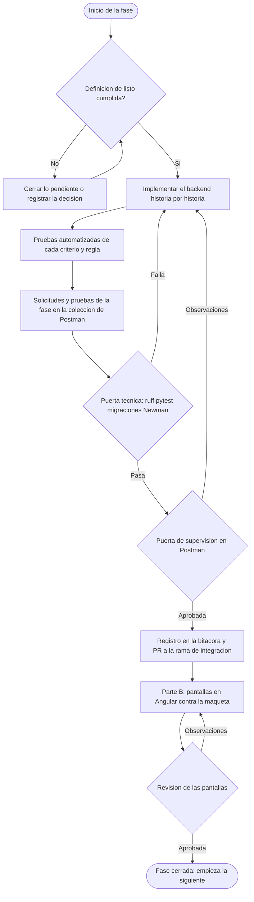

# PLAN-02 — Plan de implementación por fases, con validación en Postman

| Campo | Valor |
|---|---|
| Documento | PLAN-02 |
| Versión | 1.0 |
| Estado | Vigente desde el 23/10/2026 |
| Deriva de | [`PLAN_DE_TRABAJO.md`](PLAN_DE_TRABAJO.md) (PLAN-01), [`ACTA_CIERRE_FASE_DOCUMENTAL.md`](ACTA_CIERRE_FASE_DOCUMENTAL.md) y la línea base 2.1 |
| Alcance | Del backend heredado al sistema desplegado para la presentación: diez fases, F0 a F9 |
| Relación con PLAN-01 | PLAN-01 fija el calendario semanal, la definición de terminado y la estrategia de pruebas. Este plan detalla **cómo** se ejecuta cada semana, paso por paso, y **cómo se valida** antes de avanzar |

---

## 1. Propósito

Construir el sistema de forma **gradual, supervisable y verificable**:

- **Gradual.** Diez fases. Cada fase se divide en pasos pequeños, y cada paso termina en un commit
  por historia de usuario que deja el sistema funcionando.
- **Supervisable.** Ninguna fase se da por cerrada sin una **puerta**: una lista de comprobaciones
  automáticas y una validación del supervisor, que queda escrita en la bitácora de puertas.
- **Verificable en Postman.** Cada endpoint tiene sus solicitudes en una colección de Postman
  versionada en el repositorio, con pruebas que comprueban el código HTTP, el cuerpo de la respuesta
  y el mensaje literal del criterio de aceptación. La colección crece fase a fase y se vuelve a
  ejecutar completa en cada puerta.

La fuente de lo que se construye es la línea base 2.1: cada paso cita la historia, la regla o la
decisión que implementa. Si al programar algo obliga a apartarse de ella, se detiene el paso y se
registra una decisión nueva (acta de cierre, §5).

## 2. El ciclo de una fase



**Regla del ciclo:** la fase N+1 no empieza hasta que la puerta de la fase N está aprobada. La parte
B de una fase —las pantallas— puede avanzar en paralelo con la parte A de la siguiente, porque
consume una API ya validada.

### 2.1 Quién hace qué

| Rol | Responsabilidad en cada fase |
|---|---|
| Implementador (el agente) | Programa los pasos, escribe las pruebas automatizadas y las solicitudes de Postman, ejecuta la puerta técnica y prepara la evidencia |
| Supervisor (el autor) | Ejecuta la carpeta de la fase en Postman, revisa la evidencia, aprueba u observa la puerta y aprueba las pantallas contra la maqueta |
| Empresa | Valida los roles (F1) y entrega el catálogo de tipos de mineral, las taras y los tickets reales (F2) |
| Responsable del repositorio | Define la rama de integración y fusiona los PR aprobados |

## 3. Mapa de fases

| Fase | Nombre | Semana de PLAN-01 | Historias | Casos de la lista de control |
|---|---|---|---|---|
| F0 | Preparación del repositorio y del entorno | Antes de la semana 1 | — (sin lógica nueva) | — |
| F1 | Autenticación, roles, registrador de auditoría y respaldo | 1 | HU-M01-01 a HU-M01-03 | CP10 |
| F2 | Catálogo maestro | 2 | HU-M02-01 a HU-M02-03 | CP06 (catálogo) |
| F3 | Registro de ingresos con reconocimiento y validación | 3 | HU-M03-01 a HU-M03-04, HU-M04-01, HU-M04-02, HU-M05-01 | CP01 a CP06, CP11 |
| F4 | Auditoría: historial y consulta | 4 | HU-M09-01 a HU-M09-03 | — |
| F5 | Trazabilidad del proceso | 5 | HU-M06-01 a HU-M06-05 | CP07, CP12 |
| F6 | Consulta de ingresos, inicio y avisos | 6 | HU-M07-01 a HU-M07-04 | CP08 |
| F7 | Consolidación y elección del motor | 7 | HU-M08-01, HU-M08-02 | CP09 |
| F8 | Estabilización y congelamiento | 8 | Todas (regresión) | CP01 a CP12 |
| F9 | Despliegue para la presentación y puesta en marcha | Después de la semana 8 | Todas (humo en el servidor) | — |

**Ajuste de secuencia respecto de PLAN-01.** El registrador de auditoría (`ServicioAuditoria` y
`EVENTO_AUDITORIA`) se construye en F1 y no en F4, porque HU-M01-01 CA07 ya exige registrar el inicio
de sesión y M03 lo necesita dentro de su transacción (RN-M09-01). F4 añade lo que solo M09 ofrece:
el historial de un ingreso, la consulta de la auditoría y la verificación de los eventos de F1 a F3.

## 4. Validación con Postman

### 4.1 Archivos en el repositorio

```
postman/
  LogisticaMinera.postman_collection.json     la coleccion, una carpeta por fase
  entornos/
    local.postman_environment.json            backend en el equipo del desarrollador
    preproduccion.postman_environment.json    se crea en F8
    presentacion.postman_environment.json     se crea en F9
  archivos/                                   imagenes de prueba para el registro
    ticket_legible.jpg   ticket_ilegible.jpg   ticket_10mb.jpg   documento.pdf
  README.md                                   como importar, ejecutar y regenerar
docs/03-pruebas/
  bitacora_puertas.md                         una fila por puerta aprobada u observada
  evidencias/F0/ ... evidencias/F9/           salida de pytest, Newman y reporte de trazabilidad
```

La colección y los entornos se versionan como cualquier otro archivo: el supervisor los importa
desde el repositorio y no mantiene una copia propia que pueda divergir. Los entornos versionados
llevan solo las credenciales de prueba que crea el comando de carga de datos (§4.6); ninguna
credencial real entra al repositorio.

### 4.2 Variables de entorno

| Variable | Contenido |
|---|---|
| `base_url` | `http://localhost:8000/api/v1` en local |
| `usuario_admin`, `clave_admin` | Cuenta de prueba del Administrador, creada por el comando de carga |
| `usuario_administrativo`, `clave_administrativo` | Cuenta de prueba del Administrativo |
| `usuario_supervisor`, `clave_supervisor` | Cuenta de prueba del Supervisor de planta |
| `token_admin`, `token_administrativo`, `token_supervisor` | Se llenan al ejecutar la carpeta «00 · Sesiones» |
| `refresh_admin`, `refresh_administrativo`, `refresh_supervisor` | Ídem |
| `id_usuario`, `id_vehiculo`, `placa`, `id_tipo_mineral`, `id_transportista` | Se capturan de las respuestas durante la ejecución |
| `id_ingreso`, `codigo_ingreso`, `id_lote`, `nombre_lote`, `id_parte` | Ídem |
| `limite_ms` | Umbral de tiempo de respuesta por defecto: 2000 ms; el reconocimiento usa 5000 ms (RNF de M04) |

### 4.3 Organización de la colección

```
LogisticaMinera API v1
  00 · Sesiones                       login de los tres roles; se ejecuta antes de cualquier carpeta
  F0 · Salud y esquema
  F1 · M01 Autenticacion y roles
    HU-M01-01 Inicio y cierre de sesion
      HU-M01-01 · CA02 · Credenciales invalidas -> 401
      ...
  F2 · M02 Catalogo maestro
  F3 · M03 M04 M05 Registro reconocimiento y validacion
  F4 · M09 Auditoria
  F5 · M06 Trazabilidad
  F6 · M07 Consulta
  F7 · M08 Consolidacion
  F9 · Humo en el servidor
```

Cada solicitud se nombra `HU-Mxx-nn · CAnn · Caso -> código`, de modo que la ejecución en el Runner o
en Newman se lee como la lista de criterios de aceptación. El Anexo A contiene los 277 criterios con
el código HTTP esperado y si se verifican por la API, por la interfaz o por ambas: es la lista de
solicitudes que la colección debe tener al final de F7.

### 4.4 Pruebas comunes de cada solicitud

Cada solicitud lleva pruebas en la pestaña *Tests*. Las de un rechazo siguen siempre el mismo
patrón (D-23):

```javascript
// Rechazo: código, cuerpo uniforme y mensaje literal del criterio de aceptación
pm.test("HTTP 403", () => pm.response.to.have.status(403));
pm.test("Cuerpo uniforme", () => {
  pm.expect(pm.response.json()).to.have.all.keys("codigo", "mensaje", "detalles");
});
pm.test("Mensaje literal", () => {
  pm.expect(pm.response.json().mensaje).to.eql("Acción no autorizada");
});
```

Las de una operación exitosa comprueban el código, los campos que el criterio exige y capturan los
identificadores para las solicitudes siguientes:

```javascript
pm.test("HTTP 201", () => pm.response.to.have.status(201));
const b = pm.response.json();
pm.test("Código asignado por el servidor", () => pm.expect(b.codigo).to.match(/^ING-\d{4}-\d{5}$/));
pm.test("Tres marcas de tiempo distintas", () => {
  pm.expect(b.hora_inicio_registro).to.not.eql(b.hora_fin_registro);
  pm.expect(b.fecha_hora_pesaje).to.not.eql(b.hora_inicio_registro);
});
pm.environment.set("id_ingreso", b.id);
pm.environment.set("codigo_ingreso", b.codigo);
```

En el nivel de la colección se añade una prueba de tiempo, que toma el umbral de la variable
`limite_ms`:

```javascript
pm.test("Responde dentro del umbral", () => {
  pm.expect(pm.response.responseTime).to.be.below(Number(pm.environment.get("limite_ms") || 2000));
});
```

El formato exacto del código del ingreso lo fija el generador de M03 en F3; la expresión regular de
arriba se ajusta entonces y no antes.

### 4.5 Sesiones por rol

La carpeta «00 · Sesiones» inicia sesión con las tres cuentas y guarda sus tokens. Cada solicitud de
las demás carpetas declara explícitamente con qué rol se ejecuta —`Authorization: Bearer
{{token_supervisor}}`—, porque la mitad de los criterios son pruebas de rol y un token implícito las
volvería ambiguas.

```javascript
// 00 · Sesiones · Login del Supervisor de planta
pm.test("HTTP 200", () => pm.response.to.have.status(200));
const b = pm.response.json();
pm.test("Rol correcto", () => pm.expect(b.usuario.rol).to.eql("SUPERVISOR"));
pm.environment.set("token_supervisor", b.access);
pm.environment.set("refresh_supervisor", b.refresh);
```

### 4.6 Datos de prueba

- **Comando de carga** `python manage.py cargar_datos_prueba` (se crea en F0 y crece en cada fase):
  los tres usuarios de prueba, un catálogo mínimo y, desde F3, ingresos en cada estado. Es el juego
  de datos de PLAN-01 §6.4. Sus credenciales son de prueba y coinciden con el entorno local de
  Postman.
- **Valores únicos.** Lo que debe ser único —placas, nombres de lote, nombres de usuario— se genera
  en el *Pre-request* para que la colección pueda ejecutarse varias veces sin reiniciar la base:

```javascript
const letras = "ABCDEFGHJKLMNPRSTUVWXYZ";
const r = (n, s) => Array.from({length: n}, () => s[Math.floor(Math.random() * s.length)]).join("");
pm.environment.set("placa_nueva", r(1, letras) + r(2, "0123456789") + "-" + r(3, "0123456789"));
```

- **Reconocimiento determinista.** Para que las pruebas de F3 tengan resultados fijos, el backend
  en local se ejecuta con el adaptador determinista de `ReconocedorTicket` (variable de entorno del
  backend, por ejemplo `RECONOCEDOR_TICKET=determinista`). El adaptador local real se verifica aparte,
  a mano, con los tickets reales de F2 (D-12).
- **Reinicio completo**, antes de una ejecución de regresión:

```bash
docker compose exec backend python manage.py flush --no-input
docker compose exec backend python manage.py cargar_datos_prueba
```

### 4.7 Ejecución y evidencia

En Postman: *Runner* → colección → «00 · Sesiones» y la carpeta de la fase → *Run*. Para la evidencia
se usa Newman, que ejecuta lo mismo desde la terminal:

```bash
npx newman run postman/LogisticaMinera.postman_collection.json \
  -e postman/entornos/local.postman_environment.json \
  --folder "00 · Sesiones" --folder "F1 · M01 Autenticacion y roles" \
  --reporters cli,junit --reporter-junit-export docs/03-pruebas/evidencias/F1/newman.xml
```

### 4.8 Regresión acumulada

Cada puerta ejecuta la carpeta de su fase **y todas las anteriores**. Una fase que rompe un
endpoint de otra no pasa su puerta, aunque sus propias solicitudes estén en verde.

### 4.9 Lo que Postman no verifica

| Qué | Dónde se verifica |
|---|---|
| Los 6 criterios marcados «Interfaz» en el Anexo A (menú por rol, pestañas, campos resaltados, imagen ampliable) | Parte B de la fase, contra la maqueta |
| Concurrencia: dos registros simultáneos no repiten código (CP05) | `pytest` con hilos o transacciones concurrentes |
| Expiración por inactividad y bloqueo de quince minutos | `pytest` con el reloj controlado; en Postman se comprueba la respuesta inmediata |
| Atomicidad: nada queda a medio registrar si falla un paso (HU-M03-01 CA12) | `pytest` con una falla inducida |
| Número de consultas por listado (N+1) | `pytest` con `assertNumQueries` |

## 5. La puerta de fase

### 5.1 Puerta técnica (la ejecuta el implementador)

- [ ] `ruff check .` sin hallazgos.
- [ ] `python manage.py makemigrations --check --dry-run` sin cambios pendientes; el SQL de cada
      migración nueva revisado con `sqlmigrate`.
- [ ] `pytest` en verde: una prueba por criterio de aceptación y por regla de negocio de la fase,
      nombrada con su código; `services/` con al menos el 80 % de líneas cubiertas (PLAN-01 §6.3).
- [ ] `python3 scripts/reporte_trazabilidad.py`: todos los criterios y reglas de la fase con prueba,
      y ningún código citado que la documentación no defina.
- [ ] Newman en verde para «00 · Sesiones», la carpeta de la fase y las de las fases anteriores.
- [ ] Evidencia guardada en `docs/03-pruebas/evidencias/Fn/`.
- [ ] Si se tocó `docs/`: `verificar_migracion.sh` y `validar_docs.py` sin hallazgos.

### 5.2 Puerta de supervisión (la ejecuta el supervisor)

1. Actualiza la rama, levanta el entorno y carga los datos de prueba (§4.6).
2. Importa la colección y el entorno desde `postman/` y ejecuta, en el Runner, «00 · Sesiones» y la
   carpeta de la fase. Todo debe salir en verde.
3. Abre al menos tres solicitudes al azar y lee la respuesta completa: el mensaje coincide con el
   criterio, los datos tienen sentido y no aparecen campos que no deberían salir —por ejemplo, una
   contraseña—.
4. Repite una solicitud de rechazo con un rol distinto del previsto y comprueba el 403.
5. Revisa la evidencia de la puerta técnica.
6. Escribe el resultado en la bitácora: **Aprobada**, o **Observada** con la lista de observaciones.
   Una puerta observada vuelve a implementación; no se corrige «después».

### 5.3 Bitácora de puertas

`docs/03-pruebas/bitacora_puertas.md` se crea en F0 con esta tabla (Anexo B):

| Fase | Fecha | Commit | pytest | Newman | Trazabilidad | Resultado | Supervisor | Observaciones |
|---|---|---|---|---|---|---|---|---|

## 6. Las fases en detalle

Cada fase sigue el mismo formato: objetivo, condición de entrada, pasos, endpoints, validación en
Postman, puerta de salida, parte B y riesgos. Los commits siguen `convenciones_codigo.md` §4 —uno
por historia, con su código—, y el PR sigue PLAN-01 §4.3.

---

### F0 — Preparación del repositorio y del entorno

**Objetivo.** Dejar el backend heredado coherente con la línea base 2.1, sin lógica nueva, con un
entorno reproducible y la colección de Postman iniciada.

**Entra con.** Acta de cierre aprobada; rama de integración definida por el responsable del
repositorio.

**Pasos.**

| N.° | Paso | Resultado verificable |
|---|---|---|
| 0.1 | Docker Compose de desarrollo con `db` (PostgreSQL 16, volumen `db`), `backend` y el volumen `media`; `.env.example` actualizado | `docker compose up` levanta la base y el backend |
| 0.2 | Retirar los restos de `apps/salidas` y `apps/sincronizacion` que quedaron en el árbol de trabajo | Las carpetas no existen |
| 0.3 | `Producto` → `TipoMineral` en `apps/catalogo` y sus referencias en `apps/ingresos`, con migración nueva; ruta `tipos-mineral/` | `grep -rn producto backend/apps` sin resultados de dominio |
| 0.4 | Retirar `apps/existencias` y `common/stock.py`, con los movimientos de inventario que usaba `apps/ingresos` | La app no está en `LOCAL_APPS`; migración de retiro aplicada | <!-- migracion:ok -->
| 0.5 | Modelo `Ingreso` alineado con el modelo de datos 3.1: tres marcas de tiempo, tipo de mineral, tara aplicada, peso neto nulo mientras está En proceso, estados `EN_PROCESO`/`REGISTRADO`/`ANULADO`, marca y motivo del registro sin foto; fuera los campos del alcance anterior | Revisión campo por campo contra el modelo de datos |
| 0.6 | Esqueletos de `reconocimiento`, `validacion` y `trazabilidad` con la estructura en capas; renombrar `busqueda` a `consulta` y `reportes` a `consolidacion` | Apps importables, sin modelos todavía |
| 0.7 | `LOCAL_APPS` con la numeración M01 a M09; almacenamiento de Django sobre el volumen `media` (D-14, D-18); límite de 10 MB; Pillow; `TIME_ZONE` de la planta | `python manage.py check` sin avisos |
| 0.8 | Pruebas heredadas: actualizar o retirar las que citan historias que ya no existen | `reporte_trazabilidad.py` sin códigos huérfanos |
| 0.9 | Comando `cargar_datos_prueba` con los tres usuarios de prueba | Se ejecuta dos veces sin error |
| 0.10 | Carpeta `postman/` con la colección, el entorno local, «00 · Sesiones» y «F0 · Salud y esquema»; `docs/03-pruebas/bitacora_puertas.md` | Newman en verde |

**Endpoints que se verifican.**

| Solicitud | Esperado |
|---|---|
| `GET {{base_url}}/esquema/` | 200, documento OpenAPI |
| `GET {{base_url}}/docs/` | 200, interfaz de documentación |
| `POST {{base_url}}/auth/login/` con cada rol | 200, `access`, `refresh` y `usuario.rol` |
| `GET {{base_url}}/catalogo/tipos-mineral/` | 200, paginado |
| `GET {{base_url}}/catalogo/productos/` | 404: la ruta del alcance anterior ya no existe |

**Puerta de salida.** §5 completa. Commits `chore(backend): ...`, uno por paso.

**Parte B.** No aplica.

**Riesgos.** El refactor de `Ingreso` rompe pruebas heredadas de M03: se retiran las que prueban el
diseño anterior y se reescriben en F3, no se adaptan a medias.

---

### F1 — Autenticación, roles, registrador de auditoría y respaldo

**Objetivo.** M01 completo según la 2.1, con todos los permisos que usarán los demás módulos, el
registro de eventos desde el primer día y el respaldo ejecutable.

**Entra con.** Puerta F0 aprobada; matriz de roles validada con la empresa al inicio de la semana
(DR-23).

**Pasos.**

| N.° | Paso | Historia o decisión |
|---|---|---|
| 1.1 | `EVENTO_AUDITORIA` completo según el modelo de datos y `ServicioAuditoria` como único punto de escritura; unificar con él el registrador que hoy vive en `common/eventos.py` | HU-M09-01, RS-M09-07 |
| 1.2 | `debe_cambiar_clave` en `Usuario`; el login lo devuelve dentro de `usuario` | RS-M01-12 |
| 1.3 | Login, refresco y cierre de sesión: 401 por credenciales o cuenta inactiva, bloqueo tras cinco intentos con 423, expiración por inactividad, eventos `INICIAR_SESION` y `CERRAR_SESION` con IP | HU-M01-01 |
| 1.4 | Usuarios: alta, edición, desactivación —nunca la propia—, reactivación, restablecimiento con contraseña temporal generada con `secrets` y cambio de la propia contraseña | HU-M01-02, RNF-M01-07 |
| 1.5 | Las clases de permiso de la skill `backend-auth-permisos` y `RequiereClaveDefinitiva` como permiso global; el rol se lee de la base en cada solicitud; rechazo con evento `ACCESO_RECHAZADO` | HU-M01-03, D-23 |
| 1.6 | Respaldo y restauración ejecutables: `pg_dump` de la base y archivo del volumen `media`, con fecha común | D-20 |

**Endpoints.**

| Método y ruta | Rol | Historia |
|---|---|---|
| `POST /auth/login/`, `POST /auth/refresh/`, `POST /auth/logout/` | Público / autenticado | HU-M01-01 |
| `GET`, `POST /usuarios/` · `PATCH /usuarios/{id}/` | Administrador | HU-M01-02 |
| `PATCH /usuarios/{id}/desactivar/` · `PATCH /usuarios/{id}/reactivar/` | Administrador | HU-M01-02 |
| `POST /usuarios/{id}/restablecer-clave/` | Administrador | HU-M01-02 |
| `POST /usuarios/cambiar-clave/` | Cualquiera, sobre su cuenta | HU-M01-01, HU-M01-02 |

**Validación en Postman.** Carpeta «F1 · M01 Autenticacion y roles», con los criterios de HU-M01-01 a
HU-M01-03 del Anexo A. Secuencias que conviene armar en orden:

1. Crear un usuario desechable → fallar su clave cinco veces → sexto intento: 423.
2. Restablecer la clave de un usuario → iniciar sesión con la temporal → cualquier `GET`: 403
   «Debe cambiar la contraseña temporal antes de continuar» → cambiar la clave → el mismo `GET`: 200.
3. Supervisor intenta `POST /usuarios/`: 403 «Acción no autorizada».
4. Administrador intenta desactivar su propia cuenta: 400 «No puede desactivar su propia cuenta».
5. Cambiar el rol de un usuario y repetir su siguiente solicitud: aplica el rol nuevo sin volver a
   iniciar sesión (HU-M01-03 CA03).
6. Desactivar y reactivar un usuario: 200 «Usuario desactivado» y «Usuario reactivado».

Los eventos de auditoría de F1 se comprueban con `pytest` ahora y con Postman en F4.

**Puerta de salida.** §5 completa, más: restauración de un respaldo en una base limpia; CP10 en
la parte que ya puede ejecutarse.

**Parte B.** Repositorio del frontend (D-11), Angular con componentes standalone y signals;
interceptor JWT y de errores con el cuerpo uniforme; inicio de sesión, «¿Olvidó su contraseña?»,
cambio obligatorio de la contraseña temporal, armazón con el menú por rol y la administración de
usuarios. Se revisa contra las pantallas de la maqueta.

**Riesgos.** Que la validación de roles cambie la matriz después de escribir los permisos: por eso se
valida al inicio. Que un permiso quede solo en Angular: cada opción oculta tiene su prueba de rechazo.

---

### F2 — Catálogo maestro

**Objetivo.** Vehículos con titularidad, capacidad y tara; tipos de mineral; transportistas; con baja
lógica y reactivación.

**Entra con.** Puerta F1 aprobada. Durante la fase, la empresa entrega los tipos de mineral, las
taras y capacidades de los vehículos que ya operan y los tickets reales para el piloto (DR-03,
DR-08).

**Pasos.**

| N.° | Paso | Historia o regla |
|---|---|---|
| 2.1 | Vehículo: placa única con formato peruano, titularidad `PROPIO`/`EXTERNO`, transportista obligatorio solo si es externo, capacidad positiva, tara nula al alta con su fecha y usuario de registro | HU-M02-01, RN-M02-01 a RN-M02-05, RN-M02-11 |
| 2.2 | Modificación de una tara ya registrada: solo Administrador, motivo obligatorio, auditoría con valor anterior y nuevo, sin tocar ingresos ya registrados | RN-M02-12, RN-M02-13 |
| 2.3 | Tipos de mineral: código de 2 a 6 caracteres, inmutable; nombre único sin distinguir mayúsculas; código generado cuando se da de alta desde el registro | HU-M02-02, RN-M02-15 a RN-M02-17 |
| 2.4 | Transportistas: RUC de once dígitos y único | HU-M02-03, RN-M02-07, RN-M02-18 |
| 2.5 | Desactivar y reactivar las tres entidades, con los mensajes de los criterios; nunca `DELETE` | RN-M02-08, RN-M02-19, D-22 |
| 2.6 | Carga inicial del catálogo con los datos de la empresa | DR-03 |

**Endpoints.** Los de la tabla de funciones de M02: vehículos, tara, tipos de mineral y
transportistas, con sus acciones `desactivar/` y `reactivar/`.

**Validación en Postman.** Carpeta «F2 · M02 Catalogo maestro», con HU-M02-01 a HU-M02-03 del
Anexo A. Secuencias clave: alta de un vehículo externo sin transportista (400) y con él (201);
alta sin tara y su marca de pendiente de destare; el Administrativo intenta cambiar una tara (403
«Solo el Administrador puede modificar la tara del vehículo»); el Administrador la cambia sin motivo
(400) y con motivo (200); baja de un vehículo con ingresos y su reactivación con la misma tara; el
Supervisor intenta editar el catálogo (403) pero da de alta un vehículo como desde el registro (201).

**Puerta de salida.** §5 completa, más el catálogo de la empresa cargado y revisado por la jefatura
de operaciones.

**Parte B.** Pantallas de catálogos: vehículos, tipos de mineral y transportistas, con los filtros,
la baja y la reactivación de la maqueta.

**Riesgos.** Si la empresa no entrega los tipos de mineral, se cargan los de la maqueta marcados como
provisionales y la puerta queda observada en ese punto hasta recibirlos.

---

### F3 — Registro de ingresos con reconocimiento y validación

**Objetivo.** El núcleo del sistema: del ticket fotografiado al ingreso registrado, con su
reconocimiento, su validación, el primer viaje con su destare, la corrección, su reversión y la
anulación. Es la fase más grande; se divide en seis subfases con su propia minipuerta —pruebas
automatizadas y Newman de lo construido— antes de pasar a la siguiente.

**Entra con.** Puerta F2 aprobada; tickets de prueba en `postman/archivos/`.

| Subfase | Contenido | Historias, reglas y decisiones |
|---|---|---|
| F3.1 Validación | `ValidadorConsistencia` con una clase por regla V1 a V5, la colección que las recorre todas, y `ServicioValidacion` que persiste `RESULTADO_VALIDACION` | HU-M05-01, D-08 |
| F3.2 Reconocimiento | Interfaz `ReconocedorTicket`; adaptador determinista para pruebas; adaptador local dentro del backend; umbral 0,80; `RECONOCIMIENTO_TICKET` y `CAMPO_RECONOCIDO` con motor y versión | HU-M04-01, D-12, D-13 |
| F3.3 Registro | `POST /ingresos/borradores/` con imagen o sin foto con motivo: hora de inicio, propuesta con hora del pesaje sugerida e inconsistencias; `POST /ingresos/`: revalidación, código con bloqueo, hora de fin, tara aplicada y peso neto en una transacción con su evento | HU-M03-01, D-01, D-02, D-17, RN-M09-01 |
| F3.4 Primer viaje y destare | Placa nueva dada de alta desde el registro → ingreso En proceso; `GET /ingresos/?estado=EN_PROCESO`; `POST /ingresos/destares/` con V2 y V4 en el destare | HU-M03-04, DR-25 |
| F3.5 Corrección, reversión y anulación | `PATCH /ingresos/{id}/` con motivo y revalidación; `POST .../revertir-correccion/` solo sobre la última; `PATCH .../anular/` solo Administrador. El retiro del ingreso anulado de un lote Abierto se conecta en F5 | HU-M03-02, HU-M03-03, DR-28 |
| F3.6 Consultas de M04 y M05 | `GET /reconocimientos/`, `GET /reconocimientos/{id}/`, `GET /ingresos/{id}/validaciones/` para los tres roles | HU-M04-02, DR-31 |

**Validación en Postman.** Carpeta «F3 · M03 M04 M05 Registro reconocimiento y validacion», con
HU-M03-01 a HU-M03-04, HU-M04-01, HU-M04-02 y HU-M05-01 del Anexo A. Las solicitudes de registro usan
`form-data` con los archivos de `postman/archivos/`. Secuencias clave:

1. Borrador con `ticket_legible.jpg` → propuesta de tres campos con confianza entre 0 y 1, hora del
   pesaje sugerida y nada persistido todavía (HU-M04-01 CA06).
2. Confirmar con datos válidos → 201, código asignado y tres marcas distintas; consultar el ingreso y
   comprobar que la tara aplicada y el peso neto coinciden con el catálogo.
3. `documento.pdf` y `ticket_10mb.jpg` → 400 con el mensaje de formato y tamaño.
4. Las diez inconsistencias sembradas, dos por regla: V2, V3 y V5 bloquean; V1 y V4 exigen
   justificación (CP03).
5. Registro sin foto con motivo → sin reconocimiento y marcado sin respaldo fotográfico (CP11).
6. Placa nueva → alta del vehículo → ingreso En proceso sin peso neto → destare → Registrado.
7. Corrección dos veces → revertir: vuelven los valores previos a la segunda (HU-M03-02 CA12) →
   revertir de nuevo: vuelven los previos a la primera (DR-28) → anular como Administrativo (403) y
   como Administrador (200) → corregir el anulado (409). El rechazo de revertir una corrección que
   no es la última (CA13) se prueba en `pytest`, sobre el servicio.

**Puerta de salida.** §5 completa por cada subfase, más CP01 a CP06 y CP11 ejecutados con evidencia.
Comprobación manual adicional: diez tickets reales con el adaptador local, solo para conocer su
comportamiento antes del piloto de F7.

**Parte B.** Registro de un ingreso en pasos —captura, revisión con los campos dudosos resaltados,
inconsistencias junto al campo, confirmación—; alta del vehículo y del tipo de mineral sin salir del
registro; destare; borrador conservado ante pérdida de conexión (RNF-M03-05); detalle con las
pestañas de datos, ticket, reconocimiento y validación; corrección, reversión y anulación.

**Riesgos.** El código del ingreso bajo concurrencia (CP05): se prueba con transacciones
concurrentes en `pytest`, no con Postman. La atomicidad del registro (HU-M03-01 CA12): se prueba con
una falla inducida dentro de la transacción.

---

### F4 — Auditoría: historial y consulta

**Objetivo.** Exponer lo que M09 ya registra desde F1 y comprobar que toda operación de F1 a F3 deja
su evento.

**Entra con.** Puerta F3 aprobada.

**Pasos.**

| N.° | Paso | Historia |
|---|---|---|
| 4.1 | `GET /ingresos/{id}/historial/` para los tres roles: eventos del ingreso y, desde F5, de su lote; sin eventos de usuarios, catálogos ni accesos rechazados | HU-M09-02, RS-M09-15 |
| 4.2 | `GET /auditoria/` solo para el Administrador, con filtros por usuario, acción y texto | HU-M09-03 |
| 4.3 | Revisión de que cada operación de escritura de F1 a F3 registra su evento con el usuario, los valores y el motivo cuando corresponde | HU-M09-01 |
| 4.4 | Comprobación de que ningún evento contiene una contraseña | RS-M09-16 |

**Validación en Postman.** Carpeta «F4 · M09 Auditoria»: después de ejecutar F1 a F3, buscar en
`/auditoria/` el código del ingreso, la placa del vehículo y el usuario desechable, y comprobar el
evento esperado de cada operación —registro, corrección con valor anterior y nuevo, reversión,
anulación, destare, restablecimiento de contraseña sin la contraseña, acceso rechazado—. El
Administrativo y el Supervisor reciben 403 en `/auditoria/` y 200 en el historial de un ingreso.

**Puerta de salida.** §5 completa.

**Parte B.** Pestaña de historial del detalle del ingreso y pantalla de auditoría del Administrador.

---

### F5 — Trazabilidad del proceso

**Objetivo.** Lotes de proceso con su ciclo completo: composición, recorrido por la ruta, división,
ingresos tardíos, bigbags y cierre con destino.

**Entra con.** Puerta F4 aprobada.

| Subfase | Contenido | Historias, reglas y decisiones |
|---|---|---|
| F5.1 Catálogos cerrados | `ETAPA_PROCESO` por migración de datos y rutas como dominio cerrado con los códigos de D-21; `GET /etapas/` y `GET /rutas/` | RN-M06-09, D-21 |
| F5.2 Lotes y composición | Abrir con nombre único; lista de minerales con «Agregar otro mineral» y baja lógica al quitar; asignar ingresos Registrados, también de otro mineral con autorización; retirar o trasladar hasta el zarandeo o la molienda; iniciar el recorrido; conectar la anulación de M03 con el retiro | HU-M06-01, DR-27, DR-29, D-22 |
| F5.3 Recorrido | Secado común; la ruta se fija con la primera etapa siguiente; orden y fechas de las etapas; horas de molienda | HU-M06-02, RN-M06-05 a RN-M06-08, RN-M06-15 |
| F5.4 División y tardíos | División por fracciones con `Fraction`, de dos a seis partes; ingresos tardíos antes y después del secado; secado propio y reparto | HU-M06-04, DR-18, DR-20 |
| F5.5 Bigbags y cierre | Bigbags con peso estimado o recalculado; resumen de cierre con pendientes; cierre solo del Administrador, con destino y todo ensacado | HU-M06-02, HU-M06-05, DR-14 |
| F5.6 Trazabilidad de un ingreso | `GET /ingresos/{id}/trazabilidad/` con la proporción sobre la ruta o la unión de las rutas de las partes | HU-M06-03, DR-16, DR-21 |

**Validación en Postman.** Carpeta «F5 · M06 Trazabilidad», con HU-M06-01 a HU-M06-05 del Anexo A.
Recorridos completos que conviene automatizar en orden:

1. **Lote simple:** abrir → asignar → iniciar → secado → zarandeo eligiendo la ruta
   `ZARANDEO_ENSACADO` → ensacado → bigbags → resumen sin pendientes → cerrar como Administrativo
   (403) y como Administrador con destino (200) → registrar una etapa (409 «El lote {codigo} ya fue
   cerrado»).
2. **Retiro (DR-29):** lote en recorrido con secado → retirar un ingreso (200) → zarandeo → retirar
   otro (409 «El mineral del ingreso {codigo} ya pasó por zarandeo o molienda») → retirar el último de
   un lote con uno solo (409).
3. **Varios minerales (DR-27):** agregar un mineral → quitarlo sin ingresos → quitar uno con ingresos
   (409) → asignar un ingreso de otro mineral sin autorización (400) y con ella (200).
4. **División y tardío:** dividir en 1/3 y 2/3 → fracciones que no suman la unidad (400) → ingreso
   tardío después del secado con su reparto → trazabilidad de un ingreso del lote dividido: cuatro
   etapas de cuatro (CP07).

**Puerta de salida.** §5 completa, más CP07 y CP12 con evidencia; el historial de un ingreso ya
muestra los eventos de su lote.

**Parte B.** Lista de lotes, detalle con composición por mineral y recorrido, registro de etapas,
división, bigbags y cierre con destino, siguiendo la maqueta.

**Riesgos.** El cálculo de la etapa siguiente con huecos en el recorrido: se busca la etapa
inmediatamente anterior de la ruta, no se cuentan pasos (notas de M06).

---

### F6 — Consulta de ingresos, inicio y avisos

**Objetivo.** El lado de lectura: búsqueda por placa y fecha con el respaldo, listado con totales y
exportación, detalle completo, calendario, búsqueda desde la cabecera y la pantalla de inicio con
avisos por rol.

**Entra con.** Puerta F5 aprobada.

| Subfase | Contenido | Historias |
|---|---|---|
| F6.1 Búsqueda, listado y detalle | `GET /consulta/ingresos/` con placa parcial, fechas y filtros; totales solo de Registrados; detalle compuesto con los repositorios de M04, M05, M06 y M09; imagen del ticket detrás de la sesión | HU-M07-01, HU-M07-02, D-19 |
| F6.2 Calendario | `GET /consulta/calendario/?anio&mes` en una consulta agregada, en la zona horaria de la planta | HU-M07-03 |
| F6.3 Exportación y cabecera | `GET /consulta/ingresos/exportar/` en CSV UTF-8 con evento `EXPORTAR`; búsqueda por código o por sus dígitos finales | HU-M07-02, DR-30 |
| F6.4 Inicio y avisos | `GET /consulta/inicio/` y `GET /consulta/avisos/`, calculados al consultarse y filtrados por rol | HU-M07-04, DR-30 |

**Validación en Postman.** Carpeta «F6 · M07 Consulta», con HU-M07-01 a HU-M07-04 del Anexo A.
Comprobaciones clave: un anulado aparece pero no suma; un En proceso aparece sin peso neto; la
imagen sin token responde 401; la exportación del Supervisor responde 403 y la del Administrativo
devuelve `text/csv`; los avisos del Supervisor no incluyen lotes listos para cerrar ni ingresos sin
lote; el aviso de destare desaparece después de registrar el destare.

**Puerta de salida.** §5 completa, más CP08 con la búsqueda cronometrada por debajo de un minuto.

**Parte B.** Inicio, listado de ingresos con exportación, consulta por placa y fecha con el ticket
ampliable, calendario, búsqueda de la cabecera y campana de avisos.

---

### F7 — Consolidación y elección del motor

**Objetivo.** El total mensual por tipo de mineral con su exportación, y el cierre de D-12 con el
sistema funcional.

**Entra con.** Puerta F6 aprobada.

**Pasos.**

| N.° | Paso | Historia o decisión |
|---|---|---|
| 7.1 | `GET /consolidacion/mensual/` con el filtro de ingresos computables compartido con M07 | HU-M08-01 |
| 7.2 | `GET /consolidacion/mensual/exportar/` en XLSX, con el mismo cálculo y evento `EXPORTAR` | HU-M08-02 |
| 7.3 | Piloto de motores: 20 a 30 tickets reales con dos o tres motores; se comparan exactitud, costo y dependencia de conexión; se elige, se implementa su adaptador si hace falta y se cierran D-12 y D-15 | D-12, D-15 |

**Validación en Postman.** Carpeta «F7 · M08 Consolidacion», con HU-M08-01 y HU-M08-02 del Anexo A.
Una solicitud compara el total del mes en `/consolidacion/mensual/` con la suma del mismo mes en
`/consulta/calendario/`: deben coincidir exactamente (RNF-M07-12). Mes sin ingresos: mensaje de
ausencia sin error; periodo futuro: 400.

**Puerta de salida.** §5 completa, más CP09 y el informe del piloto con el motor elegido.

**Parte B.** Pantalla de consolidación con la exportación.

---

### F8 — Estabilización y congelamiento

**Objetivo.** Dejar el sistema listo: sin defectos críticos ni altos, con la regresión completa en
verde, probado en preproducción y con el motor y las reglas congelados.

**Pasos.**

| N.° | Paso | Verificación |
|---|---|---|
| 8.1 | Regresión completa: `pytest` y Newman de todas las carpetas, más el juego manual de PLAN-01 §6.5 | Cero fallos |
| 8.2 | Preproducción: el mismo Compose en el servidor de pruebas y el entorno `preproduccion` de Postman | Newman en verde contra preproducción |
| 8.3 | Pruebas de rendimiento de los RNF, solo en preproducción | Umbrales de cada RNF cumplidos |
| 8.4 | Lista de control CP01 a CP12 ejecutada y firmada | Acta de pruebas |
| 8.5 | Corrección de defectos abiertos | Ningún defecto crítico ni alto |
| 8.6 | Congelamiento del motor, su versión y las reglas V1 a V5; etiqueta de versión | D-16 |
| 8.7 | Restauración del último respaldo en preproducción | D-20 |

Los instrumentos de la tesis se aplican en su propio proceso. Esta fase les entrega el sistema
congelado y las evidencias.

**Puerta de salida.** Todas las puertas anteriores reconfirmadas, más el acta de pruebas.

---

### F9 — Despliegue para la presentación y puesta en marcha

**Objetivo.** El sistema en el servicio de alojamiento de la presentación, con sus decisiones
pendientes cerradas.

**Pasos.**

| N.° | Paso | Decisión |
|---|---|---|
| 9.1 | Elegir el servicio de alojamiento | D-20 |
| 9.2 | Cerrar el medio definitivo de las imágenes y configurarlo, sin cambiar el código | D-14, D-18 |
| 9.3 | Política de respaldo —frecuencia, retención y ubicación fuera del servidor— programada y con una restauración probada | D-20 |
| 9.4 | HTTPS, secretos fuera del repositorio, zona horaria única y límite de subida coherente entre Nginx y Django | Skill `despliegue-docker` |
| 9.5 | Bitácora de despliegues iniciada | PLAN-01 §12.3 |
| 9.6 | Entorno `presentacion` de Postman y carpeta «F9 · Humo en el servidor»: sesión de cada rol, registro de un ingreso, consulta y consolidado | — |

**Puerta de salida.** Humo en verde en el servidor y verificación de la skill `despliegue-docker`
completa. El sistema no entra en operación real en planta hasta que termine el pretest.

## 7. Calendario resumido

| Momento | Fase | Puerta |
|---|---|---|
| Antes de la semana 1 | F0 | Repositorio coherente y colección iniciada |
| Semana 1 | F1 | M01 y respaldo |
| Semana 2 | F2 | M02 y catálogo de la empresa |
| Semana 3 | F3.1 a F3.6 | Una minipuerta por subfase y la puerta de F3 |
| Semana 4 | F4 | M09 |
| Semana 5 | F5.1 a F5.6 | M06 |
| Semana 6 | F6.1 a F6.4 | M07 |
| Semana 7 | F7 | M08 y motor elegido |
| Semana 8 | F8 | Sistema congelado |
| Después de la semana 8 | F9 | Sistema en el alojamiento de la presentación |

Si una fase no cierra su puerta en su semana, la siguiente no empieza: se ajusta el calendario de
PLAN-01 y se registra el motivo, en lugar de acumular deuda para la estabilización.

## 8. Reglas de trabajo durante toda la implementación

1. **Una historia, un commit; una fase, un PR.** El commit cita la historia; el PR lista las
   historias cerradas, la salida de `pytest`, la de Newman y el SQL de las migraciones.
2. **El servidor manda.** Ninguna regla vive solo en Angular; toda opción oculta tiene su 403.
3. **Nada se elimina.** Ningún endpoint usa `DELETE` (D-22); las bajas son lógicas.
4. **Los mensajes son contrato.** El texto de cada error coincide con su criterio de aceptación;
   cambiarlo es cambiar la documentación primero.
5. **Las decisiones nuevas se registran antes de fusionar** (PLAN-01 §4.3 y acta §5).
6. **La colección de Postman es parte del entregable.** Un endpoint sin solicitudes en la colección
   no está terminado.

---

## Anexo A — Casos de Postman por criterio de aceptación

Generado desde los `HU.md` de la línea base 2.1. **HTTP** sigue D-23; «2xx» es 201 en las altas y
200 en el resto. **Dónde** indica si el criterio se verifica por la API, por la interfaz —parte B de
la fase— o por ambas. Cuando el criterio cita un mensaje, la prueba compara el campo `mensaje` de la
respuesta con ese texto literal, sustituyendo las variables entre llaves.

#### HU-M01-01 — Inicio y cierre de sesión

| CA | Caso | Resultado esperado | HTTP | Dónde |
|---|---|---|---|---|
| CA01 | Un usuario activo ingresa credenciales válidas; confirma el inicio de sesión | El sistema establece la sesión y lo dirige a la pantalla principal de su rol | 2xx | API e interfaz |
| CA02 | Un usuario ingresa credenciales inválidas; envía el formulario | El sistema rechaza el acceso mostrando "Usuario o contraseña incorrectos", sin indicar cuál de los dos campos falló | 401 | API |
| CA03 | Un usuario acumula cinco intentos fallidos consecutivos; intenta un sexto acceso | El sistema bloquea la cuenta por quince minutos y muestra "Cuenta bloqueada temporalmente. Intente nuevamente en 15 minutos" | 423 | API |
| CA04 | Un usuario existe pero está inactivo; ingresa credenciales correctas | El sistema rechaza el acceso mostrando "La cuenta se encuentra inactiva. Contacte al administrador" | 401 | API |
| CA05 | Un usuario tiene sesión activa; selecciona cerrar sesión | El sistema invalida el token y lo redirige a la pantalla de inicio de sesión | 2xx | API e interfaz |
| CA06 | La sesión supera el tiempo de inactividad configurado; el usuario realiza una acción | El sistema la cierra y muestra "Su sesión ha expirado. Ingrese nuevamente" | 401 | API |
| CA07 | Un inicio o un cierre de sesión ocurre; concluye la operación | El sistema registra el evento en auditoría con usuario, fecha, hora y dirección IP | 2xx | API |
| CA08 | Un usuario olvidó su contraseña; elige «¿Olvidó su contraseña?» en la pantalla de inicio de sesión | El sistema le indica que solo el Administrador puede restablecerla con una contraseña temporal, sin revelar si el nombre de usuario existe | — | Interfaz |
| CA09 | Un usuario inicia sesión con una contraseña temporal; el sistema establece la sesión | Le exige cambiarla antes de permitirle cualquier otra operación, y rechaza las demás mostrando "Debe cambiar la contraseña temporal antes de continuar" | 403 | API |

#### HU-M01-02 — Gestión de usuarios

| CA | Caso | Resultado esperado | HTTP | Dónde |
|---|---|---|---|---|
| CA01 | El administrador completa nombres, apellidos, nombre de usuario, contraseña y rol; guarda | El sistema crea el usuario en estado activo | 2xx | API |
| CA02 | El nombre de usuario ya existe; el administrador intenta guardar | El sistema rechaza la operación mostrando "El nombre de usuario ya está registrado" | 400 | API |
| CA03 | El administrador desactiva un usuario; confirma la operación | El sistema lo marca inactivo, conserva sus registros y su historial, impide su acceso y muestra "Usuario desactivado". Ninguna operación elimina físicamente un usuario | 2xx | API |
| CA04 | Un usuario con rol distinto de Administrador intenta acceder a la gestión de usuarios; envía la solicitud | El sistema la rechaza mostrando "Acción no autorizada" | 403 | API |
| CA05 | El usuario ingresa su contraseña actual correcta y una nueva contraseña válida repetida dos veces; confirma | El sistema actualiza la contraseña y solicita iniciar sesión nuevamente | 2xx | API |
| CA06 | La contraseña actual ingresada es incorrecta; el usuario confirma el cambio | El sistema rechaza la operación mostrando "La contraseña actual no es correcta" | 400 | API |
| CA07 | La nueva contraseña tiene menos de ocho caracteres; el usuario confirma el cambio | El sistema la rechaza mostrando "La contraseña debe tener al menos ocho caracteres" | 400 | API |
| CA08 | Un usuario olvidó su contraseña; el administrador la restablece | El sistema genera una contraseña temporal, la muestra una sola vez, marca la cuenta para exigir el cambio en el siguiente inicio de sesión y registra el restablecimiento en auditoría, sin guardar la contraseña legible | 2xx | API |
| CA09 | El administrador intenta desactivar su propia cuenta; confirma la operación | El sistema la rechaza mostrando "No puede desactivar su propia cuenta" | 400 | API |
| CA10 | Un usuario está inactivo; el administrador lo reactiva | El sistema le devuelve el acceso con su mismo rol, registra el evento en auditoría y muestra "Usuario reactivado" | 2xx | API |
| CA11 | La nueva contraseña y su repetición no coinciden; el usuario confirma el cambio | El sistema lo rechaza mostrando "Las contraseñas no coinciden" | 400 | API |

#### HU-M01-03 — Control de acceso por rol

| CA | Caso | Resultado esperado | HTTP | Dónde |
|---|---|---|---|---|
| CA01 | Un usuario con rol Supervisor de planta inicia sesión; se carga el menú | El sistema muestra únicamente el inicio, los ingresos —con su registro, el registro de destares y el calendario—, la trazabilidad con el registro del paso por las etapas y la consulta, y no muestra los catálogos, el cierre de lotes, la consolidación ni la administración | — | Interfaz |
| CA02 | Un usuario invoca directamente un endpoint fuera de las operaciones de su rol; el servidor recibe la solicitud | La rechaza con código 403 y el mensaje "Acción no autorizada", sin ejecutar la operación | 403 | API |
| CA03 | El administrador cambia el rol de un usuario; ese usuario realiza su siguiente acción | El sistema aplica los permisos del nuevo rol | 2xx | API |
| CA04 | Una operación se rechaza por falta de autorización; concluye el rechazo | El sistema registra el evento en auditoría con el usuario y la operación intentada | 403 | API |
| CA05 | Un supervisor de planta registra un ingreso cuya placa no está en el catálogo; da de alta el vehículo desde el registro o registra después su destare | El sistema permite la operación aunque el rol no gestione el catálogo | 2xx | API |
| CA06 | Un usuario con rol Administrativo o Supervisor de planta solicita cerrar un lote con su destino; el servidor recibe la solicitud | La rechaza mostrando "Acción no autorizada", sin modificar el lote | 403 | API |

#### HU-M02-01 — Gestión del catálogo de vehículos

| CA | Caso | Resultado esperado | HTTP | Dónde |
|---|---|---|---|---|
| CA01 | El usuario completa placa, titularidad y capacidad; guarda | El sistema registra el vehículo en estado activo | 2xx | API |
| CA02 | La placa ya está registrada; el usuario intenta guardar | El sistema rechaza la operación mostrando "La placa ya está registrada" | 400 | API |
| CA03 | La placa no cumple el formato de placa vehicular peruana; el usuario intenta guardar | El sistema la rechaza mostrando "El formato de la placa no es válido" | 400 | API |
| CA04 | El usuario marca la titularidad como EXTERNO; intenta guardar sin seleccionar transportista | El sistema rechaza la operación mostrando "Debe indicar el transportista para un vehículo externo" | 400 | API |
| CA05 | El usuario marca la titularidad como PROPIO; guarda | El sistema acepta el registro sin transportista asociado | 2xx | API |
| CA06 | Un vehículo tiene ingresos asociados; el usuario lo da de baja | El sistema lo desactiva —nunca lo elimina—, conserva sus ingresos y muestra "El vehículo se desactivó porque tiene ingresos registrados" | 2xx | API |
| CA07 | Un vehículo está desactivado; se registra un ingreso nuevo | El sistema no permite asociarlo a ese ingreso | 2xx | API |
| CA08 | El usuario da de alta un vehículo; guarda | El sistema lo registra sin tara y lo muestra como pendiente de destare | 2xx | API |
| CA09 | Un vehículo ya tiene tara; un usuario que no es Administrador intenta modificarla | El sistema rechaza la operación mostrando "Solo el Administrador puede modificar la tara del vehículo" | 403 | API |
| CA10 | El Administrador modifica la tara de un vehículo; intenta guardar sin indicar el motivo | El sistema rechaza la operación mostrando "Debe indicar el motivo del cambio de tara" | 400 | API |
| CA11 | El Administrador modifica la tara con motivo; guarda | El sistema actualiza la tara, registra en auditoría el valor anterior, el nuevo y el motivo, y los ingresos ya registrados de ese vehículo conservan el peso neto con que se registraron | 2xx | API |
| CA12 | La placa de un ticket no está en el catálogo; el usuario da de alta el vehículo desde la pantalla de registro | El sistema aplica las mismas validaciones que el alta desde el catálogo y devuelve al registro con el vehículo ya asociado | 2xx | API |
| CA13 | Un vehículo está desactivado; el usuario lo reactiva | El sistema vuelve a ofrecerlo en el registro con su misma tara, registra el cambio en auditoría y muestra "Vehículo reactivado" | 2xx | API |
| CA14 | El usuario tiene rol de Supervisor de planta; intenta editar, dar de baja o reactivar un vehículo desde el catálogo | El sistema rechaza la operación mostrando "Acción no autorizada"; el alta desde el registro y el destare siguen permitidos | 403 | API |

#### HU-M02-02 — Gestión del catálogo de tipos de mineral

| CA | Caso | Resultado esperado | HTTP | Dónde |
|---|---|---|---|---|
| CA01 | El usuario completa código y nombre; guarda | El sistema registra el tipo de mineral en estado activo | 2xx | API |
| CA02 | El código ya existe; el usuario intenta guardar | El sistema rechaza la operación mostrando "El código ya está registrado" | 400 | API |
| CA03 | Un tipo de mineral tiene ingresos asociados; el usuario lo da de baja | El sistema lo desactiva —nunca lo elimina—, conserva la clasificación de esos ingresos y muestra "El tipo de mineral se desactivó porque tiene ingresos registrados" | 2xx | API |
| CA04 | Un tipo de mineral está desactivado; se abre el formulario de registro de un ingreso | No aparece entre las opciones seleccionables | 2xx | API |
| CA05 | Ya existe un tipo de mineral con el mismo nombre; el usuario intenta guardar | El sistema rechaza la operación mostrando "Ya existe un tipo de mineral con ese nombre" | 400 | API |
| CA06 | El código indicado no tiene de dos a seis letras o números; el usuario intenta guardar | El sistema lo rechaza mostrando "El código debe tener de 2 a 6 letras o números" | 400 | API |
| CA07 | El Administrativo o el Administrador da de alta un tipo de mineral desde el registro de un ingreso sin indicar el código; guarda | El sistema genera un código que no se repite, registra el tipo de mineral en estado activo y lo deja elegido para el ingreso | 2xx | API |
| CA08 | El usuario da de alta un tipo de mineral desde el registro sin indicar el nombre; intenta guardar | El sistema rechaza la operación mostrando "Debe indicar el nombre del tipo de mineral" | 400 | API |
| CA09 | Un tipo de mineral está desactivado; el usuario lo reactiva | El sistema vuelve a ofrecerlo en el registro de ingresos y en la apertura de lotes, y registra el cambio en auditoría | 2xx | API |
| CA10 | El usuario tiene rol de Supervisor de planta; intenta crear, editar, dar de baja o reactivar un tipo de mineral | El sistema rechaza la operación mostrando "Acción no autorizada" | 403 | API |

#### HU-M02-03 — Gestión de transportistas

| CA | Caso | Resultado esperado | HTTP | Dónde |
|---|---|---|---|---|
| CA01 | El usuario completa razón social y RUC; guarda | El sistema registra el transportista en estado activo | 2xx | API |
| CA02 | El RUC no tiene once dígitos; el usuario intenta guardar | El sistema lo rechaza mostrando "El RUC debe tener once dígitos" | 400 | API |
| CA03 | Un transportista tiene vehículos asociados; el usuario lo da de baja | El sistema lo desactiva —nunca lo elimina—, conserva la asociación con sus vehículos y muestra "El transportista se desactivó porque tiene vehículos asociados" | 2xx | API |
| CA04 | El RUC ya está registrado para otro transportista; el usuario intenta guardar | El sistema rechaza la operación mostrando "El RUC ya está registrado" | 400 | API |
| CA05 | Un transportista está desactivado; el usuario lo reactiva | El sistema vuelve a ofrecerlo al registrar o editar un vehículo externo y registra el cambio en auditoría | 2xx | API |
| CA06 | El usuario tiene rol de Supervisor de planta; intenta crear, editar, dar de baja o reactivar un transportista | El sistema rechaza la operación mostrando "Acción no autorizada" | 403 | API |

#### HU-M03-01 — Registro de un ingreso a partir del ticket de balanza

| CA | Caso | Resultado esperado | HTTP | Dónde |
|---|---|---|---|---|
| CA01 | El vehículo tiene tara registrada y el usuario confirma datos válidos y sin inconsistencias pendientes; confirma el registro | El sistema calcula el peso neto, persiste el ingreso como Registrado, le asigna un código y muestra "Ingreso registrado con el código {codigo}" | 2xx | API |
| CA02 | El usuario no adjuntó la imagen del ticket ni eligió el registro sin foto; intenta confirmar | El sistema rechaza la operación mostrando "Debe adjuntar la imagen del ticket de balanza" | 400 | API |
| CA03 | Falta la placa, la fecha, la hora del pesaje, el peso bruto, el tipo de mineral o, en el registro sin foto, el motivo; el usuario intenta confirmar | El sistema rechaza la operación mostrando "Debe completar los campos obligatorios" e indica cuáles faltan | 400 | API |
| CA04 | La placa no está registrada en el catálogo; el sistema la valida | Muestra "La placa {placa} no está registrada. Complete los datos del vehículo para continuar" y ofrece el alta del vehículo en la misma pantalla, sin perder los datos ya capturados | 2xx | API e interfaz |
| CA05 | El vehículo no tiene tara registrada; el usuario confirma datos válidos | El sistema persiste el ingreso En proceso, sin peso neto, y muestra "Ingreso {codigo} registrado en proceso: pendiente del destare del vehículo {placa}" | 2xx | API |
| CA06 | Existe una inconsistencia bloqueante o una advertencia sin justificar; el usuario intenta confirmar | El sistema rechaza la operación mostrando "Debe corregir o justificar las inconsistencias señaladas" | 400 | API e interfaz |
| CA07 | El usuario adjunta un archivo que no es JPG ni PNG, o que supera los 10 MB; intenta cargarlo | El sistema lo rechaza mostrando "La imagen debe estar en formato JPG o PNG y no superar los 10 MB" | 400 | API |
| CA08 | Un ingreso se confirma como Registrado; el sistema lo persiste | El peso neto es igual al peso bruto menos la tara del vehículo, no es editable, y el ingreso conserva la tara que se le aplicó | 2xx | API |
| CA09 | Un ingreso fue confirmado; se consulta su detalle | El sistema muestra la fecha y hora del pesaje, el inicio del registro y el fin del registro como tres valores distintos, y no permite editar los dos últimos | 2xx | API |
| CA10 | El usuario abre la revisión de los datos; el sistema los presenta | Propone como hora del pesaje la hora actual, la señala como propuesta y permite modificarla antes de confirmar | 2xx | API |
| CA11 | El ingreso se persiste; concluye la operación | El sistema conserva la imagen asociada al ingreso, cuando la hay, guarda para cada campo reconocido el valor propuesto y el confirmado, y registra el evento en auditoría | 2xx | API |
| CA12 | La operación falla en cualquier punto después de confirmar; el sistema la interrumpe | No queda un ingreso a medio registrar: o se persiste todo o no se persiste nada | 2xx | API |
| CA13 | La placa corresponde a un vehículo dado de baja; el usuario intenta confirmar | El sistema rechaza la operación mostrando "El vehículo {placa} está dado de baja: no puede asociarse a un ingreso" | 400 | API |
| CA14 | El tipo de mineral no está en el catálogo y el usuario es Administrativo o Administrador; lo agrega desde el registro | El sistema lo incorpora al catálogo con las mismas reglas del alta desde el catálogo y lo deja elegido para el ingreso, sin perder los datos ya capturados | 2xx | API |
| CA15 | El usuario es Supervisor de planta y el tipo de mineral no está en el catálogo; abre la lista de tipos de mineral | El sistema no le ofrece agregarlo y muestra "Si no está en la lista, pida a un administrativo que lo registre" | 2xx | API e interfaz |
| CA16 | El ticket se extravió o no puede fotografiarse; el usuario elige el registro sin foto, indica el motivo y confirma datos válidos | El sistema persiste el ingreso sin imagen y sin reconocimiento, con su motivo, y lo marca como sin respaldo fotográfico | 2xx | API |
| CA17 | Un ingreso se registró sin foto; se consulta en cualquier lista o en su detalle | El sistema lo muestra señalado como sin respaldo fotográfico, con su motivo | 2xx | API e interfaz |

#### HU-M03-02 — Corrección de un ingreso registrado

| CA | Caso | Resultado esperado | HTTP | Dónde |
|---|---|---|---|---|
| CA01 | El usuario modifica uno o más campos corregibles e indica el motivo; guarda la corrección | El sistema actualiza el ingreso, recalcula el peso neto y muestra "Ingreso {codigo} actualizado" | 2xx | API |
| CA02 | El usuario no indica el motivo; intenta guardar la corrección | El sistema rechaza la operación mostrando "Debe indicar el motivo de la corrección" | 400 | API |
| CA03 | Los valores corregidos incumplen una regla de validación; el usuario intenta guardar | El sistema rechaza la operación con el mensaje literal de la regla incumplida | 400 | API |
| CA04 | El usuario intenta modificar el código, alguna de las marcas de tiempo asignadas por el servidor, la tara o el peso neto; envía la corrección | El sistema ignora esos valores y conserva o recalcula los que corresponden | 2xx | API |
| CA05 | El ingreso está anulado; el usuario intenta corregirlo | El sistema rechaza la operación mostrando "No se puede corregir un ingreso anulado" | 409 | API |
| CA06 | El usuario tiene rol de Supervisor de planta; intenta corregir un ingreso | El sistema rechaza la operación mostrando "Acción no autorizada" | 403 | API |
| CA07 | La corrección se persiste; concluye la operación | El sistema registra en auditoría el valor anterior y el nuevo de cada campo modificado, junto con el motivo y el usuario responsable | 2xx | API |
| CA08 | La placa corregida corresponde a un vehículo sin tara; el usuario guarda la corrección | El sistema retira el peso neto y la tara aplicada, y deja el ingreso En proceso hasta el destare de ese vehículo | 2xx | API |
| CA09 | El ingreso pertenece a un lote y el usuario cambia su tipo de mineral por otro que no está en la lista del lote; intenta guardar | El sistema rechaza la operación mostrando "{mineral} no está en el lote {lote}. Agregue ese mineral al lote para corregir el ingreso" | 400 | API |
| CA10 | El usuario no modificó ningún campo; intenta guardar la corrección | El sistema rechaza la operación mostrando "No hay cambios que guardar" | 400 | API |
| CA11 | Un ingreso asignado a un lote se corrige; el usuario consulta el lote, el consolidado del mes o la trazabilidad | Las cifras reflejan el valor corregido | 2xx | API |
| CA12 | Un ingreso tiene una corrección vigente; el usuario elige revertirla desde el detalle del ingreso o desde el listado e indica el motivo | El sistema restaura los valores anteriores a esa corrección, recalcula el peso neto y muestra "Corrección revertida en el ingreso {codigo}" | 2xx | API |
| CA13 | El usuario intenta revertir una corrección que no es la última vigente del ingreso; lo solicita | El sistema rechaza la operación mostrando "Solo puede revertirse la última corrección del ingreso" | 409 | API |
| CA14 | Los valores que restauraría la reversión incumplen una regla vigente —una regla de validación o la lista de minerales del lote—; el usuario intenta revertir | El sistema rechaza la operación con el mensaje literal de la regla | 400 | API |

#### HU-M03-03 — Anulación de un ingreso

| CA | Caso | Resultado esperado | HTTP | Dónde |
|---|---|---|---|---|
| CA01 | El administrador indica el motivo; confirma la anulación | El sistema marca el ingreso como anulado y muestra "Ingreso {codigo} anulado" | 2xx | API |
| CA02 | El administrador no indica el motivo; intenta anular | El sistema rechaza la operación mostrando "Debe indicar el motivo de la anulación" | 400 | API |
| CA03 | El ingreso ya está anulado; se intenta anularlo de nuevo | El sistema rechaza la operación mostrando "El ingreso {codigo} ya fue anulado" | 409 | API |
| CA04 | El usuario tiene rol de Administrativo o de Supervisor de planta; intenta anular un ingreso | El sistema rechaza la operación mostrando "Acción no autorizada" | 403 | API |
| CA05 | Un ingreso fue anulado; se consulta su detalle | El sistema lo muestra con todos sus datos, su imagen, su estado de anulado, el motivo y el responsable | 2xx | API |
| CA06 | Un ingreso fue anulado; se calcula cualquier total por periodo o por tipo de mineral | Ese ingreso no se incluye | 2xx | API |
| CA07 | La anulación se persiste; concluye la operación | El sistema registra el evento en auditoría con el motivo y el usuario responsable | 2xx | API |
| CA08 | El ingreso pertenece a un lote que todavía reúne ingresos; se anula | El sistema lo retira de ese lote y registra el retiro en auditoría | 2xx | API |

#### HU-M03-04 — Registro del destare de un vehículo en su primer viaje

| CA | Caso | Resultado esperado | HTTP | Dónde |
|---|---|---|---|---|
| CA01 | El vehículo tiene ingresos En proceso y el usuario digita una tara válida; confirma el destare | El sistema guarda la tara en el vehículo, calcula el peso neto de esos ingresos, los pasa a Registrado y muestra "Destare registrado" con la lista de ingresos completados y su peso neto | 2xx | API |
| CA02 | El usuario no digita la tara; intenta confirmar el destare | El sistema rechaza la operación mostrando "Debe indicar la tara del vehículo" | 400 | API |
| CA03 | La tara digitada es mayor o igual que el peso bruto de alguno de los ingresos En proceso del vehículo; el usuario intenta confirmar | El sistema rechaza la operación mostrando "La tara no puede ser mayor o igual que el peso bruto" | 400 | API |
| CA04 | El peso neto resultante de un ingreso queda fuera del rango de carga del vehículo; el usuario intenta confirmar sin justificarlo | El sistema rechaza la operación mostrando "Debe indicar la justificación del peso fuera de rango" | 400 | API |
| CA05 | El vehículo ya tiene tara registrada; se intenta registrar un destare | El sistema rechaza la operación mostrando "El vehículo {placa} ya tiene tara registrada" | 409 | API |
| CA06 | Existen ingresos En proceso; el usuario abre el registro de destares | El sistema los lista con su código, placa, fecha del pesaje y peso bruto, y permite elegir el vehículo | 2xx | API |
| CA07 | El vehículo tiene varios ingresos En proceso; se registra su tara | El sistema calcula el peso neto de todos ellos y los pasa a Registrado en la misma operación | 2xx | API |
| CA08 | El destare se persiste; concluye la operación | El sistema registra en auditoría la tara, el vehículo, los ingresos afectados y el usuario responsable | 2xx | API |
| CA09 | La fecha y hora del destare son posteriores al momento del registro; el usuario intenta confirmar | El sistema rechaza la operación mostrando "La fecha del destare no puede ser posterior a la fecha actual" | 400 | API |
| CA10 | No hay ingresos En proceso; el usuario abre el registro de destares | El sistema muestra "No hay vehículos pendientes de destare" | 2xx | API |

#### HU-M04-01 — Reconocimiento automático de los datos del ticket

| CA | Caso | Resultado esperado | HTTP | Dónde |
|---|---|---|---|---|
| CA01 | La imagen es legible; el sistema la procesa | Presenta los tres campos precargados junto con su nivel de confianza | 2xx | API |
| CA02 | Un campo tiene una confianza inferior al umbral; se presentan los resultados | El sistema lo resalta y muestra "Verifique este dato: lectura con baja confianza" | — | Interfaz |
| CA03 | El motor no logra leer un campo; se presentan los resultados | El sistema deja ese campo vacío y editable, sin proponer ningún valor | 2xx | API |
| CA04 | La imagen es ilegible o tiene un formato no admitido; el sistema intenta procesarla | Muestra "No fue posible leer el ticket. Tome una nueva fotografía o ingrese los datos manualmente" y permite continuar con el registro manual | 2xx | API |
| CA05 | El motor no responde o excede el tiempo de espera; el sistema intenta procesarla | Muestra "El reconocimiento no está disponible. Puede ingresar los datos manualmente" y permite continuar | 2xx | API |
| CA06 | El sistema obtiene un resultado; lo presenta al usuario | No ha persistido ninguno de esos valores como dato del ingreso | 2xx | API |
| CA07 | El usuario confirma el ingreso; el sistema lo persiste | Guarda para cada uno de los tres campos el valor reconocido, el valor confirmado y la confianza, junto con el motor y su versión | 2xx | API |
| CA08 | El usuario eligió el registro sin foto; confirma el ingreso | El sistema no invoca el reconocimiento ni guarda valores reconocidos para ese ingreso | 2xx | API |

#### HU-M04-02 — Consulta del dato reconocido frente al confirmado

| CA | Caso | Resultado esperado | HTTP | Dónde |
|---|---|---|---|---|
| CA01 | Un ingreso tiene reconocimiento asociado; el usuario consulta su detalle | El sistema muestra los tres campos con su valor reconocido, su valor confirmado y su confianza | 2xx | API |
| CA02 | Un campo fue corregido por el usuario; se muestra la comparación | El sistema lo señala como corregido | 2xx | API |
| CA03 | Un ingreso se registró manualmente porque la imagen era ilegible o porque se registró sin foto; el usuario consulta su detalle | El sistema indica que no hubo reconocimiento y muestra el motivo | 2xx | API |
| CA04 | El usuario tiene rol de Supervisor de planta; consulta la comparación | El sistema la presenta en modo de solo lectura, sin ofrecer la corrección del ingreso | 2xx | API |
| CA05 | Se consulta un reconocimiento; el sistema lo presenta | Muestra el motor y la versión que lo produjeron | 2xx | API |
| CA06 | Una solicitud de consulta llega sin sesión válida; el servidor la recibe | La rechaza con código 401 sin devolver ningún dato del reconocimiento | 401 | API |

#### HU-M05-01 — Detección y resolución de inconsistencias del ticket

| CA | Caso | Resultado esperado | HTTP | Dónde |
|---|---|---|---|---|
| CA01 | Los datos incumplen una regla bloqueante; el sistema los valida | Señala el campo afectado con el mensaje literal de esa regla | 2xx | API |
| CA02 | El peso neto queda fuera del rango de carga del vehículo; el usuario intenta confirmar sin justificación | El sistema rechaza la operación mostrando "Debe indicar la justificación del peso fuera de rango" | 400 | API |
| CA03 | El usuario escribe la justificación de una advertencia; confirma el ingreso | El sistema lo acepta y conserva la justificación junto al resultado de la regla | 2xx | API |
| CA04 | El usuario corrige un dato señalado; el sistema vuelve a validar | Retira la alerta si la regla ya se cumple | 2xx | API |
| CA05 | Los datos incumplen varias reglas a la vez; el sistema los valida | Informa todas las inconsistencias, no solo la primera | 2xx | API |
| CA06 | Todos los datos cumplen las cinco reglas; el sistema los valida | No muestra alertas y habilita la confirmación | 2xx | API |
| CA07 | Una petición llega sin pasar por el formulario; el sistema la procesa | Aplica las mismas cinco reglas y la rechaza si incumple alguna bloqueante | 400 | API |
| CA08 | El ingreso se confirma; el sistema lo persiste | Guarda el resultado de cada una de las cinco reglas y la justificación, si la hubo | 2xx | API |
| CA09 | Un campo requerido está vacío; el sistema valida | No lo señala como inconsistencia: la ausencia del dato la reclama el registro | 2xx | API |
| CA10 | Ya existe un ingreso no anulado con la misma placa, fecha y peso bruto; el usuario intenta confirmar sin justificación | El sistema rechaza la operación mostrando "Debe indicar la justificación del posible duplicado" | 400 | API |
| CA11 | El vehículo todavía no tiene tara; el sistema valida el registro | Omite V2 y V4, y las evalúa al registrarse el destare | 2xx | API |
| CA12 | El ingreso se registra sin foto; el usuario confirma | El sistema aplica las cinco reglas sobre los datos ingresados y guarda su resultado igual que en un ingreso con foto | 2xx | API |
| CA13 | Se corrige un ingreso ya registrado; el sistema evalúa V1 | No lo compara consigo mismo y solo advierte un duplicado frente a otro ingreso no anulado | 2xx | API |

#### HU-M06-01 — Gestión de lotes de proceso

| CA | Caso | Resultado esperado | HTTP | Dónde |
|---|---|---|---|---|
| CA01 | El usuario indica el nombre, el tipo de mineral y la fecha de apertura; crea el lote | El sistema lo registra Abierto, le asigna un código y muestra "Lote {nombre} abierto" | 2xx | API |
| CA02 | Ya existe un lote con el mismo nombre; el usuario intenta crearlo | El sistema rechaza la operación mostrando "Ya existe un lote con el nombre «{nombre}»" | 400 | API |
| CA03 | La fecha de apertura es posterior a la fecha actual; el usuario intenta crear el lote | El sistema rechaza la operación mostrando "La fecha de apertura no puede ser posterior a hoy" | 400 | API |
| CA04 | Un lote está Abierto; el usuario le asigna ingresos Registrados de un tipo de mineral que está en la lista del lote | El sistema los incorpora y muestra el total de ingresos y de toneladas del lote, y el de cada tipo de mineral | 2xx | API |
| CA05 | Un ingreso es de un tipo de mineral que no está en la lista del lote; el usuario abre la asignación | El sistema no lo ofrece entre los ingresos del lote, sino en «Agregar de otro tipo de mineral», agrupado por su tipo de mineral | 2xx | API |
| CA06 | Un ingreso está anulado; el usuario intenta asignarlo a un lote | El sistema rechaza la operación mostrando "No se puede asignar un ingreso anulado" | 409 | API |
| CA07 | Un ingreso está En proceso; el usuario intenta asignarlo a un lote | El sistema rechaza la operación mostrando "El ingreso {codigo} está en proceso: falta el destare del vehículo" | 409 | API |
| CA08 | Un ingreso pertenece a otro lote cuyo mineral aún no pasó por zarandeo ni molienda; el usuario lo asigna a este | El sistema lo traslada y deja constancia del cambio en ambos lotes | 2xx | API |
| CA09 | El mineral del ingreso ya pasó por zarandeo o molienda —en alguna parte del lote o, si es un ingreso tardío con secado propio, en alguna de sus partes—; el usuario intenta retirarlo o trasladarlo a otro lote | El sistema rechaza la operación mostrando "El mineral del ingreso {codigo} ya pasó por zarandeo o molienda" | 409 | API |
| CA10 | Un lote Abierto tiene al menos un ingreso; el usuario inicia el recorrido | El sistema registra la fecha de inicio, pasa el lote a En recorrido y muestra "Recorrido del lote {nombre} iniciado" | 2xx | API |
| CA11 | Un lote no tiene ingresos; el usuario intenta iniciar el recorrido | El sistema rechaza la operación mostrando "El lote no tiene ingresos asignados" | 409 | API |
| CA12 | El lote está En recorrido y su secado aún no se registró; el usuario le agrega un ingreso | El sistema lo incorpora como ingreso tardío que se seca junto con el resto del lote | 2xx | API |
| CA13 | El lote está En recorrido y su secado ya se registró; el usuario le agrega un ingreso | El sistema lo incorpora como ingreso tardío con secado propio | 2xx | API |
| CA14 | El usuario no seleccionó ningún ingreso; intenta asignar | El sistema rechaza la operación mostrando "Seleccione al menos un ingreso" | 400 | API |
| CA15 | El usuario tiene rol de Supervisor de planta; intenta abrir un lote, asignarle o retirarle ingresos o iniciar su recorrido | El sistema rechaza la operación mostrando "Acción no autorizada" | 403 | API |
| CA16 | El usuario consulta un lote; el sistema lo muestra | Presenta su estado y su composición —los ingresos con su código, su fecha y su peso neto, con los tardíos señalados— y el total de toneladas | 2xx | API e interfaz |
| CA17 | El lote no está Cerrado; el usuario elige «Agregar otro mineral» e indica un tipo de mineral del catálogo | El sistema lo suma a la lista del lote, muestra su grupo sin ingresos y registra el cambio en auditoría | 2xx | API |
| CA18 | Un tipo de mineral ya está en el lote; el usuario intenta agregarlo de nuevo | El sistema rechaza la operación mostrando "El mineral {mineral} ya está en el lote" | 409 | API |
| CA19 | Un tipo de mineral del lote tiene ingresos asignados; el usuario intenta quitarlo | El sistema rechaza la operación mostrando "No se puede quitar {mineral}: tiene ingresos en el lote" | 409 | API |
| CA20 | El usuario eligió ingresos de otro tipo de mineral; intenta agregarlos sin indicar la autorización o el motivo | El sistema rechaza la operación mostrando "Indique quién autorizó o el motivo para unificar otro tipo de mineral" | 400 | API |
| CA21 | El usuario agrega un ingreso de otro tipo de mineral con su autorización; el sistema lo incorpora | Suma ese mineral a la lista del lote, muestra el ingreso en su grupo marcado «Otro mineral» con la autorización, y registra ambos actos en auditoría | 2xx | API |
| CA22 | El lote está En recorrido y ninguna de sus partes registró zarandeo ni molienda; el usuario retira un ingreso agregado por error | El sistema lo devuelve a cancha sin lote, recalcula los totales del lote, conserva el secado ya registrado y registra el retiro en auditoría | 2xx | API |
| CA23 | El lote está En recorrido y tiene un solo ingreso; el usuario intenta retirarlo o trasladarlo | El sistema rechaza la operación mostrando "El lote {codigo} en recorrido debe conservar al menos un ingreso" | 409 | API |

#### HU-M06-02 — Registro del paso de un lote por una etapa de su ruta

| CA | Caso | Resultado esperado | HTTP | Dónde |
|---|---|---|---|---|
| CA01 | El lote está En recorrido y le corresponde la siguiente etapa de su ruta; el usuario registra su paso indicando el momento | El sistema lo registra y muestra "Etapa {etapa} registrada para {nombre}", con el nombre del lote o de la parte, que es como la planta identifica cada carga (RN-M06-14) | 2xx | API |
| CA02 | El lote ya registró su secado y todavía no tiene ruta; el usuario intenta registrar el paso siguiente sin elegirla | El sistema rechaza la operación mostrando "Elija qué etapa sigue después del secado" | 400 | API |
| CA03 | El lote no ha pasado por la etapa anterior de su ruta; el usuario intenta registrar una etapa | El sistema rechaza la operación mostrando "El lote debe pasar primero por la etapa {etapa anterior}" | 400 | API |
| CA04 | La etapa ya fue registrada para ese lote o esa parte; el usuario intenta registrarla de nuevo | El sistema rechaza la operación mostrando "La etapa {etapa} ya fue registrada para {nombre}" | 409 | API |
| CA05 | El lote está Abierto; el usuario intenta registrar una etapa | El sistema rechaza la operación mostrando "El lote debe iniciar su recorrido antes de registrar etapas" | 409 | API |
| CA06 | La fecha indicada es posterior al momento del registro; el usuario intenta guardar | El sistema rechaza la operación mostrando "La fecha de la etapa no puede ser posterior a la fecha actual" | 400 | API |
| CA07 | La fecha indicada es anterior a la del paso por la etapa previa; el usuario intenta guardar | El sistema rechaza la operación mostrando "La fecha de la etapa no puede ser anterior a la de la etapa {etapa anterior}" | 400 | API |
| CA08 | La fecha de la primera etapa es anterior al inicio del recorrido; el usuario intenta guardar | El sistema rechaza la operación mostrando "La fecha de la etapa no puede ser anterior al inicio del recorrido" | 400 | API |
| CA09 | El lote o la parte ya completó su ruta; el usuario intenta registrar otra etapa | El sistema rechaza la operación mostrando "No hay etapas pendientes para este lote" | 409 | API |
| CA10 | El usuario registra la molienda con horas de molino; las horas no son mayores que cero | El sistema rechaza la operación mostrando "Las horas de molienda deben ser mayores que cero"; si son válidas, muestra las toneladas por hora | 400 | API |
| CA11 | El usuario registra el ensacado con una cantidad de bigbags; guarda | El sistema asocia los bigbags al lote o a la parte y estima el peso aproximado de cada uno a partir de las toneladas pendientes de ensacar | 2xx | API |
| CA12 | Todo lo registrado ya está ensacado; el usuario asocia más bigbags sin recalcular | El sistema rechaza la operación mostrando "Lo registrado ya está ensacado: marque Recalcular e indique el peso de cada bigbag" | 400 | API |
| CA13 | El usuario intenta asociar bigbags a un lote o una parte que no registró su ensacado; lo solicita | El sistema lo rechaza mostrando "Los bigbags se asocian al registrar el ensacado" | 400 | API |
| CA14 | Un ingreso tardío llegó después del secado del lote; el usuario registra su secado propio | El sistema lo registra aparte y sus porciones quedan a la espera de la ruta de las partes a las que se reparten | 2xx | API |
| CA15 | El lote está Cerrado; el usuario intenta registrar una etapa o asociar bigbags | El sistema rechaza la operación mostrando "El lote {codigo} ya fue cerrado" | 409 | API |
| CA16 | El paso se registra; concluye la operación | El sistema guarda el usuario responsable y registra el evento en auditoría | 2xx | API |

#### HU-M06-03 — Consulta de la trazabilidad de un ingreso

| CA | Caso | Resultado esperado | HTTP | Dónde |
|---|---|---|---|---|
| CA01 | Un ingreso pertenece a un lote con ruta decidida; el usuario consulta su trazabilidad | El sistema muestra las etapas de esa ruta señalando cuáles se completaron, con su fecha y su responsable | 2xx | API |
| CA02 | Un ingreso no está asignado a ningún lote; el usuario consulta su trazabilidad | El sistema indica que el ingreso aún no tiene lote y que no ha recorrido ninguna etapa | 2xx | API |
| CA03 | El lote del ingreso completó todas las etapas de su ruta; el usuario consulta su trazabilidad | El sistema lo indica como proceso completo | 2xx | API |
| CA04 | El usuario consulta la trazabilidad; el sistema la presenta | Muestra cuántas etapas de la ruta del ingreso se han recorrido sobre el total de etapas de esa ruta | 2xx | API |
| CA05 | Un ingreso fue anulado después de asignarse a un lote; se consulta su trazabilidad | El sistema la muestra señalando que el ingreso está anulado | 2xx | API |
| CA06 | El lote del ingreso se dividió en partes con rutas distintas; se consulta su trazabilidad | El sistema muestra cada parte con su ruta y calcula las etapas recorridas sobre la unión de las etapas de esas rutas | 2xx | API |
| CA07 | El lote registró el secado y todavía no tiene ruta; se consulta la trazabilidad | El sistema muestra el secado como recorrido e indica que la ruta está por decidir, sin calcular la proporción | 2xx | API |
| CA08 | El lote del ingreso está Cerrado; se consulta su trazabilidad | El sistema muestra también su destino y la fecha del cierre | 2xx | API |

#### HU-M06-04 — División de un lote por fracciones

| CA | Caso | Resultado esperado | HTTP | Dónde |
|---|---|---|---|---|
| CA01 | El usuario indica el nombre, la fracción y la ruta de cada parte y las fracciones suman la unidad; confirma la división | El sistema la registra y muestra "Lote dividido en {n} partes" | 2xx | API |
| CA02 | Falta el nombre, la fracción o la ruta de alguna parte; el usuario intenta confirmar | El sistema rechaza la operación mostrando "Debe completar los campos obligatorios de cada parte" | 400 | API |
| CA03 | Dos partes tienen el mismo nombre; el usuario intenta confirmar | El sistema rechaza la operación mostrando "Cada parte debe tener un nombre distinto" | 400 | API |
| CA04 | Las fracciones no suman la unidad; el usuario intenta confirmar | El sistema rechaza la operación mostrando "Las fracciones suman {suma} y deben sumar la unidad" | 400 | API |
| CA05 | El usuario indica más de seis partes; intenta confirmar | El sistema rechaza la operación mostrando "Puede dividir el lote en seis partes como máximo" | 400 | API |
| CA06 | El lote ya fue dividido; el usuario intenta dividirlo de nuevo | El sistema rechaza la operación mostrando "El lote ya fue dividido" | 409 | API |
| CA07 | Alguna parte del lote ya avanzó por su ruta; el usuario intenta dividirlo | El sistema rechaza la operación mostrando "No se puede dividir: el lote ya avanzó por su ruta" | 409 | API |
| CA08 | El lote se dividió; el usuario consulta las partes | El sistema muestra para cada una su fracción, su ruta y sus toneladas aproximadas, señaladas como estimación | 2xx | API e interfaz |
| CA09 | Llega un ingreso tardío a un lote dividido; el usuario lo reparte | El sistema propone las fracciones del lote, permite editarlas y rechaza el reparto si no suman la unidad, mostrando "Las fracciones del reparto suman {suma} y deben sumar la unidad" | 400 | API |
| CA10 | El usuario tiene rol de Supervisor de planta; intenta dividir un lote | El sistema rechaza la operación mostrando "Acción no autorizada" | 403 | API |

#### HU-M06-05 — Cierre del lote con su destino

| CA | Caso | Resultado esperado | HTTP | Dónde |
|---|---|---|---|---|
| CA01 | Todo el mineral del lote está ensacado y el administrador indica el destino; confirma el cierre | El sistema cierra el lote, registra la fecha y el responsable, y muestra "Lote {nombre} cerrado con destino {destino}" | 2xx | API |
| CA02 | El lote tiene etapas pendientes; el administrador intenta cerrarlo | El sistema rechaza la operación mostrando "Todavía no se puede cerrar el lote. Pendiente: {pendientes}", con la lista de lo que falta | 409 | API |
| CA03 | El administrador no indica el destino; intenta cerrar el lote | El sistema rechaza la operación mostrando "Debe indicar el destino del lote" | 400 | API |
| CA04 | El lote ya está Cerrado; se intenta cerrarlo de nuevo | El sistema rechaza la operación mostrando "El lote ya fue cerrado" | 409 | API |
| CA05 | El usuario tiene rol de Administrativo o de Supervisor de planta; intenta cerrar un lote | El sistema rechaza la operación mostrando "Acción no autorizada" | 403 | API |
| CA06 | El administrador va a cerrar un lote; el sistema presenta la confirmación | Muestra el resumen del proceso, con la diferencia entre lo ensacado y lo registrado señalada como estimación | 2xx | API e interfaz |
| CA07 | El lote está Cerrado; alguien intenta agregarle ingresos, registrar etapas o asociar bigbags | El sistema rechaza la operación mostrando "El lote {codigo} ya fue cerrado" | 409 | API |
| CA08 | El cierre se persiste; concluye la operación | El sistema registra en auditoría el destino, el resumen y el usuario responsable | 2xx | API |

#### HU-M07-01 — Consulta de un ingreso por placa y fecha con su respaldo

| CA | Caso | Resultado esperado | HTTP | Dónde |
|---|---|---|---|---|
| CA01 | El usuario indica una placa y una fecha; ejecuta la consulta | El sistema muestra los ingresos de ese vehículo en esa fecha, ordenados del más reciente al más antiguo | 2xx | API |
| CA02 | El usuario indica solo parte de la placa; ejecuta la consulta | El sistema muestra los ingresos de todos los vehículos cuya placa contenga ese texto | 2xx | API |
| CA03 | El usuario abre un resultado; el sistema muestra el detalle | Presenta la imagen del ticket junto a los datos registrados, y permite ampliarla | — | Interfaz |
| CA04 | No existen ingresos para esos criterios; se ejecuta la consulta | El sistema muestra "No se encontraron ingresos con los criterios indicados" | 2xx | API |
| CA05 | Uno de los resultados corresponde a un ingreso anulado; se muestran los resultados | El sistema lo incluye señalado como anulado y con su motivo | 2xx | API e interfaz |
| CA06 | El usuario no indica ningún criterio; intenta ejecutar la consulta | El sistema rechaza la operación mostrando "Debe indicar al menos la placa o la fecha" | 400 | API |
| CA07 | Un ingreso se registró sin imagen recuperable; se abre su detalle | El sistema muestra los datos e indica que el respaldo no está disponible | 2xx | API |
| CA08 | Uno de los resultados corresponde a un ingreso En proceso; se muestran los resultados | El sistema lo incluye señalado como En proceso, con su peso bruto y con el peso neto indicado como pendiente del destare | 2xx | API e interfaz |
| CA09 | El ingreso se registró sin foto; se abre su resultado | El sistema muestra los datos, indica que no tiene respaldo fotográfico y presenta el motivo, en lugar de la imagen | 2xx | API |
| CA10 | El ingreso pertenece a un lote; se muestra el resultado | El sistema presenta el lote, su estado y el recorrido por las etapas de su ruta | 2xx | API |
| CA11 | El ingreso aún no tiene lote; se muestra el resultado | El sistema indica que el mineral espera en cancha y que no ha recorrido ninguna etapa | 2xx | API |
| CA12 | El rango de fechas indicado es inverso; el usuario ejecuta la consulta | El sistema rechaza la operación mostrando "La fecha inicial no puede ser posterior a la fecha final" | 400 | API |

#### HU-M07-02 — Listado y detalle de ingresos

| CA | Caso | Resultado esperado | HTTP | Dónde |
|---|---|---|---|---|
| CA01 | El usuario indica un rango de fechas; ejecuta el listado | El sistema muestra los ingresos de ese periodo, paginados y ordenados por fecha descendente | 2xx | API |
| CA02 | El usuario combina varios filtros; ejecuta el listado | El sistema muestra solo los ingresos que cumplen todos ellos | 2xx | API |
| CA03 | El usuario ejecuta un listado; el sistema muestra los resultados | Presenta el número de ingresos y la suma de toneladas del conjunto filtrado, excluyendo de esa suma los anulados y los que están En proceso | 2xx | API |
| CA04 | El usuario abre el detalle de un ingreso; el sistema lo muestra | Presenta los datos del ticket, la imagen, las tres marcas de tiempo como valores distintos, el usuario que registró, el estado, la tara aplicada y el peso neto calculado | 2xx | API |
| CA05 | Un ingreso tiene reconocimiento, validaciones o trazabilidad asociados; se abre su detalle | El sistema los presenta en su bloque correspondiente | 2xx | API |
| CA06 | Un ingreso no tiene alguno de esos elementos; se abre su detalle | El sistema indica su ausencia en lugar de omitir el bloque | 2xx | API |
| CA07 | El rango de fechas indicado es inverso; el usuario ejecuta el listado | El sistema rechaza la operación mostrando "La fecha inicial no puede ser posterior a la fecha final" | 400 | API |
| CA08 | El usuario abre el listado sin indicar fechas; el sistema lo presenta | Muestra los ingresos del mes en curso hasta la fecha actual | 2xx | API |
| CA09 | Un ingreso del listado se registró sin foto; se muestran los resultados | El sistema lo señala como sin respaldo fotográfico sin necesidad de abrir el detalle | 2xx | API e interfaz |
| CA10 | El usuario escribe parte de una placa o de un código; ejecuta la búsqueda | El sistema muestra los ingresos cuya placa o cuyo código lo contienen | 2xx | API |
| CA11 | No hay ingresos con los filtros indicados; se ejecuta el listado | El sistema muestra "No hay ingresos con estos filtros" | 2xx | API |
| CA12 | El usuario abre la pestaña de historial del detalle; el sistema la presenta | Muestra los eventos del ingreso en orden cronológico (HU-M09-02) | — | Interfaz |
| CA13 | El usuario es Administrativo o Administrador y el listado tiene resultados; elige exportar | El sistema genera un archivo CSV con todos los ingresos del conjunto filtrado, sin limitarse a la página visible, y registra la exportación en auditoría con el número de ingresos | 2xx | API |
| CA14 | El conjunto filtrado no tiene ingresos; el usuario intenta exportarlo | El sistema rechaza la operación mostrando "No hay ingresos para exportar" | 400 | API |
| CA15 | El usuario tiene rol de Supervisor de planta; intenta exportar el listado | El sistema rechaza la operación mostrando "Acción no autorizada" | 403 | API |
| CA16 | El usuario escribe en la búsqueda de la cabecera el código de un ingreso, completo o sus dígitos finales; la ejecuta | El sistema abre el detalle de ese ingreso | 2xx | API |
| CA17 | Lo escrito en la búsqueda de la cabecera no corresponde a ningún código; el usuario la ejecuta | El sistema lleva a la consulta por placa y fecha con ese texto como placa (HU-M07-01) | 2xx | API |

#### HU-M07-03 — Calendario de llegadas

| CA | Caso | Resultado esperado | HTTP | Dónde |
|---|---|---|---|---|
| CA01 | El usuario abre el calendario; el sistema lo presenta | Muestra el mes en curso con el número de ingresos y las toneladas netas de cada día | 2xx | API |
| CA02 | Un día tiene ingresos anulados; se muestra el calendario | El sistema no los cuenta ni los suma, y marca el día como con anulados | 2xx | API |
| CA03 | Un día tiene ingresos En proceso; se muestra el calendario | El sistema los cuenta como llegadas, no suma su peso y marca el día como con ingresos en proceso | 2xx | API |
| CA04 | El usuario elige un día; el sistema lo presenta | Lista sus ingresos con la hora del pesaje, la placa, el código, el tipo de mineral, el peso neto y el estado | 2xx | API |
| CA05 | El día elegido no tiene ingresos; el sistema lo presenta | Muestra "No llegaron volquetes este día" | 2xx | API |
| CA06 | El usuario navega a otro mes; el sistema lo presenta | Recalcula los días y el resumen del mes con el mismo criterio | 2xx | API |
| CA07 | El usuario elige un ingreso de la lista del día; lo abre | El sistema muestra su detalle completo (HU-M07-02) | 2xx | API |
| CA08 | Se calcula el total de toneladas de un mes en el calendario; se compara con el consolidado de ese mes | Ambos coinciden | 2xx | API |

#### HU-M07-04 — Resumen del día y avisos de pendientes

| CA | Caso | Resultado esperado | HTTP | Dónde |
|---|---|---|---|---|
| CA01 | El usuario inicia sesión; se carga la pantalla de inicio | El sistema muestra los ingresos de hoy sin los anulados, las toneladas netas de hoy, los ingresos pendientes de destare y los lotes en proceso | 2xx | API |
| CA02 | Hoy hay ingresos En proceso; se muestran las toneladas netas del día | El sistema no suma su peso e indica "Sin contar {n} en proceso" | 2xx | API |
| CA03 | Aún no se registró ningún ingreso hoy; se carga la pantalla de inicio | El sistema muestra cero ingresos y la indicación "Aún no hay ingresos hoy" | 2xx | API |
| CA04 | Se presentan las toneladas de los últimos siete días; se compara la suma de un día con la del calendario para ese día | Ambas coinciden | 2xx | API |
| CA05 | El usuario elige uno de los últimos ingresos; lo abre | El sistema muestra su detalle completo (HU-M07-02) | 2xx | API |
| CA06 | Hay ingresos pendientes de destare; el usuario abre los avisos | El sistema muestra uno por ingreso, con la placa y el peso bruto, y lleva al registro del destare | 2xx | API |
| CA07 | El usuario es Administrador y un lote tiene todo su mineral ensacado; abre los avisos | El sistema le indica que el lote está listo para cerrar con su destino y lleva a su cierre | 2xx | API |
| CA08 | El usuario es Supervisor de planta; abre los avisos | El sistema no le muestra los lotes listos para cerrar ni los ingresos sin lote, porque no son operaciones de su rol | 2xx | API e interfaz |
| CA09 | No hay nada pendiente para el rol del usuario; abre los avisos | El sistema muestra "No hay nada pendiente" | 2xx | API |
| CA10 | Se registra el destare que originó un aviso; el usuario vuelve a abrir los avisos | Ese aviso ya no aparece | 2xx | API |
| CA11 | El rol del usuario no tiene acceso a la pantalla de una cifra; se muestra el resumen | El sistema presenta la cifra sin enlace a esa pantalla | 2xx | API e interfaz |

#### HU-M08-01 — Total acumulado mensual por tipo de mineral

| CA | Caso | Resultado esperado | HTTP | Dónde |
|---|---|---|---|---|
| CA01 | El usuario indica un mes y un año con ingresos registrados; solicita la consolidación | El sistema muestra el total de toneladas por cada tipo de mineral que tuvo ingresos en ese periodo | 2xx | API |
| CA02 | Un ingreso del periodo está anulado; se calcula el total | El sistema no lo incluye en la suma ni en el conteo | 2xx | API |
| CA03 | El mes indicado no tiene ningún ingreso; se solicita la consolidación | El sistema muestra "No hay ingresos registrados para el periodo indicado" | 2xx | API |
| CA04 | El usuario indica un periodo futuro; solicita la consolidación | El sistema rechaza la operación mostrando "No se puede consolidar un periodo futuro" | 400 | API |
| CA05 | Se corrige el peso bruto de un ingreso ya consolidado en un cálculo anterior, y con él su peso neto; se vuelve a solicitar la consolidación de ese mismo periodo | El sistema devuelve el total actualizado con la corrección | 2xx | API |
| CA06 | El usuario tiene rol de Supervisor de planta; intenta solicitar la consolidación | El sistema rechaza la operación mostrando "Acción no autorizada" | 403 | API |
| CA07 | Un ingreso del periodo está En proceso; se calcula el total | El sistema no lo incluye en la suma ni en el conteo y muestra "Hay {n} ingresos en proceso en el periodo, pendientes del destare" | 2xx | API |
| CA08 | Un ingreso Registrado del periodo se registró sin respaldo fotográfico; se calcula el total | El sistema lo incluye en la suma y en el conteo como cualquier otro ingreso Registrado | 2xx | API |
| CA09 | El usuario consolida el mes en curso; el sistema muestra el resultado | Indica que el total es al corte del día de la consulta | 2xx | API |
| CA10 | Un lote que reúne ingresos del periodo se divide o se cierra con su destino; se vuelve a solicitar la consolidación de ese periodo | El total no cambia | 2xx | API |

#### HU-M08-02 — Exportación del total acumulado mensual

| CA | Caso | Resultado esperado | HTTP | Dónde |
|---|---|---|---|---|
| CA01 | El usuario solicita exportar un periodo con ingresos; el sistema genera el archivo | Lo entrega con el total por tipo de mineral y el número de ingresos de cada uno | 2xx | API |
| CA02 | El usuario solicita exportar un periodo sin ingresos; el sistema procesa la solicitud | Rechaza la operación mostrando "No hay ingresos registrados para el periodo indicado" | 400 | API |
| CA03 | Se genera el archivo; el usuario lo abre | El total de cada tipo de mineral coincide exactamente con el que muestra la consulta en pantalla para el mismo periodo | 2xx | API e interfaz |
| CA04 | El usuario tiene rol de Supervisor de planta; intenta exportar | El sistema rechaza la operación mostrando "Acción no autorizada" | 403 | API |
| CA05 | La exportación se genera; concluye la operación | El sistema registra el evento en auditoría con el periodo exportado y el usuario responsable | 2xx | API |

#### HU-M09-01 — Registro de eventos del sistema

| CA | Caso | Resultado esperado | HTTP | Dónde |
|---|---|---|---|---|
| CA01 | Se crea, modifica o anula un registro en cualquier módulo; la operación se completa | El sistema registra el evento correspondiente con el usuario y el momento | 2xx | API |
| CA02 | Una modificación cambia el valor de un campo; se registra el evento | El sistema guarda el valor anterior y el nuevo de ese campo | 2xx | API |
| CA03 | Una operación de escritura falla antes de completarse; el sistema la interrumpe | No queda registrado ningún evento para esa operación | 2xx | API |
| CA04 | Un usuario intenta una operación para la que no tiene permiso; el sistema la rechaza | Registra el evento de acceso rechazado con el usuario y la operación intentada | 403 | API |
| CA05 | Se reconoce un ticket o se corrige un dato propuesto; la operación se completa | El sistema registra el evento correspondiente | 2xx | API |
| CA06 | Se genera una exportación; concluye | El sistema registra el evento con el periodo o el criterio exportado | 2xx | API |
| CA07 | Una modificación exige motivo; se registra el evento | El sistema guarda el motivo junto con el valor anterior y el nuevo | 2xx | API |

#### HU-M09-02 — Historial de un ingreso

| CA | Caso | Resultado esperado | HTTP | Dónde |
|---|---|---|---|---|
| CA01 | Un ingreso tiene eventos registrados; el usuario abre su historial | El sistema los muestra en orden cronológico con su autor | 2xx | API |
| CA02 | Un evento es una modificación; se muestra en el historial | El sistema presenta el valor anterior, el nuevo y el motivo, si lo hubo | 2xx | API |
| CA03 | El ingreso pertenece a un lote; se muestra su historial | El sistema incluye la asignación al lote, el inicio del recorrido, el paso por las etapas y el cierre del lote | 2xx | API |
| CA04 | El usuario es Supervisor de planta; abre el historial de un ingreso | El sistema se lo muestra igual que a los demás roles | 2xx | API |
| CA05 | El usuario no es Administrador; consulta el historial de un ingreso | El sistema no le ofrece el acceso a la auditoría completa | — | Interfaz |

#### HU-M09-03 — Consulta de la auditoría del sistema

| CA | Caso | Resultado esperado | HTTP | Dónde |
|---|---|---|---|---|
| CA01 | Existen eventos; el administrador abre la auditoría | El sistema los muestra del más reciente al más antiguo, con su entidad, su referencia y su autor | 2xx | API |
| CA02 | El administrador combina filtros de usuario, acción y referencia; los aplica | El sistema muestra solo los eventos que cumplen todos ellos | 2xx | API |
| CA03 | Un evento es una modificación; se muestra | El sistema presenta el valor anterior y el nuevo del campo afectado, y el motivo si lo hubo | 2xx | API |
| CA04 | Ningún evento cumple los filtros; se aplican | El sistema muestra "No hay eventos con estos filtros" | 2xx | API |
| CA05 | El usuario tiene rol de Administrativo o de Supervisor de planta; intenta consultar la auditoría | El sistema rechaza la operación mostrando "Acción no autorizada" | 403 | API |

## Anexo B — Plantilla de la bitácora de puertas

`docs/03-pruebas/bitacora_puertas.md`:

```markdown
# Bitácora de puertas de fase

| Fase | Fecha | Commit | pytest | Newman | Trazabilidad | Resultado | Supervisor | Observaciones |
|---|---|---|---|---|---|---|---|---|
| F0 | dd/mm/aaaa | abc1234 | 0 fallos | 0 fallos | sin huérfanos | Aprobada | Nombre | — |
```

Una fila por cada ejecución de la puerta, también las observadas: la bitácora muestra cuántas veces
se intentó cada puerta y por qué no pasó, que es justamente lo que la hace supervisable.
