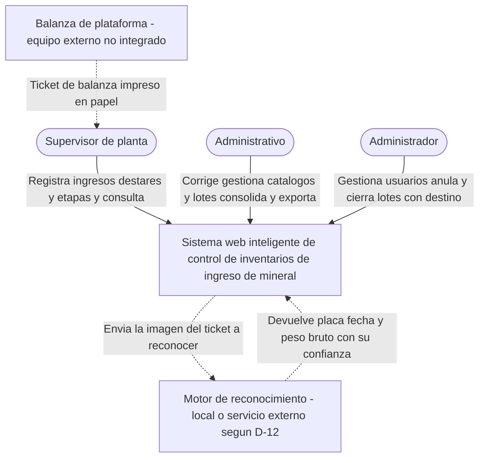
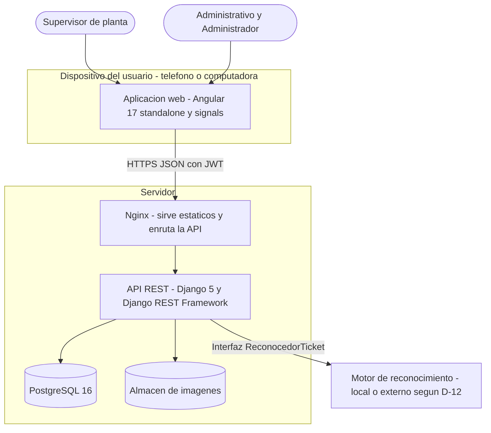
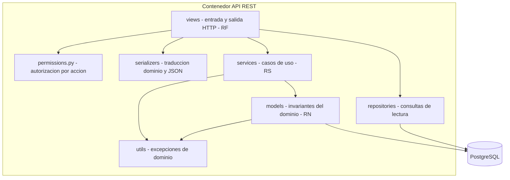
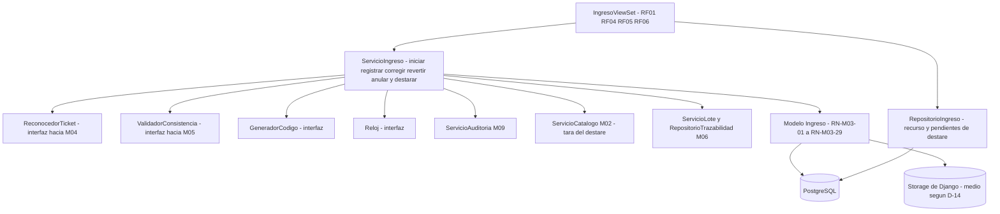
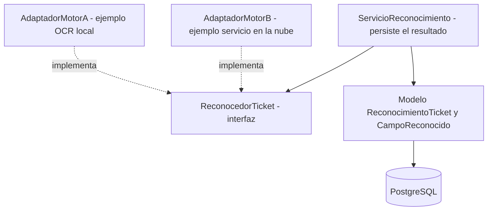
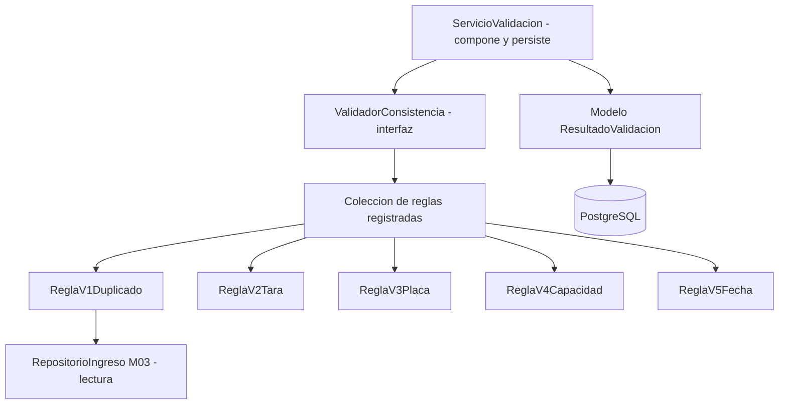
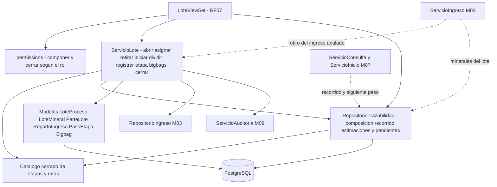
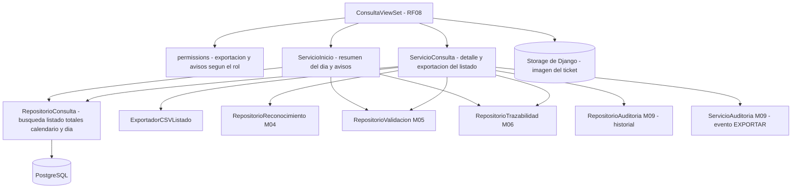
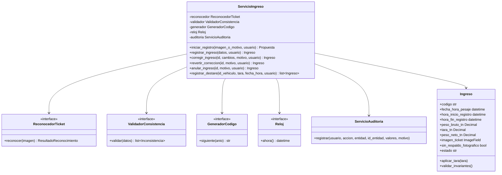
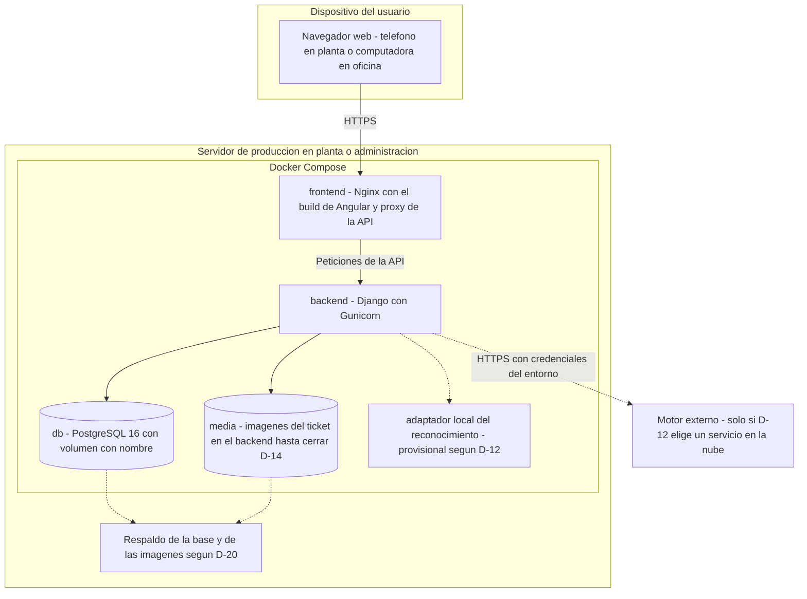

# ARQ-03 — Modelo C4 del sistema

**Documento:** ARQ-03
**Versión:** 3.1 — versión 2.1 del sistema (DR-11 a DR-31)
**Estado:** Validado el 23/10/2026
**Alcance:** los cuatro niveles de abstracción del sistema y su vista de despliegue, con la
justificación de cada elemento
**Deriva de:** `ARQ-01_Modulos_del_Sistema.md`, `ARQ-02_Arquitectura_Tecnica.md` y
`../00-arquitectura/decisiones_diseno.md`

| Versión | Fecha | Cambio |
|---|---|---|
| 3.0 | 21/10/2026 | Versión 2 del sistema (DR-11 a DR-23): contexto, contenedores, componentes de M03 a M05 y código del registro |
| 3.1 | 23/10/2026 | Versión 2.1 (DR-24 a DR-31, D-18 y D-19): componentes de M06 y M07, nivel 3 de M03 corregido, reversión y auditoría en el nivel 4, vista de despliegue y trazabilidad ampliada |

---

## 1. Por qué C4

Un único diagrama de arquitectura obliga a elegir entre ser legible para la gerencia o ser útil para
programar. C4 resuelve esa tensión con cuatro niveles de acercamiento, cada uno con su audiencia:

| Nivel | Responde a | Audiencia |
|---|---|---|
| 1 · Contexto | Qué hace el sistema y con quién interactúa | Gerencia, jefatura de operaciones, equipo técnico |
| 2 · Contenedores | En qué piezas ejecutables se divide | Equipo técnico y desarrollo |
| 3 · Componentes | Cómo se organiza cada pieza por dentro | Desarrollo |
| 4 · Código | Cómo se estructuran las clases del caso crítico | Desarrollo y defensa de SOLID |
| Despliegue | Dónde se ejecuta cada contenedor en cada entorno | Equipo técnico y quien administre el servidor |

Un diagrama que dibuje contenedores que el despliegue no tiene, u omita los que sí tiene, se
contradice con la lista de control de funcionalidad en cuanto alguien lo contrasta con el sistema
real.

Notación: Mermaid, coherente con el resto de la documentación. Las etiquetas van sin tildes por la
convención del repositorio, que evita fallos de renderizado en la exportación del documento.

---

## 2. Nivel 1 — Contexto

### 2.1 Justificación de los elementos

| Elemento | Por qué está | Qué pasaría sin él |
|---|---|---|
| **Supervisor de planta** | Está en el punto de pesaje y en la cancha: fotografía el ticket —o registra sin foto, con motivo—, da de alta el vehículo nuevo, registra el destare y el paso del lote por las etapas, y consulta lo registrado, con su reconocimiento y su validación (DR-17, DR-31) | El registro y el recorrido volverían a depender de que alguien transcriba el papel más tarde, que es la causa de la espera entre el pesaje y el registro |
| **Administrativo** | Corrige datos reconocidos, gestiona los catálogos, compone y divide los lotes, consulta, consolida y exporta el consolidado y el listado de ingresos (DR-23, DR-30) | Un dato mal leído por el motor quedaría sin forma de corregirse fuera del momento del registro, y los lotes no tendrían quién decidir su composición |
| **Administrador** | Gestiona usuarios y restablece sus contraseñas, modifica taras, anula ingresos y cierra los lotes con su destino (DR-14, DR-30) | Sin gestión de usuarios y sin un responsable del cierre, ni las operaciones serían atribuibles ni el destino del mineral tendría quien responda de él |
| **Balanza de plataforma** | Frontera declarada: **no hay integración** | — |
| **Motor de reconocimiento** | Sistema externo o local que lee la imagen; el sistema depende de su contrato, no de su implementación (D-12) | Sin él, el registro sería manual y RF02 no tendría cómo cumplirse |

### 2.2 La frontera con la balanza sigue siendo la decisión más importante de este nivel

La balanza **no está integrada** y no se propone integrarla. El dato llega al sistema como una
fotografía del ticket impreso, que el motor de reconocimiento lee y el usuario confirma. Esto no es
una carencia que haya que disculpar: es lo que **hace existir la medición de oportunidad del
registro**.

Porque el pesaje y el registro son actos separados, hay tres marcas de tiempo distintas —la del
pesaje, con la fecha leída de la fotografía y la hora que el usuario ajusta sobre la propuesta del
sistema (DR-11); el inicio del registro, cuando llega la imagen o se elige el registro sin foto; y el
fin del registro, cuando se confirma— y las diferencias entre ellas son lo que el sistema busca reducir
(D-01). Si la balanza estuviera integrada, esas marcas coincidirían por construcción y no habría
nada que observar.

### 2.3 El motor de reconocimiento como frontera abierta

A diferencia de la balanza, el motor de reconocimiento **sí participa activamente**: recibe una
imagen y devuelve datos. Se dibuja como sistema externo, con línea discontinua, porque D-12 aún no
decide si vive dentro del servidor (procesamiento local) o fuera de él (un servicio en la nube). El
sistema no se compromete con ninguna de las dos: la interfaz `ReconocedorTicket` (nivel 3) es la
misma en ambos casos.

---

## 3. Nivel 2 — Contenedores

### 3.1 Justificación de cada contenedor

| Contenedor | Tecnología | Responsabilidad | Justificación |
|---|---|---|---|
| **Aplicación web** | Angular 17+ | Interfaz de los nueve módulos | Instalable desde el navegador, sin tienda de aplicaciones ni proceso de publicación. La aplicación móvil nativa está fuera de alcance (ARQ-01 §5) |
| **Nginx** | Nginx | Sirve el build de Angular y enruta `/api/` al backend | Un solo origen para el navegador, sin abrir CORS en producción; termina HTTPS |
| **API REST** | Django 5 + DRF | Reglas de negocio, casos de uso y autorización | Autoridad única de validación (D-08): toda petición, venga de donde venga, se somete a las mismas reglas |
| **PostgreSQL 16** | PostgreSQL | Persistencia | Transacciones ACID, necesarias para asignar el código bajo concurrencia (D-02) y para que el reconocimiento, la validación y la auditoría se persistan en el mismo acto que el ingreso |
| **Almacén de imágenes** | A definir con D-14 | Conserva la fotografía del ticket como respaldo del ingreso | Sostiene RN-M03-01 (ningún ingreso sin imagen, salvo el registro sin foto con motivo de DR-13) y la consulta de M07; separado de PostgreSQL porque el volumen y el patrón de acceso de archivos binarios difieren del de filas relacionales. La API lo usa a través del almacenamiento de Django, de modo que cerrar D-14 cambia la configuración y no el código (D-18) |
| **Motor de reconocimiento** | A definir con D-12 | Lee la placa, la fecha y el peso bruto del ticket a partir de la imagen | Se accede exclusivamente a través de `ReconocedorTicket`; el contenedor puede vivir dentro del servidor o fuera de él sin que el resto del sistema lo note |

No hay Service Worker ni almacén local con cola de reintento en segundo plano: ese componente
pertenecía a un módulo que ya no forma parte del alcance (DR-01). El navegador conserva un borrador
del formulario mientras no hay señal (RNF-M03-05), pero eso no exige infraestructura de
sincronización: el ingreso siempre se confirma contra el servidor.

### 3.2 Contenedores que deliberadamente no existen

| No existe | Por qué |
|---|---|
| **Broker de tareas** (Celery, Redis) | D-15 fija el procesamiento síncrono por defecto. Se revisa solo si el piloto de motores muestra tiempos que lo justifiquen |
| **Cola de sincronización o almacén de reintento en el cliente** | Pertenecía a la captura sin señal de red, retirada del alcance (DR-01) |
| **Servicio de exportación separado** | El consolidado (M08) y el listado de ingresos (M07) se generan en la misma API y se descargan; no se almacenan |
| **Servicio de notificaciones** (correo, mensajería, avisos push) | Los avisos de pendientes se calculan dentro de la API cada vez que el usuario los consulta (DR-30, RN-M07-15); no se envían ni se guardan |
| **Segunda base de datos o caché distribuida** | El volumen previsto no la justifica; los índices del modelo entidad-relación sostienen los tiempos exigidos |

Esta tabla es tan importante como el diagrama. Un contenedor dibujado y no construido contradice la
lista de control de funcionalidad; uno construido y no dibujado aparece como sorpresa en la revisión.

---

## 4. Nivel 3 — Componentes

Se dibujan los cinco módulos con lógica o composición propia: M03, M04 y M05, donde vive la
inversión de dependencias del registro; M06, el módulo con más reglas después de M03; y M07, el lado
de lectura que compone lo que aportan los demás. Los otros cuatro siguen la estructura transversal de
§4.1 sin piezas que añadan explicación: M01 aporta las clases de `permissions.py` que usan todos, M02
es un catálogo, M08 es un repositorio de agregación con sus exportadores (D-10) y M09 es el
`ServicioAuditoria` que aparece en los diagramas de los demás.

En todos los diagramas de este nivel, una caja con el nombre de otro módulo es un componente de ese
módulo usado por su servicio o su repositorio, nunca por sus modelos.

### 4.1 Componentes del contenedor API — estructura transversal

Todas las apps de `apps/` tienen la misma organización interna. Es la aplicación directa de la
correspondencia requisito-capa de ARQ-02 §5.

| Componente | Responsabilidad única | Principio |
|---|---|---|
| `views` | Traducir HTTP y nada más | SRP |
| `permissions.py` | Autorizar por acción, no por objeto monolítico de usuario | ISP |
| `serializers` | Traducir dominio ↔ JSON; no valida reglas de negocio | SRP |
| `services` | Orquestar un caso de uso; invoca reglas, no las contiene | SRP, DIP |
| `repositories` | Consultar para leer, separado de la escritura | SRP |
| `models` | Proteger las invariantes de la entidad | SRP |
| `utils` | Excepciones de dominio, traducidas a HTTP en el borde | DIP |

**La flecha que no existe es la que más importa:** `models` y `services` no dependen de
`rest_framework`. Si lo hicieran, la regla de negocio quedaría atada al transporte HTTP, y un
componente distinto de vista —una tarea programada, un comando de administración— no podría
reutilizarla.

### 4.2 Componentes de M03 — Registro de ingresos

Es el módulo núcleo: la unidad de registro del sistema es el ingreso de mineral a partir del ticket.

| Componente | Justificación |
|---|---|
| `ServicioIngreso` | Concentra los casos de uso del ingreso: iniciar el registro —con foto o sin ella—, registrar, corregir, revertir la última corrección, anular y registrar el destare. La transacción única —código, valores reconocidos y confirmados, y evento de auditoría— vive aquí. Si el evento falla, el ingreso no queda registrado: ninguna operación se completa sin su rastro (RN-M09-01) |
| `ReconocedorTicket` como **interfaz** | D-12 deja abierta la elección del motor. Se inyecta en el servicio, no se instancia dentro: así se sustituye por un doble determinista en pruebas sin depender de un servicio externo |
| `ValidadorConsistencia` como interfaz | Las reglas V1 a V5 viven en M05 y se aplican sobre lo propuesto, sobre lo confirmado, en la corrección, en la reversión y, en el primer viaje de un vehículo, al registrar el destare. El servicio de M03 no conoce las reglas concretas, solo el contrato |
| `GeneradorCodigo` y `Reloj` como interfaces | El código se asigna con bloqueo dentro de la transacción (D-02) y las tres marcas de tiempo son el núcleo del registro (D-01). Un servicio que llamara a `timezone.now()` o calculara el correlativo por su cuenta no se podría probar controlando el instante ni la concurrencia |
| `ServicioAuditoria` de M09 | Servicio concreto, inyectado como en todo servicio de escritura, que registra el evento dentro de la misma transacción. No se abstrae: es único y las pruebas verifican el evento que deja (D-09) |
| `ServicioCatalogo` de M02 | El destare guarda la tara en el vehículo por el servicio del catálogo, que controla quién puede escribirla; M03 no toca el modelo `Vehiculo` (D-17) |
| `ServicioLote` y `RepositorioTrazabilidad` de M06 | La corrección y su reversión comprueban que el tipo de mineral esté en la lista del lote (DR-27); la anulación pide a M06 que retire el ingreso de un lote Abierto (RN-M03-27) |
| `RepositorioIngreso` | Lado de lectura de M03: el recurso de un ingreso y la lista de pendientes de destare. El listado general con filtros, totales y exportación no está aquí: es de M07 (D-19) |
| Storage de Django | La imagen se guarda por el `ImageField` del ingreso, que delega en el almacenamiento configurado para el entorno. No es una dependencia del servicio ni una interfaz propia (D-18). En el registro sin foto no se usa, y tampoco `ReconocedorTicket`; `ValidadorConsistencia` sí |

### 4.3 Componentes de M04 — Reconocimiento automático del ticket

| Componente | Justificación |
|---|---|
| `ReconocedorTicket` como interfaz, no como clase | Es el único punto de acoplamiento entre M03 y el motor concreto. Ningún otro componente del sistema importa el SDK o la librería de un motor: solo el adaptador correspondiente |
| Dos adaptadores dibujados a la vez | D-12 exige comparar motores en un piloto antes de elegir. El diagrama muestra que la arquitectura ya admite esa comparación sin cambios estructurales |
| `ServicioReconocimiento` separado de los adaptadores | Los adaptadores solo traducen: reciben una imagen y devuelven el contrato de `ReconocedorTicket`. Guardar el resultado, calcular si un campo fue corregido y registrar el evento de auditoría es responsabilidad de otro componente, para que cambiar de motor no toque la lógica de persistencia |

### 4.4 Componentes de M05 — Validación automática de consistencia

| Componente | Justificación |
|---|---|
| Una clase por regla | Añadir una regla nueva —una placa fuera del catálogo, un tipo de mineral incompatible— es una clase más en la colección, sin tocar V1 a V5 (OCP) |
| `ValidadorConsistencia` recorre la colección sin nombrar ninguna regla | Es la garantía de que RN-M05-04 (evaluar las cinco siempre) no dependa de que el desarrollador recuerde encadenar condicionales |
| `ReglaV1Duplicado` con un repositorio inyectado | Es la única regla que necesita otros ingresos: busca uno no anulado con la misma placa, fecha y peso bruto. Lo hace a través de una interfaz de lectura, no importando el modelo de M03, y se prueba con un doble de ese repositorio |
| `ServicioValidacion` separado de las reglas | Las reglas son puras: reciben datos, devuelven si cumplen. Persistir el resultado con su momento y su resolución es responsabilidad de otro componente |

### 4.5 Componentes de M06 — Trazabilidad del proceso

| Componente | Justificación |
|---|---|
| `ServicioLote` | Un solo servicio para el ciclo del lote, porque todas sus operaciones comparten las mismas comprobaciones de estado: abrir y componer —con la lista de minerales (DR-27)—, retirar o trasladar un ingreso hasta el zarandeo o la molienda (DR-29), iniciar el recorrido (DR-19), dividir por fracciones (DR-18), registrar cada etapa en el orden de su ruta, el secado propio y el reparto de un ingreso tardío (DR-20), asociar bigbags y cerrar con destino (DR-14). Cada operación registra su evento con los ingresos que afecta |
| `RepositorioTrazabilidad` | Lado de lectura del módulo: la composición por tipo de mineral, el recorrido de un ingreso sobre la unión de las rutas de sus partes (DR-21), las estimaciones de toneladas y bigbags y los pendientes del lote. Todo se calcula al consultarse, de modo que una corrección en M03 se refleja sin acción adicional (RN-M06-24) |
| `ServicioLote` usa el repositorio | `cerrar_lote()` consulta los mismos pendientes que muestra la pantalla de cierre: la pantalla y el servidor no pueden discrepar sobre si el lote está listo |
| Catálogo cerrado de etapas y rutas | Cuatro etapas cargadas por migración y tres rutas con su orden fijo (RN-M06-09). No es administrable: una etapa nueva rompería la comparación entre recorridos |
| `RepositorioIngreso` de M03 | M06 lee los ingresos para asignarlos y sumar sus toneladas; solo escribe su `id_lote`, nunca otro dato del ingreso |
| Uso desde M03 y M07 | M03 pide a `ServicioLote` el retiro del ingreso anulado y consulta la lista de minerales del lote al corregir; M07 lee el recorrido y el siguiente paso de cada lote para la consulta y los avisos. Ninguno toca los modelos de M06 |
| Fracciones con `Fraction` | Las fracciones se guardan como numerador y denominador y se suman con `fractions.Fraction`: con decimales, tres tercios no sumarían la unidad (DR-18) |

### 4.6 Componentes de M07 — Consulta de ingresos y respaldo

| Componente | Justificación |
|---|---|
| Sin `models/` | M07 no tiene entidad propia: lee sobre `INGRESO` y sobre lo que aportan los demás módulos (D-10). Es el lado de lectura del CQRS ligero del sistema |
| `RepositorioConsulta` | Una sola fuente para la búsqueda por placa y fecha, el listado con sus totales, el calendario y las cifras del día. Todas suman con el mismo filtro de ingresos computables que usa M08, para que un mes tenga un solo total (RN-M07-12, RN-M07-14) |
| `ServicioConsulta` con repositorios inyectados | Compone el detalle de un ingreso con los repositorios de lectura de M04, M05, M06 y M09, sin importar sus modelos. Cada uno puede responder «sin datos», y el servicio lo presenta como bloque ausente, no omitido (RN-M07-08) |
| `ServicioInicio` | Calcula el resumen del día y los avisos según el rol al consultarse; no hay tabla de avisos ni servicio de notificaciones (RN-M07-15). El siguiente paso de un lote lo pregunta a M06, que es quien lo sabe |
| `ExportadorCSVListado` | Clase propia en `exportadores/`, igual que en M08: un formato nuevo es una clase nueva (OCP). Recibe el mismo conjunto filtrado del listado, sin paginar (RN-M07-16) |
| `ServicioAuditoria` de M09 | La exportación es la única operación de M07 que deja rastro: el servicio registra el evento `EXPORTAR` con los filtros y el número de ingresos (RN-M07-17) |
| Storage de Django | La vista de la imagen comprueba la sesión antes de leer del almacenamiento; la imagen nunca se sirve desde una ruta pública (RN-M07-06, D-18) |
| Listado único | El listado con filtros es de M07 y de ningún otro módulo (D-19) |

---

## 5. Nivel 4 — Código

C4 admite este nivel y recomienda usarlo con parsimonia: el código cambia más rápido que el
documento, y un nivel 4 exhaustivo produce documentación desactualizada, que es peor que no tenerla.

Se dibuja **solo el caso de uso crítico**, `registrar_ingreso`, porque es donde se concentra la
inversión de dependencias y es la pregunta que se defiende en la revisión técnica.

### 5.1 Qué demuestra este diagrama

- **DIP.** `ServicioIngreso` depende de cuatro interfaces, no de sus implementaciones. Cambiar de
  motor de reconocimiento o de generador de código no toca el caso de uso ni obliga a rehacer sus
  pruebas. `ServicioAuditoria` se inyecta como clase concreta: es único y su efecto se verifica en
  la base (D-09). La imagen no es una dependencia: `imagen_ticket` delega en el almacenamiento de
  Django configurado para el entorno (D-18).
- **Reutilización del camino de escritura.** `revertir_correccion()` restaura los valores anteriores
  por el mismo camino que `corregir_ingreso()`, con la misma validación, y deja ambos actos en
  auditoría (DR-28). No hay un segundo flujo que pueda divergir del primero.
- **SRP.** `Ingreso` protege sus invariantes; no sabe de motores de reconocimiento, de reglas de
  validación ni de HTTP. El peso neto no se recibe: `aplicar_tara()` lo calcula como peso bruto menos
  la tara, conserva la tara aplicada y pasa el ingreso de En proceso a Registrado. Así la regla
  «neto = bruto − tara» vive en un solo lugar, sea que la tara llegue del catálogo al confirmar o
  del destare del primer viaje (D-17).
- **Capacidad de prueba.** Las cuatro abstracciones existen porque hay pruebas que las exigen:
  un motor de reconocimiento real no puede invocarse en cada corrida de pruebas, las reglas de
  validación deben poder simularse en ambos sentidos, y el reloj debe poder fijarse para verificar
  las tres marcas de tiempo con precisión. No se abstrae por si acaso: una interfaz sin segunda
  implementación ni prueba que la sustituya es ceremonia y se defiende peor que su ausencia (D-09).

---

## 6. Vista de despliegue

C4 la trata como diagrama complementario: muestra en qué infraestructura corre cada contenedor del
nivel 2. Sigue `ARQ-02_Arquitectura_Tecnica.md` §7 y la skill `despliegue-docker`.

| Entorno | Qué corre | Para qué | Regla |
|---|---|---|---|
| Desarrollo | El mismo Compose en el equipo del desarrollador, con datos de prueba y el almacenamiento de Django en el sistema de archivos local | Construir y ejecutar las pruebas automatizadas | Libre |
| Preproducción | El mismo Compose que producción, en un servidor de pruebas | Pruebas funcionales y de rendimiento antes de la estabilización | Nunca contra producción |
| Producción | El Compose de la figura, en el servidor de planta o administración | Operación real | No entra en uso en planta hasta que termine el pretest; todo despliegue posterior se registra con fecha, hora y motivo |

| Elemento | Justificación |
|---|---|
| Un solo Compose por entorno | Los tres entornos ejecutan las mismas imágenes; lo que cambia es la configuración. Un error que aparece en producción y no en preproducción deja de deberse a una diferencia de construcción |
| Nginx como único punto de entrada | Sirve el frontend y enruta la API desde un mismo origen: no se abre CORS en producción y HTTPS termina en un solo lugar |
| Volúmenes con nombre para `db` y `media` | Un contenedor recreado sin volumen se llevaría los registros y las fotografías que el sistema existe para conservar (D-07) |
| Motor dibujado en dos lugares, con línea discontinua | Mientras D-12 no elija el motor, el reconocimiento corre con un adaptador local dentro del backend; si el motor elegido es un servicio externo, el backend lo usa a través de `ReconocedorTicket` igual que al adaptador local |
| Respaldo | Procedimiento ejecutable desde la semana 1: volcado de la base y copia del volumen `media`, con restauración de prueba (D-20) |
| Congelamiento durante la medición | Entre el inicio y el fin de la medición no se despliega una versión distinta del motor ni de las reglas (D-16) |

**Pendientes que este diagrama no fija.** El servicio de alojamiento de la presentación y, con él, el
medio definitivo de las imágenes (D-14) y la política de respaldo —frecuencia, retención y ubicación
fuera del servidor— (D-20). Mientras tanto, las imágenes viven en el volumen `media` del backend y el
respaldo es el procedimiento mínimo ejecutable.

---

## 7. Trazabilidad del modelo

| Nivel | Elemento | Módulo | RF | Decisión |
|---|---|---|---|---|
| 1 | Frontera con la balanza | M03 | RF01 | D-01 |
| 1 | Motor de reconocimiento como sistema externo | M04 | RF02 | D-12 |
| 2 | Almacén de imágenes | M03 | RF01 | D-14 |
| 2 | API REST como autoridad de validación | Todos | RF03 | D-08 |
| 2 | PostgreSQL con transacciones | M03, M09 | RF05 | D-02 |
| 3 | `ReconocedorTicket` inyectado | M03, M04 | RF02 | D-12 |
| 3 | `ValidadorConsistencia` inyectado | M03, M05 | RF03 | D-08 |
| 3 | `repositories` separado | M07, M08 | RF08, RF09 | D-09 |
| 4 | `Reloj` inyectado, también para proponer la hora del pesaje | M03 | RF01 | D-01, DR-11 |
| 4 | Registro sin foto por el mismo `registrar_ingreso` | M03 | RF01 | D-13, DR-13 |
| 2 | Almacén de imágenes usado por el almacenamiento de Django | M03, M07 | RF01, RF08 | D-14, D-18 |
| 2 | Sin servicio de notificaciones: avisos calculados al consultarse | M07 | — | DR-30 |
| 3 | `ServicioAuditoria` inyectado en todo servicio de escritura | M03, M06, M07, M09 | — | D-07 |
| 3 | `ServicioLote` con el ciclo, la división, las etapas y el cierre del lote | M06 | RF07 | DR-14, DR-16, DR-18 a DR-20, DR-27, DR-29 |
| 3 | Catálogo cerrado de etapas y rutas | M06 | RF07 | DR-16 |
| 3 | `RepositorioTrazabilidad` leído por M03, M06 y M07 | M06 | RF07, RF08 | D-09, DR-28 |
| 3 | `ServicioConsulta` compone el detalle con repositorios inyectados | M07 | RF08 | D-10 |
| 3 | Listado único en M07, con su exportación | M03, M07 | RF08 | D-19, DR-30 |
| 3 | `ServicioInicio` con el resumen del día y los avisos por rol | M07 | — | DR-30 |
| 4 | `revertir_correccion` por el mismo camino que la corrección | M03 | RF04 | DR-28 |
| 3 | Códigos de ruta que no coinciden con los de etapa | M06 | RF07 | D-21 |
| Despliegue | Compose con volúmenes con nombre, almacenamiento y reconocimiento provisionales en el backend y respaldo mínimo ejecutable | Todos | — | D-12, D-14, D-16, D-20 |

---

## 8. Referencias cruzadas

- Lista cerrada de módulos y alcance declarado: `ARQ-01_Modulos_del_Sistema.md`
- Capas, contrato de API y aplicación de SOLID: `ARQ-02_Arquitectura_Tecnica.md`
- Decisiones que condicionan el modelo: `../00-arquitectura/decisiones_diseno.md`, en especial D-09,
  D-10, D-18 y D-19
- Componentes de M06 y M07 en detalle: `../modulos/M06-trazabilidad/notas.md` y
  `../modulos/M07-consulta/notas.md`
- Despliegue: `ARQ-02_Arquitectura_Tecnica.md` §7 y la skill `despliegue-docker`
- Entidades y sus campos: `../00-arquitectura/modelo_datos_entidad_relacion.md`
- Convención de códigos y nomenclatura: `../00-arquitectura/convenciones_codigo.md`
