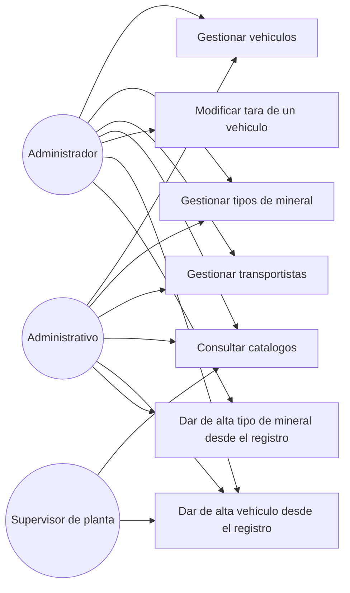

# Diagrama de casos de uso — M02 Catálogo maestro

## Casos de uso

| Caso | HU | Actores | Nota |
|---|---|---|---|
| Gestionar vehículos | HU-M02-01 | Administrador, Administrativo | La titularidad y la capacidad son obligatorias; el vehículo nace sin tara. Incluye la baja lógica y la reactivación |
| Modificar tara de un vehículo | HU-M02-01 | Administrador | Con motivo obligatorio; los ingresos ya registrados conservan su tara |
| Dar de alta vehículo desde el registro | HU-M02-01, HU-M03-01 | Los tres roles | Mismas reglas que el alta desde el catálogo; es el primer viaje del vehículo |
| Gestionar tipos de mineral | HU-M02-02 | Administrador, Administrativo | Catálogo único, usado al registrar y al consolidar. Incluye la baja lógica y la reactivación |
| Dar de alta tipo de mineral desde el registro | HU-M02-02, HU-M03-01 | Administrador, Administrativo | Mismas reglas que el alta desde el catálogo; el código puede generarlo el sistema |
| Gestionar transportistas | HU-M02-03 | Administrador, Administrativo | Del que depende un vehículo con titularidad externa. Incluye la baja lógica y la reactivación |
| Consultar catálogos | HU-M02-01 a 03 | Los tres roles | El Supervisor de planta consulta para seleccionar en el registro de ingresos; además da de alta vehículos desde el registro |

Los actores se definen en `../../M01-autenticacion/diagramas/caso_uso.md` y no se redefinen aquí.
