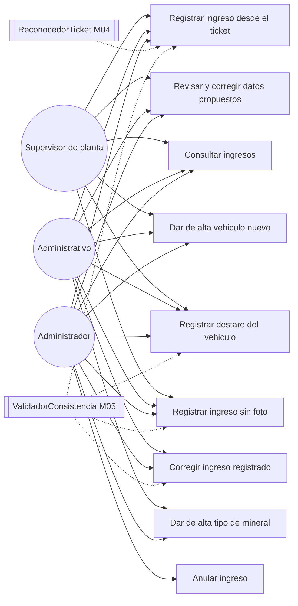

# Diagrama de casos de uso — M03 Registro de ingresos

## Casos de uso

| Caso | HU | Actores | Nota |
|---|---|---|---|
| Registrar ingreso desde el ticket | HU-M03-01 | Los tres roles | Empieza con la captura de la imagen; la hora del pesaje se propone y el usuario la ajusta; el código, la hora de fin y el peso neto los asigna el servidor |
| Revisar y corregir datos propuestos | HU-M03-01 | Los tres roles | Ocurre antes de confirmar; la placa leída puede corregirse; nada se persiste hasta entonces |
| Consultar ingresos | HU-M03-01 | Los tres roles | Listado y detalle del propio recurso. La búsqueda por placa y fecha es de M07 |
| Corregir ingreso registrado | HU-M03-02 | Administrativo, Administrador | Exige motivo y vuelve a validar. El Supervisor de planta no corrige |
| Anular ingreso | HU-M03-03 | Administrador | Exige motivo. No elimina: excluye de los totales y conserva el registro |
| Dar de alta vehículo nuevo | HU-M03-01 | Los tres roles | En la misma pantalla del registro, sin perder lo capturado. Es el primer viaje: el ingreso queda En proceso |
| Registrar destare del vehículo | HU-M03-04 | Los tres roles | Se elige el vehículo; la tara se digita, no se reconoce. Completa el peso neto de todos sus ingresos En proceso |
| Registrar ingreso sin foto | HU-M03-01 | Los tres roles | Excepción con motivo obligatorio: sin imagen ni reconocimiento, con validación. El ingreso queda marcado sin respaldo fotográfico |
| Dar de alta tipo de mineral | HU-M03-01 | Administrativo, Administrador | En la misma pantalla del registro, con las reglas del catálogo de M02. El Supervisor de planta no lo ofrece |

`ReconocedorTicket` y `ValidadorConsistencia` son interfaces que M03 invoca, no actores humanos: se
dibujan con línea discontinua para mostrar que el caso de uso depende de ellas. El registro sin foto
depende del validador, pero no del reconocedor.

Los actores se definen en `../../M01-autenticacion/diagramas/caso_uso.md` y no se redefinen aquí.
