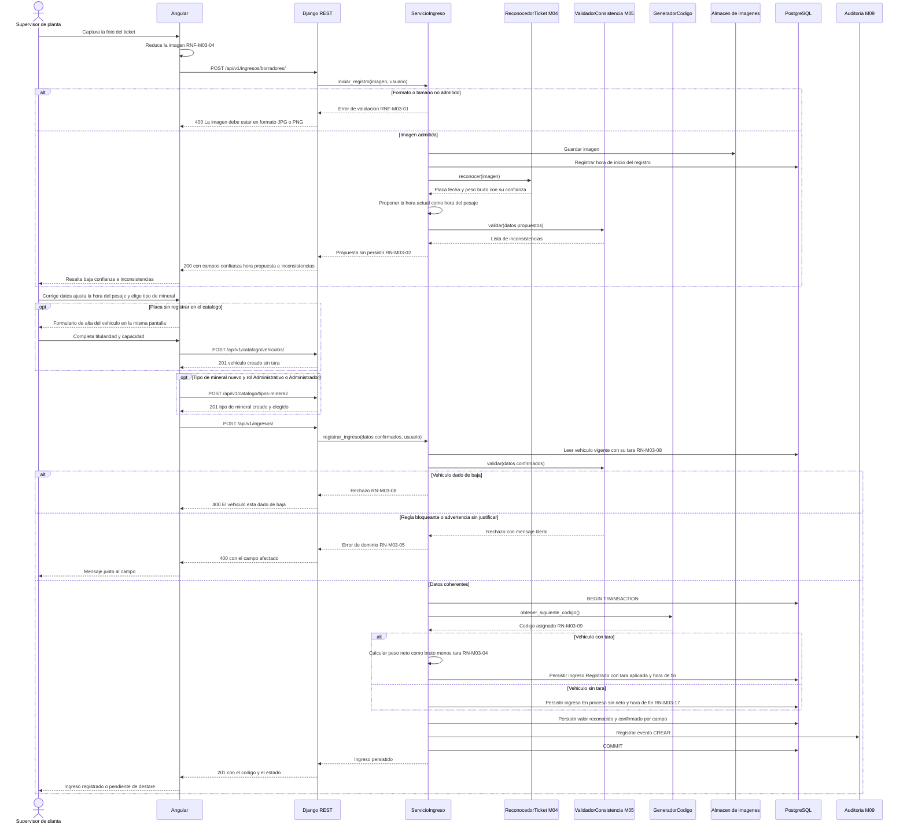
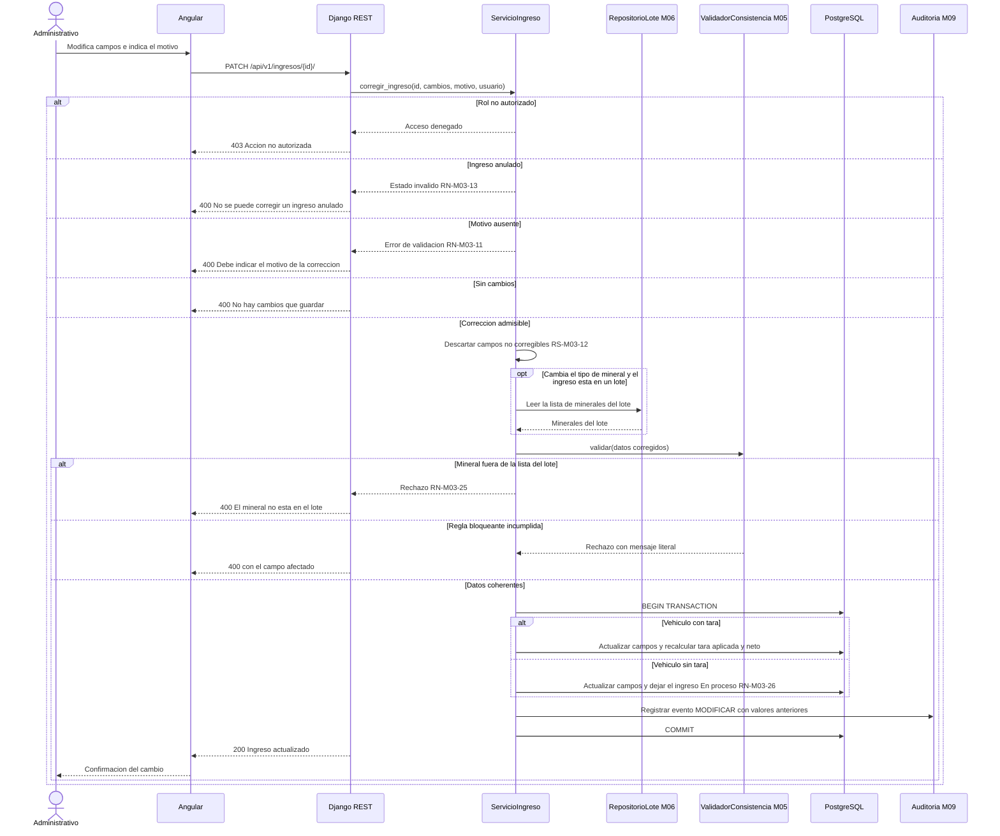
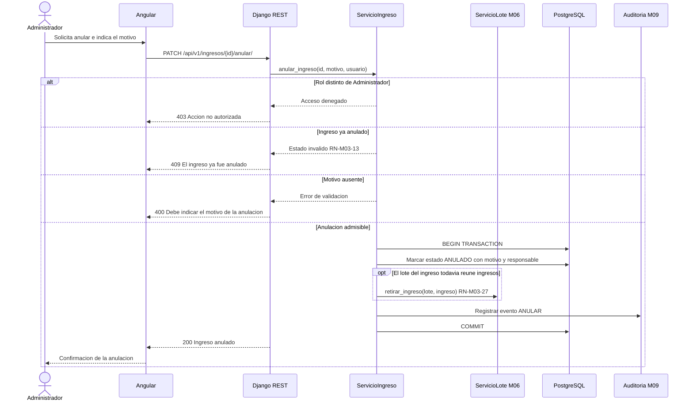
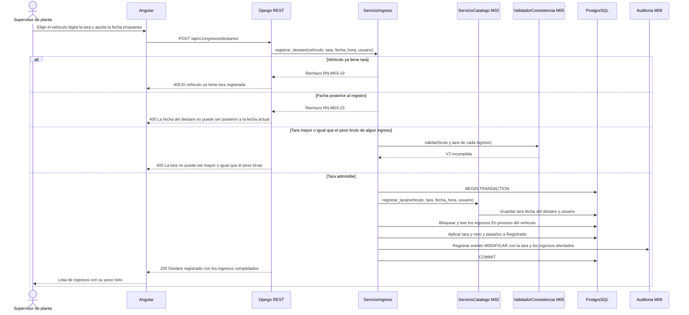
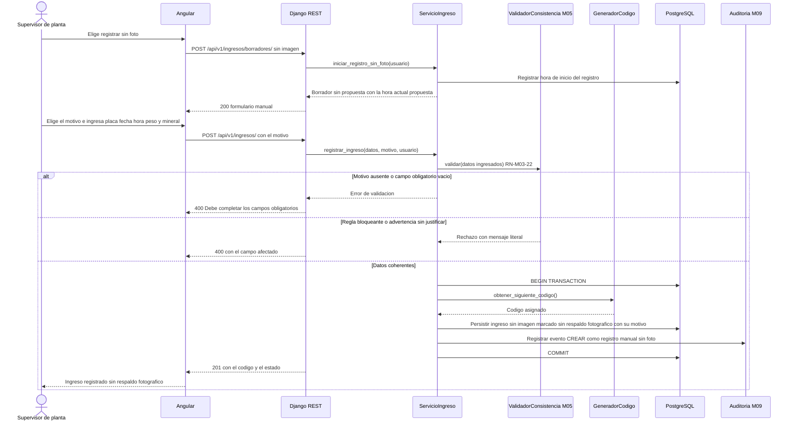

# Diagramas de secuencia — M03 Registro de ingresos

## S-M03-01 · Registro de un ingreso con reconocimiento y validación (HU-M03-01)

## S-M03-02 · Corrección de un ingreso registrado (HU-M03-02)

## S-M03-03 · Anulación de un ingreso (HU-M03-03)

La imagen del ticket no se elimina al anular: el ingreso permanece consultable con su respaldo
(RNF-M03-10).

## S-M03-04 · Registro del destare de un vehículo en su primer viaje (HU-M03-04)

La tara se guarda en el vehículo a través del servicio de M02, que es el dueño de esa entidad; M03
no escribe directamente en la tabla de vehículos.

## S-M03-05 · Registro de un ingreso sin foto (HU-M03-01)

El registro sin foto no invoca a `ReconocedorTicket`: no hay imagen que leer y, por tanto, no se
guardan valores reconocidos. El cálculo del peso neto y el estado En proceso siguen las mismas reglas
que en S-M03-01.
