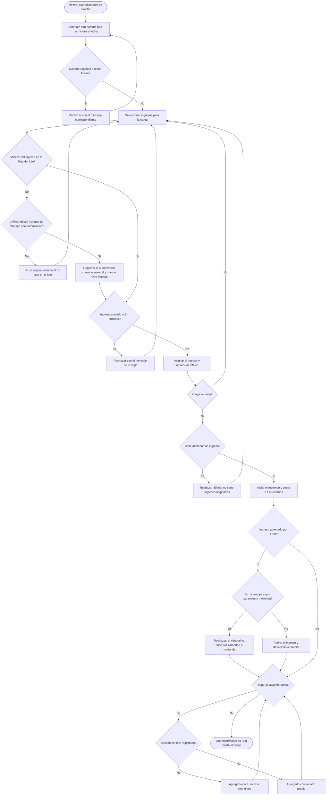
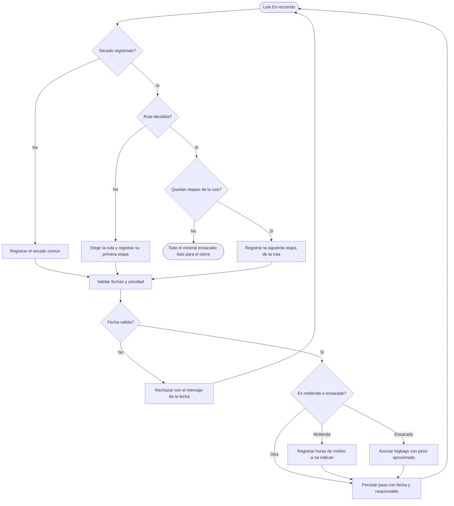
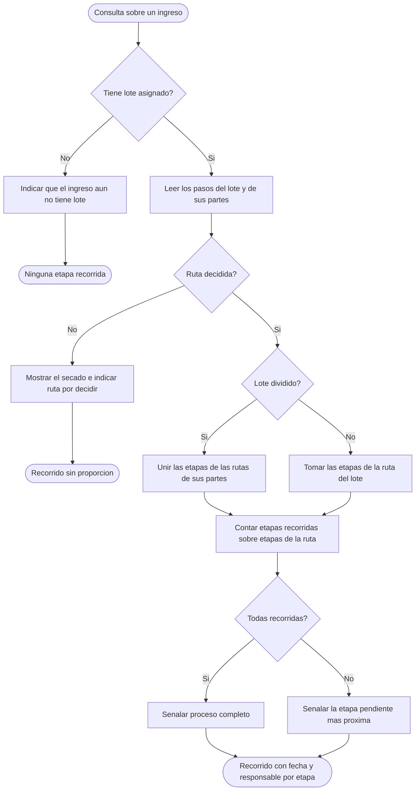
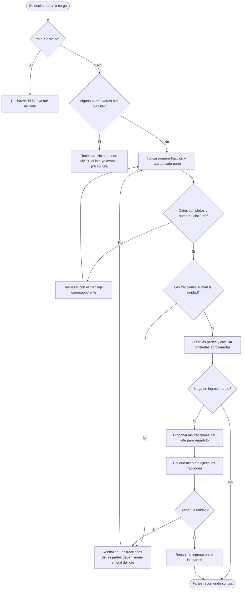
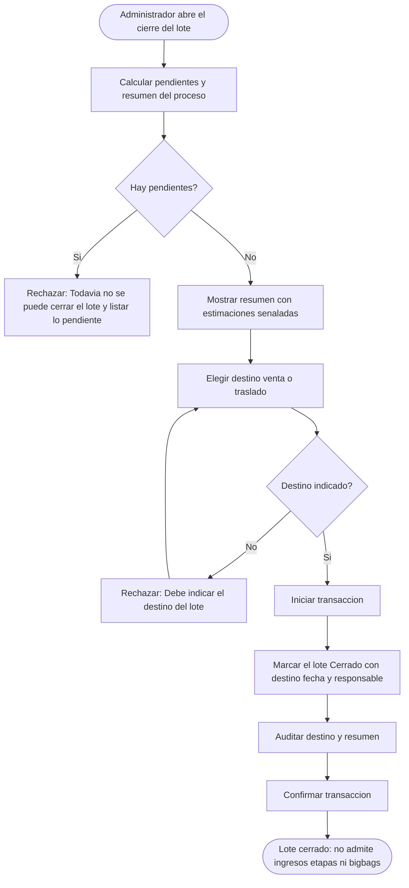

# Diagramas de actividades — M06 Trazabilidad del proceso

## A-M06-01 · Ciclo de vida de un lote (RN-M06-01 a RN-M06-04, RN-M06-10, RN-M06-13, RN-M06-14)

Mientras el lote está Abierto, un ingreso puede retirarse o trasladarse a otro lote. Desde el inicio
del recorrido se suman ingresos tardíos, y un ingreso agregado por error todavía puede retirarse
hasta que su mineral pase por zarandeo o molienda, siempre que el lote conserve al menos un ingreso.
El secado ya registrado se conserva (RN-M06-04).

## A-M06-02 · Recorrido del lote por su ruta (RN-M06-05 a RN-M06-08, RN-M06-15, RN-M06-19)

Si el lote está dividido, este recorrido ocurre por cada parte, con su propia ruta. La interfaz
ofrece únicamente la etapa que corresponde registrar (RNF-M06-07); las decisiones de este diagrama
son las que el servidor comprueba de todas formas.

## A-M06-03 · Respuesta a la pregunta por dónde va un ingreso (RN-M06-11, RN-M06-22)

Un ingreso sin lote no es un dato faltante: es el estado normal de un ingreso recién registrado.

## A-M06-04 · División de un lote y reparto de un ingreso tardío (RN-M06-16 a RN-M06-18)

Las toneladas de cada parte son una estimación: el mineral acumulado no se pesa (RN-M06-17).

## A-M06-05 · Cierre del lote con su destino (RN-M06-20, RN-M06-21)

El cierre registra el destino, no la venta ni el traslado: no hay guía, factura ni precio (DR-14).
