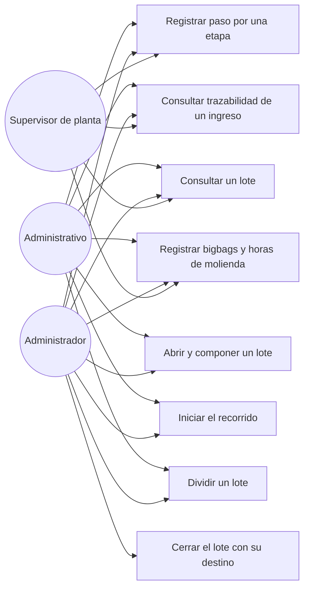

# Diagrama de casos de uso — M06 Trazabilidad del proceso

## Casos de uso

| Caso | HU | Actores | Nota |
|---|---|---|---|
| Abrir y componer un lote | HU-M06-01 | Administrativo, Administrador | Incluye asignar ingresos mientras el lote está Abierto, agregar ingresos tardíos mientras está En recorrido y retirar un ingreso hasta que su mineral pase por zarandeo o molienda |
| Iniciar el recorrido | HU-M06-01 | Administrativo, Administrador | El lote deja de reunir ingresos y empieza por el secado. Exige al menos un ingreso |
| Registrar paso por una etapa | HU-M06-02 | Los tres roles | Solo sobre lotes En recorrido y en el orden de la ruta, que se elige después del secado |
| Consultar trazabilidad de un ingreso | HU-M06-03 | Los tres roles | Responde a través del lote o de sus partes, sobre las etapas de su ruta |
| Consultar un lote | HU-M06-01 | Los tres roles | Muestra el estado, los ingresos asignados, las partes y el total de toneladas |
| Dividir un lote | HU-M06-04 | Administrativo, Administrador | Por fracciones, con una ruta por parte, antes de que ninguna parte avance |
| Registrar bigbags y horas de molienda | HU-M06-02 | Los tres roles | Datos descriptivos: los bigbags al ensacar, las horas al moler |
| Cerrar el lote con su destino | HU-M06-05 | Administrador | Solo con todo el mineral ensacado. Destino: venta o traslado |

El Supervisor de planta registra el paso por las etapas porque está en el proceso, pero no decide la
composición de las cargas, su división ni su destino.

Los actores se definen en el diagrama de casos de uso de M01 y no se redefinen aquí.
