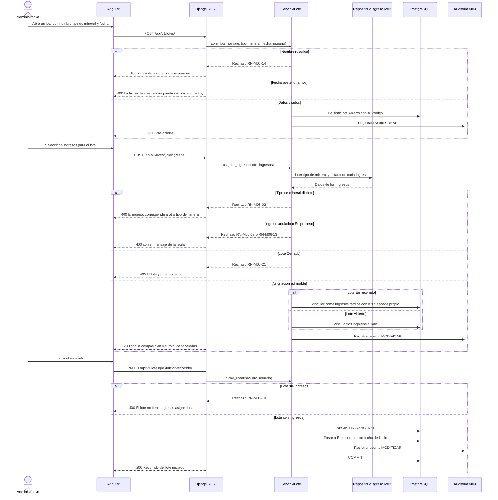
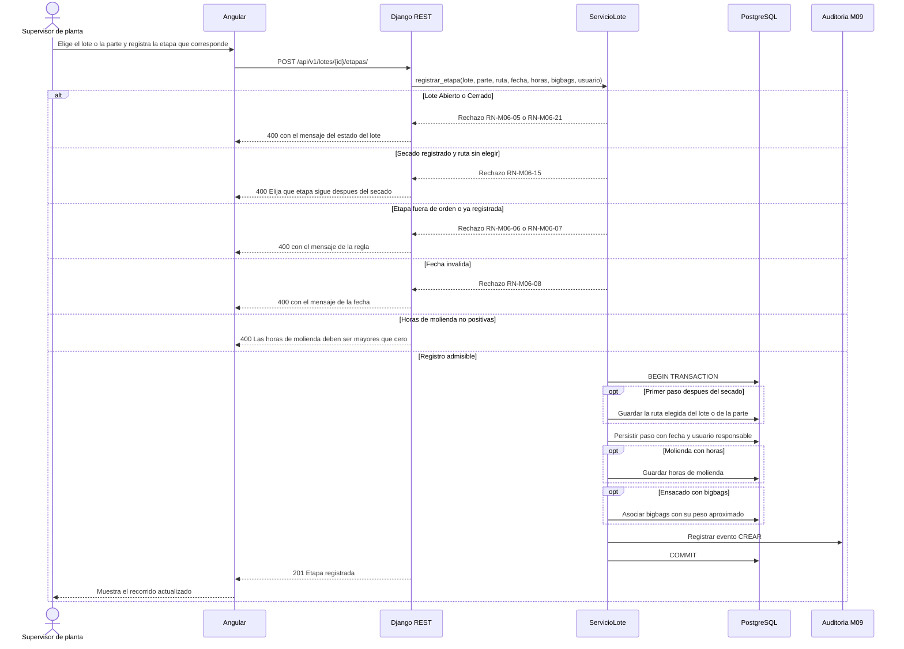
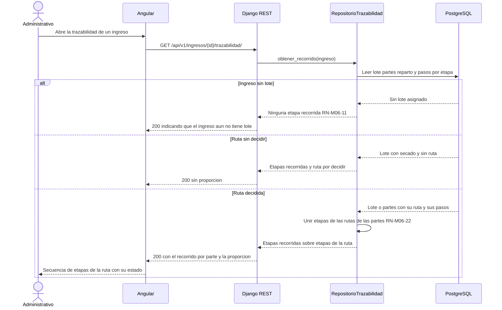
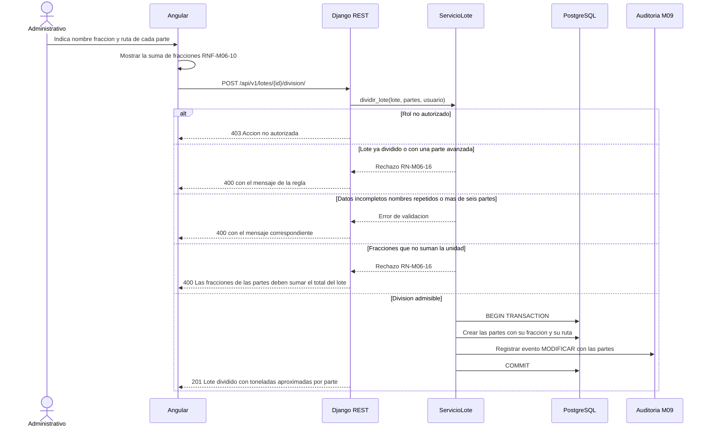
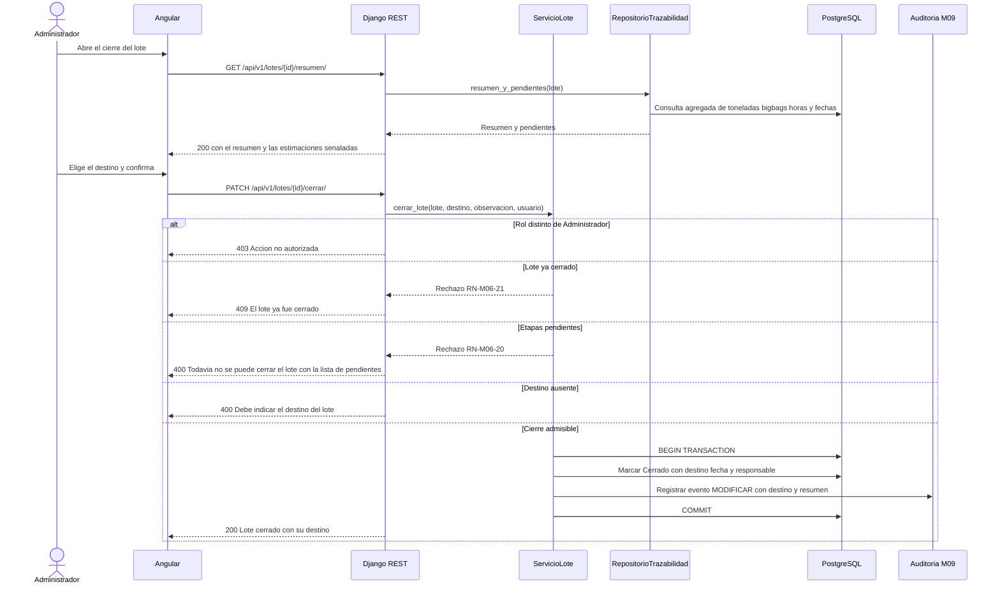

# Diagramas de secuencia — M06 Trazabilidad del proceso

## S-M06-01 · Composición de un lote e inicio del recorrido (HU-M06-01)

## S-M06-02 · Registro del paso por una etapa de la ruta (HU-M06-02)

## S-M06-03 · Consulta de la trazabilidad de un ingreso (HU-M06-03)

## S-M06-04 · División de un lote por fracciones (HU-M06-04)

El reparto de un ingreso tardío en un lote dividido sigue la misma comprobación de fracciones: el
sistema propone las del lote y el usuario puede ajustarlas antes de confirmar (DR-20).

## S-M06-05 · Cierre del lote con su destino (HU-M06-05)

El cierre no registra la venta ni el traslado en sí: solo su destino (DR-14).
