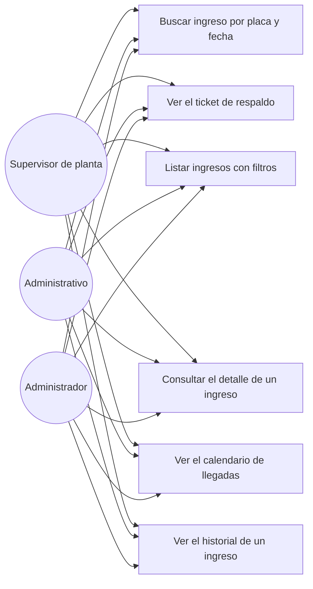

# Diagrama de casos de uso — M07 Consulta de ingresos y respaldo

## Casos de uso

| Caso | HU | Actores | Nota |
|---|---|---|---|
| Buscar ingreso por placa y fecha | HU-M07-01 | Los tres roles | Admite placa parcial. Exige al menos uno de los dos criterios. Muestra también el lote y el recorrido del ingreso |
| Ver el ticket de respaldo | HU-M07-01 | Los tres roles | La imagen se amplía para poder contrastarla con lo registrado; sin foto, se muestra el motivo |
| Listar ingresos con filtros | HU-M07-02 | Los tres roles | Filtros combinables y búsqueda por placa o código, con el total de ingresos y de toneladas del conjunto |
| Consultar el detalle de un ingreso | HU-M07-01, HU-M07-02 | Los tres roles | Reúne datos, imagen, validaciones, reconocimiento, trazabilidad e historial |
| Ver el calendario de llegadas | HU-M07-03 | Los tres roles | Llegadas y toneladas por día del mes, con acceso a los ingresos de cada día |
| Ver el historial de un ingreso | HU-M09-02 | Los tres roles | Pestaña del detalle; lo provee M09 |

Los ingresos anulados aparecen en todos los casos de uso, señalados como tales: ocultarlos haría
creer que el volquete nunca se registró.

Los actores se definen en el diagrama de casos de uso de M01 y no se redefinen aquí.
