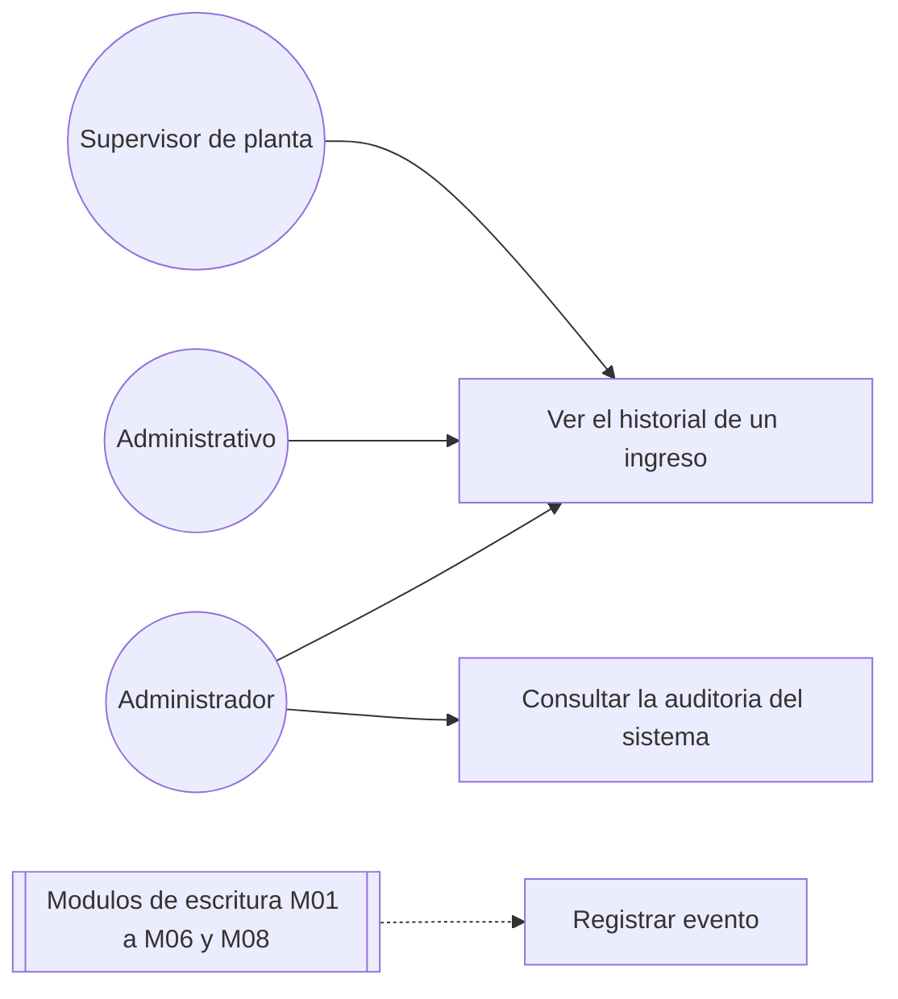

# Diagrama de casos de uso — M09 Auditoría

## Casos de uso

| Caso | HU | Actores | Nota |
|---|---|---|---|
| Registrar evento | HU-M09-01 | Todos los módulos de escritura, no un usuario | Ocurre dentro de la transacción de cada operación auditada; ningún rol lo activa directamente |
| Ver el historial de un ingreso | HU-M09-02 | Los tres roles | Desde el detalle del ingreso; reúne sus eventos y los de su lote que lo afectan |
| Consultar la auditoría del sistema | HU-M09-03 | Administrador | Todos los eventos, con filtros; incluye accesos rechazados y eventos de usuarios |

Los módulos de escritura se dibujan como sistemas que invocan el registro, porque quien lo hace no
es una persona sino la propia operación que se está completando.

Los actores se definen en el diagrama de casos de uso de M01 y no se redefinen aquí.
