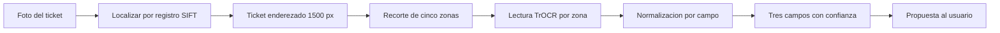

# Laboratorio de reconocimiento manuscrito del ticket de balanza

| Campo | Valor |
|---|---|
| Módulo | M04 Reconocimiento automático del ticket |
| Paso del plan | 7.3 de F7, piloto de motores (D-12, D-15) |
| Rama | `feature/M04-reconocimiento-manuscrito` |
| Estado | Etapa local cerrada (L0 a L7). Pendientes: saneamiento (S1 a S5) y documentación (D1 a D4) |
| Modelo candidato | `trocr-ticket-v1+sha256:35598224867a` |
| Fecha de corte | 04/11/2026 |

Este documento reúne lo que se hizo en el laboratorio, por qué se hizo así, qué se midió y qué falta
para llevarlo al sistema. El plan de pasos está en [PLAN_EJECUCION.md](PLAN_EJECUCION.md); los
resultados completos quedan en `datos/informe_capacidad.md`, que no se versiona.

El laboratorio vive fuera de `backend/` y de `docs/`. Ningún resultado aquí modifica la documentación
cerrada: lo que deba entrar a ella entra como decisión nueva (sección 11).

---

## 1. Problema de partida

En las pruebas del registro de ingreso, todas las fotos reales del ticket terminaban con el mensaje
«No fue posible leer el ticket. Tome una nueva fotografía o ingrese los datos manualmente». El
diagnóstico encontró dos causas independientes.

1. **El adaptador de Tesseract busca un ticket que no existe.** Su comentario y su prueba suponen un
   ticket impreso con `FECHA dd/mm/aaaa`, `PLACA XXX-NNN` y `P. BRUTO 32 500 kg`. El ticket real, el
   que describe DR-09, trae el peso sin unidad (`Peso: 13.400`), la fecha en tres casillas (DÍA, MES,
   AÑO, con el año en dos dígitos) y la placa escrita a mano. Es una contradicción entre el código y
   la fuente de verdad: gana DR-09 y el código se corrige en el saneamiento (S1).
2. **Tesseract no lee letra manuscrita.** Aun recortando, ampliando y binarizando el ticket, lee bien
   las etiquetas impresas («Peso:», «Placa:») y mal los valores escritos a mano.

Con el conjunto de desarrollo, el adaptador actual obtiene **0 de 32 tickets**.

## 2. El ticket de la Balanza

El ticket lo emite la Balanza, un agente externo, en un talonario de formato fijo. Para el sistema
solo interesan cinco zonas manuscritas:

| Zona | Contenido | Variaciones observadas |
|---|---|---|
| Peso | Peso bruto, en toneladas, sin unidad | `13.400`, `13.4`, `15720` sin separador, `15 720` con espacio. A veces trae el cálculo de tara y neto en la misma línea |
| Placa | `XXX-NNN` | Con o sin guion, seguida de un color («Azul», «Blanco»), o reemplazada por un nombre o un apodo del vehículo |
| Día, mes y año | Tres casillas | Mes en uno o dos dígitos, año con punto final («26.») |

«Recibí», «La suma de», «Concepto», el número del talonario y las firmas sirven a la Balanza y **no
se leen**.

## 3. Conjunto de desarrollo

### 3.1 Composición

| Concepto | Cantidad |
|---|---:|
| Fotos recibidas (todas por WhatsApp, entre 594 y 1280 px de lado) | 52 |
| Copias exactas del mismo archivo, detectadas por hash | 18 |
| Fotos con dos tickets, excluidas | 2 |
| **Fotos usables** | **32** |
| **Tickets distintos** | **29** |
| Tickets fotografiados dos veces | 3 |
| Fotos rotadas unos 90° | 11 |
| Fotos con letra cursiva (escritor A) | 21 |
| Fotos con mayúsculas de imprenta (escritor B) | 11 |
| Fotos con el cálculo de tara y neto en la línea de peso | 10 |
| Fotos con un nombre o un apodo en lugar de la placa | 5 |
| Fotos con el peso escrito sin punto | 4 |
| Campos ilegibles también a ojo (un año tapado por un dedo, un día cortado por el borde) | 2 |

El peso bruto va de 12,6 t (volquete) a 60,7 t (tráiler). La anotación «10,3 TN» de un ticket y las
restas de tara que cuadran en toneladas confirman la unidad, aunque falta la confirmación formal de la
empresa (sección 12).

### 3.2 Archivos de datos

Todo va en `datos/`, excluido de git porque los tickets contienen nombres de personas.

| Archivo | Contenido |
|---|---|
| `originales/T001.jpg` … `T052.jpg` | Las fotos tal como llegaron, sin editar |
| `inventario.csv` | Una fila por foto: origen, número de ticket, copia de cuál, si es usable, escritor y observación |
| `transcripcion.csv` | Una fila por foto usable: lo escrito tal cual en cada zona y una nota |
| `verdad.csv` | El valor normalizado de cada campo, con el formato que lee `piloto_motores` |
| `particion.csv` | El grupo de validación cruzada de cada foto |
| `enderezados/`, `recortes/` | El ticket enderezado y las cinco zonas de cada foto |
| `resultados/` | Cada lectura de cada lector, y los informes |
| `modelos/trocr-ticket-v1/` | El modelo candidato (1,3 GB) con su archivo `VERSION` |

### 3.3 Transcripción

La transcripción registra **lo que está escrito**, no lo normalizado. La primera pasada la hizo el
agente y el implementador la corroboró con una hoja de revisión que mostraba cada foto junto a su
lectura. Las dudas de forma (G o 6, A o 4, S o 5, 0 u O, J o 7) se resolvieron con las placas reales
que indicó el implementador.

| Columna | Regla |
|---|---|
| `peso_texto` | El peso bruto como está escrito |
| `peso_linea` | La línea de peso completa, con el cálculo si lo hay. Es la etiqueta de entrenamiento de la zona |
| `placa` | La placa real. Si se escribió un nombre, el nombre |
| `placa_linea` | La zona completa, con el color si lo hay. Es la etiqueta de entrenamiento |
| `dia`, `mes`, `anio` | Lo escrito en cada casilla; vacío si no se lee |
| `legible` | `si`, `parcial` (un campo ilegible) o `no` |

### 3.4 Partición

Las 32 fotos se reparten en cinco grupos fijos (semilla 2026), de 7, 7, 6, 6 y 6 fotos. Las fotos de
un mismo ticket caen siempre en el mismo grupo, para que ningún modelo se evalúe con un ticket que vio
al entrenar.

## 4. Cadena de reconocimiento



### 4.1 Localizar y enderezar (`01_localizar.py`)

Cada foto se registra contra un ticket de referencia (T017, frontal y limpio) por sus partes impresas:
marco, títulos y etiquetas. SIFT encuentra puntos comunes, el emparejamiento exhaustivo los asocia (no FLANN: sus árboles aleatorios
enderezaban distinto la misma foto en cada corrida y cambiaban la lectura), RANSAC descarta como ruido lo manuscrito,
que cambia de un ticket a otro, y la homografía resultante lleva el ticket a 1500 × 773 px.

Este método resiste el ticket rotado, inclinado, de cabeza, arrugado o con un borde fuera de la foto.
Resultado: **32 de 32 fotos localizadas**, con entre 58 y 483 puntos coincidentes; el mínimo exigido
es 30.

### 4.2 Recortar las cinco zonas (`02_recortar.py`)

Como el formato es fijo, las zonas se toman por coordenadas relativas guardadas en
[plantilla.json](plantilla.json), calibradas sobre la referencia. La hoja `datos/revision_recortes.png`
permite revisarlas a ojo: en las 32 fotos cada valor manuscrito queda completo dentro de su recorte.

### 4.3 Leer cada zona (`lab/lector.py`)

El lector es **TrOCR** (`microsoft/trocr-base-handwritten`), un modelo de lectura de texto manuscrito
preentrenado, ajustado con los recortes del conjunto (sección 5).

- **Alfabeto por zona.** El peso solo admite dígitos, punto, coma, dos puntos, guion, signo más y
  espacio; las casillas de fecha, solo dígitos y punto; la placa, letras, dígitos, guion y espacio. Se
  aplica restringiendo los tokens que el modelo puede generar.
- **Confianza.** Es la probabilidad del **carácter más dudoso** de la lectura, entre 0 y 1
  (RN-M04-06). Se eligió el mínimo y no el promedio porque un solo dígito equivocado basta para que el
  peso o la placa estén mal, y el promedio lo ocultaba (sección 6.3).
- **Decodificación.** Búsqueda en haz de 4, con un máximo de 24 tokens.

### 4.4 Normalizar (`lab/normalizacion.py`)

Las mismas reglas generan la verdad y evalúan a los lectores, así que ambos lados se normalizan igual.
Un campo que no cumple su regla queda **sin valor y sin confianza**, nunca con un valor estimado
(RN-M04-03).

| Campo | Regla | Sin lectura cuando |
|---|---|---|
| Peso | Con separador y parte entera de 1 o 2 dígitos: toneladas (`13.400`, `13.4` y `13,4` dan 13,40 t). Sin separador y 4 o 5 dígitos: kilogramos (`20410` da 20,41 t). El valor se propone en toneladas con dos decimales, como lo guarda el ingreso (`peso_bruto_tn`). Un espacio junto al separador («13. 400») se une. **El peso bruto es el mayor número de la línea**, porque el cálculo de tara aparece en cualquier orden | Ningún número cumple la regla |
| Placa | Tres caracteres, guion opcional y tres dígitos. En los tres últimos se corrigen las confusiones de forma (O→0, S→5, B→8, I→1, Z→2, G→6). La parte numérica debe tener al menos dos dígitos reales: un nombre no es placa | No hay un patrón de placa en la zona |
| Fecha | Día y mes de 1 o 2 dígitos, año de 2 o 4; el año de dos dígitos se completa a 20AA; la fecha debe existir | Falta una casilla o la fecha no existe |

En los tres primeros caracteres de la placa no se corrige nada: tanto `T7O` como `TAJ` son placas
reales, y la forma no permite saber si va letra o dígito.

## 5. Entrenamiento (`04_ajustar.py`)

### 5.1 Datos y aumentos

Cada foto aporta cinco muestras, una por zona; las zonas ilegibles a ojo no se usan. Cada muestra se
repite cuatro veces por época con variaciones aleatorias que imitan la foto de planta:

- inclinación de ±4°, desplazamiento de hasta 3 % y 6 %, escala de 0,90 a 1,08 y cizalla de 5°;
- brillo, contraste y saturación de ±35 %, y tono de ±0,04;
- desenfoque gaussiano en el 30 % de los casos y escala de grises en el 20 %.

### 5.2 Configuración

| Parámetro | Valor |
|---|---|
| Modelo base | `microsoft/trocr-base-handwritten` (334 M de parámetros) |
| Épocas | 12 (se probó 20; sección 6.3) |
| Tasa de aprendizaje | 3e-5, con calentamiento lineal del 10 % |
| Lote | 8 |
| Optimizador | AdamW, decaimiento de pesos 0,01, recorte de gradiente 1,0 |
| Precisión | bfloat16 en GPU |
| Semilla | 2026 |
| Equipo | RTX 5080 de 16 GB, PyTorch 2.11.0+cu128, Transformers 5.22.1 |

### 5.3 Qué es el modelo y dónde corre

- **Qué es.** TrOCR es una red neuronal (un *transformer* codificador y decodificador) de 334 millones
  de parámetros, preentrenada por Microsoft para leer texto manuscrito. No se creó un modelo desde
  cero: se hizo **aprendizaje por transferencia**, que ajusta un modelo existente a los tickets de la
  Balanza. PyTorch y Transformers son las librerías que lo ejecutan; el modelo en sí es el archivo de
  pesos. La localización por SIFT y las reglas de normalización son visión por computadora clásica y
  reglas, no aprendizaje.
- **Qué pesa.** 1,3 GB en precisión de 32 bits (`model.safetensors`). No se compila: PyTorch carga el
  archivo y lo ejecuta en cualquier equipo con Python, en CPU o en GPU. Necesita unos 3 GB de memoria
  libre.
- **Dónde corre.** Solo en el servidor del backend. Los usuarios usan el sistema desde el navegador, y
  ni su teléfono ni su computadora cargan el modelo.
- **Dónde se guarda.** No está en GitHub: `datos/` está excluido de git, GitHub rechaza archivos de
  más de 100 MB, y el modelo aprendió de las etiquetas de entrenamiento, entre ellas los nombres
  escritos en el lugar de la placa, así que no debe publicarse. Para el despliegue hay que elegir un
  almacenamiento privado (sección 10.1, S3).
- **Cómo podría pesar menos.** Guardarlo en 16 bits lo reduce a unos 670 MB con una pérdida mínima. La
  versión `small` de TrOCR pesa unos 250 MB, pero sin ajuste rindió la mitad que la `base`. Ambas
  opciones deben medirse con la validación cruzada antes de adoptarse.

### 5.4 Validación cruzada y modelo final

- **Validación cruzada:** cinco entrenamientos; cada uno deja fuera un grupo y se evalúa con él. Así
  cada foto se lee una vez con un modelo que no la vio. Duración: unos 2 minutos por grupo en GPU.
  Estos modelos no se guardan.
- **Modelo final:** un entrenamiento con las 32 fotos. Se guarda en `datos/modelos/trocr-ticket-v1/`
  con el hash SHA-256 de sus pesos en el archivo `VERSION`. Ese identificador debe formar parte de
  `version_motor` (RN-M04-04) y no cambia durante la ventana de operación (RN-M04-05, D-16).

## 6. Resultados

### 6.1 Comparación de lectores

Sobre 32 fotos y 96 lecturas, con umbral de confianza de 0,80. Una lectura es correcta si coincide con
la verdad; cuando la verdad está vacía (placa escrita como nombre, casilla tapada), es correcta solo si
el lector tampoco propone valor.

| Lector | Placa | Fecha | Peso bruto | Global | Errores con confianza ≥ 0,80 |
|---|---:|---:|---:|---:|---:|
| Tesseract actual (foto completa) | 0 % | 0 % | 0 % | **0 %** | 0 |
| TrOCR small sin ajuste | 12,5 % | 6,2 % | 3,1 % | 7,3 % | 0 |
| TrOCR base sin ajuste | 18,8 % | 18,8 % | 6,2 % | 14,6 % | 0 |
| TrOCR base ajustado, 20 épocas | 75,0 % | 87,5 % | 59,4 % | 74,0 % | 19 |
| **TrOCR base ajustado, 12 épocas** | **81,2 %** | **90,6 %** | **68,8 %** | **80,2 %** | **6** |

Las cifras de los modelos ajustados son de validación cruzada. La exactitud real del modelo final solo
se conocerá con tickets nuevos (sección 9).

### 6.2 Por grupo (12 épocas)

| Grupo | Fotos | Placa | Fecha | Peso bruto | Global | Errores confiados |
|---|---:|---:|---:|---:|---:|---:|
| 1 | 7 | 100,0 % | 85,7 % | 57,1 % | 81,0 % | 3 |
| 2 | 7 | 100,0 % | 100,0 % | 57,1 % | 85,7 % | 0 |
| 3 | 6 | 66,7 % | 100,0 % | 83,3 % | 83,3 % | 0 |
| 4 | 6 | 83,3 % | 83,3 % | 66,7 % | 77,8 % | 2 |
| 5 | 6 | 50,0 % | 83,3 % | 83,3 % | 72,2 % | 1 |

La dispersión entre grupos, de 72 % a 86 %, es la esperable con seis o siete fotos por grupo.

### 6.3 Qué cambió entre corridas

| Cambio | Efecto |
|---|---|
| Regla del peso: unir el espacio junto al separador | La primera corrida pasa de 74,0 % a 76,0 % sin reentrenar |
| 12 épocas en lugar de 20 | Con 20 la pérdida llega a 0,000 y el modelo memoriza números de otros tickets |
| Confianza del carácter más dudoso en lugar del promedio | Los errores que el umbral no resalta bajan de 19 a 6 |
| Corrección de la confianza: una lectura con todos sus caracteres seguros salía con 0,00, porque su log-probabilidad 0 se confundía con relleno | Solo cambian falsas alarmas sobre lecturas correctas. Ninguna lectura equivocada tenía confianza 0,00, así que la exactitud y los 6 errores confiados se mantienen |

### 6.4 Tiempo por ticket

| Entorno | Medio | Máximo |
|---|---:|---:|
| GPU (RTX 5080) | 0,5 s | — |
| **CPU** (equipo del implementador) | **4,97 s** | **5,84 s** |
| Tesseract actual, en CPU | 0,22 s | 0,37 s |

El servidor en la nube no tendrá GPU. Con unos 5 s por ticket en CPU, el tiempo queda en el límite del
criterio de D-15 para el procesamiento síncrono (sección 10).

### 6.5 Primera prueba con tickets nuevos

Cinco fotos de 2025 (P001 a P005), de tickets que el modelo no vio, leídas con `06_leer.py` en CPU y
comparadas a ojo con el ticket:

| Foto | Placa | Fecha | Peso bruto |
|---|---|---|---|
| P001 | Correcta | **Error confiado**: día «4» leído 14 (1,00) | **Error confiado**: 55,08 leído 55,03 (0,84) |
| P002 | Correcta | Sin lectura, correcto: día tapado por un dedo | Correcto, resaltado (0,65) |
| P003 | Error, resaltado (0,40) | Correcta | Correcto, resaltado (0,00) |
| P004 | **Error confiado** (0,88) | Correcta | Correcto (0,93) |
| P005 | Error, resaltado (0,56) | Correcta | Correcto, resaltado (0,55) |

Resultado: 10 de 15 lecturas correctas y 3 errores con confianza ≥ 0,80, una proporción peor que la de
la validación cruzada. Las tres placas equivocadas son de un vehículo que no aparece en el
entrenamiento: el modelo la convierte en una placa que conoce. El peso de P003 (20,41 t) y el año 2025
se leen bien pero con confianza baja, porque el entrenamiento solo tenía pesos de 12 a 17 t y de 51 a
61 t, y solo el año 26. Confirma el riesgo de la sección 9: con 29 tickets y pocas placas, el modelo
generaliza mal a valores nuevos. La salida es ampliar el entrenamiento con tickets variados y reservar
otros, distintos, para validar.

## 7. Errores del modelo de 12 épocas

| Tipo | Casos | Ejemplo | Confianza |
|---|---:|---|---|
| Un dígito del peso confundido | 8 | 14.410 leído 14.440; 12.730 leído 12.750; 15.500 leído 15.900 | Mayormente baja; dos casos ≥ 0,80 |
| Tara mal leída en la línea con cálculo, que cambia cuál es el mayor | 2 | La tara 5580 leída 55.500 y propuesta como peso bruto | Una ≥ 0,80 |
| Placa vista pocas veces al entrenar | 4 | Confusión de letras y dígitos en placas que aparecen una o dos veces | Baja, entre 0,34 y 0,75 |
| Nombre leído como placa | 2 | En dos fotos donde se escribió un nombre, el modelo propone una placa | Baja, 0,22 y 0,53 |
| Casilla tapada o cortada | 2 | Un año bajo un dedo leído 21; un día cortado leído 4 | **Muy alta, 0,98 y 0,99** |
| Dígito de la fecha confundido | 1 | 28 leído 26 | 0,98 |

Las casillas tapadas son el caso más delicado: el modelo inventa un valor con mucha seguridad. La
salvaguarda es D-13: nada se guarda sin que el usuario revise y confirme.

## 8. Cómo reproducirlo

### 8.1 Entorno (una sola vez)

```bash
cd laboratorio/ocr-manuscrito
uv venv --python 3.12 .venv
uv pip install --python .venv/Scripts/python.exe torch torchvision --index-url https://download.pytorch.org/whl/cu128
uv pip install --python .venv/Scripts/python.exe -r requirements.txt
```

Las versiones exactas usadas están en [requirements.lock](requirements.lock). La serie RTX 50 exige
PyTorch 2.7 o superior con CUDA 12.8 o superior.

### 8.2 Ejecución completa

| Paso | Comando | Duración aproximada |
|---|---|---|
| Verdad y partición | `.venv/Scripts/python.exe 00_verdad_y_particion.py` | segundos |
| Localizar | `.venv/Scripts/python.exe 01_localizar.py` | 1 min |
| Recortar | `.venv/Scripts/python.exe 02_recortar.py` | segundos |
| Línea base | `.venv/Scripts/python.exe 03_evaluar.py --modelo microsoft/trocr-base-handwritten --nombre trocr-base-sin-ajuste` | 1 min, más la descarga del modelo la primera vez |
| Validación cruzada | `.venv/Scripts/python.exe -u 04_ajustar.py --validacion --epocas 12 --sufijo=-e12` | 10 min |
| Modelo final | `.venv/Scripts/python.exe -u 04_ajustar.py --final --epocas 12 --nombre trocr-ticket-v1` | 3 min |
| Informe | `.venv/Scripts/python.exe 05_informe.py` | 1 min |
| Fotos nuevas | `.venv/Scripts/python.exe 06_leer.py datos/pruebas/entrada --dispositivo cpu` | 7 s por foto en CPU |
| Paquete para los equipos | `.venv/Scripts/python.exe 07_empaquetar.py` | 1 min; deja `datos/paquetes/trocr-ticket-v1.zip` (1,34 GB) |

Para comparar con Tesseract se usa la herramienta existente del backend, dentro del contenedor, con
las 32 fotos y `verdad.csv` copiados a una carpeta:

```bash
MSYS_NO_PATHCONV=1 docker exec logistica-minera-backend-1 python manage.py piloto_motores /tmp/piloto --motores tesseract
```

En Git Bash, `MSYS_NO_PATHCONV=1` evita que las rutas del contenedor se conviertan en rutas de
Windows.

### 8.3 Cómo saber que un entrenamiento terminó

- `04_ajustar.py` con `-u` escribe cada cinco épocas («época 5/12: pérdida …»). Si se redirige la
  salida por `grep`, debe llevar `--line-buffered` o no se verá nada hasta el final.
- La validación cruzada terminó cuando existe `datos/resultados/<lector>-validacion-cruzada.json`.
- El modelo final está listo cuando existe `datos/modelos/trocr-ticket-v1/VERSION`.
- `nvidia-smi --query-gpu=utilization.gpu,memory.used --format=csv,noheader` en cero indica que no
  hay entrenamiento en curso.

### 8.4 Probar fotos nuevas sin transcribirlas (`06_leer.py`)

Para validar el entrenamiento con tickets que el modelo nunca vio, antes de tocar el backend:

1. Copiar las fotos a `datos/pruebas/entrada/`, con cualquier nombre.
2. Ejecutar `.venv/Scripts/python.exe 06_leer.py datos/pruebas/entrada --dispositivo cpu`.

Por cada foto se muestra lo que el sistema propondría al usuario: placa, fecha y peso bruto con su
confianza, «VERIFICAR» cuando la confianza no llega a 0,80, y «sin lectura» cuando el campo no cumple
su regla. Si el ticket no se localiza, lo informa como lo haría el sistema. Las lecturas se acumulan
en `datos/pruebas/lecturas.csv`, y el ticket enderezado y los recortes quedan en
`datos/pruebas/salida/` para revisar por qué falló una lectura.

Con `--dispositivo cpu` el tiempo es el de un servidor sin GPU: unos 7 s por foto, de los cuales
1 a 2 s son la localización.

Una foto de un ticket usado en el entrenamiento sale con confianza 1,00 porque el modelo ya la
conoce. **Solo las fotos de tickets nuevos validan el entrenamiento.**

### 8.5 Agregar tickets nuevos

1. Copiar las fotos a `datos/originales/` con el número siguiente.
2. Agregar sus filas a `inventario.csv` y `transcripcion.csv`, y corroborarlas.
3. Repetir la tabla de 8.2 completa. La partición cambia, así que la validación cruzada también.
4. El modelo final nuevo tiene otro hash: es otra versión del motor.

## 9. Validez de la medición

- **Las 32 fotos son de desarrollo.** Sirvieron para calibrar la plantilla, fijar las reglas y
  entrenar. La medición formal (DR-08: 50 tickets) debe hacerse con tickets distintos, tomados después
  de congelar el motor (D-16). Si se reutilizan estas fotos, la exactitud sale inflada.
- **La validación cruzada separa por ticket, no por foto.** Las fotos del mismo ticket nunca quedaron
  una en entrenamiento y otra en evaluación.
- **El conjunto es pequeño y poco variado:** 29 tickets, dos escritores y pocas placas distintas. La
  exactitud con placas nuevas o con otra letra puede ser menor.
- **Las reglas se ajustaron mirando estos tickets**, en particular la del peso bruto como el mayor
  número de la línea. Deben confirmarse con tickets nuevos.

## 10. Lo que falta para llevarlo al sistema

### 10.1 Saneamiento (S1 a S5 del plan)

**Estado al 04/11/2026:** S1 a S4 hechos en el backend. Catálogo de motores en `settings.RECONOCEDORES`,
motor creado una vez por proceso, motor compuesto de respaldo (`RECONOCEDOR_ACTIVO=nube,trocr`),
verificación de RN-M04-05 con `RECONOCIMIENTO_VENTANA_CONTROLADA`, adaptador `trocr_local.py`
(decodificación simple, 2,6 a 3,4 s por ticket en el contenedor, 7,7 s la primera lectura),
Tesseract corregido según DR-09 y `manage.py obtener_modelo`. Las 562 pruebas del backend pasan. En
cada equipo: `docker compose exec backend python manage.py obtener_modelo --desde /app/modelos/trocr-ticket-v1.zip`
con el paquete copiado a `backend/modelos/`. Falta S5.

| Paso | Contenido |
|---|---|
| S1 | Corregir el adaptador de Tesseract según DR-09, junto con su comentario y su prueba |
| S2 | Agregar `apps/reconocimiento/motores/trocr.py` con la **cadena completa**: localización, recorte, lectura y normalización. El modelo no funciona con la foto entera. Debe ser el único archivo que importe `torch`, `transformers` y `cv2` |
| S3 | Definir dónde vive el modelo: un volumen de Docker o una descarga al construir la imagen. Verificar el hash al iniciar y llevar PyTorch para CPU al `Dockerfile`; con el modelo, son unos 2 GB más |
| S4 | Pruebas automatizadas con el adaptador determinista, más pruebas de las reglas de normalización sin el modelo |
| S5 | Ejecutar `piloto_motores --motores tesseract,trocr` y obtener el informe oficial del paso 7.3 |

### 10.2 Ajustes detectados en las herramientas existentes

- **`piloto_motores` cuenta como fallo un acierto.** Cuando la verdad está vacía y el lector no
  propone valor, lo cuenta como error. El laboratorio lo cuenta como acierto, que es lo que exige
  RN-M04-03.
- **Tiempo en CPU.** Con 5 s por ticket hay que decidir en D-15 si el reconocimiento sigue siendo
  síncrono o pasa a asíncrono. Otra opción es reducir el haz de 4 a 1, que acorta el tiempo a costa de
  algo de exactitud y debe medirse.

## 11. Documentación que habrá que registrar

| Paso | Contenido | Tipo |
|---|---|---|
| D1 | Regla de interpretación del peso manuscrito: toneladas, separadores y peso bruto como el mayor número de la línea. Precisa DR-09 | DR nueva (regla del dominio) |
| D2 | Cierre de D-12 con el motor elegido y de D-15 con el tiempo medido | Actualización de D-12 y D-15 |
| D3 | Notas y requerimientos de M04: localización por plantilla, alfabeto por zona y confianza del carácter más dudoso | Revisión de lo dependiente (acta, §5) |
| D4 | Registro en la bitácora de puertas; `verificar_migracion.sh` y `validar_docs.py` sin hallazgos | Puerta |

## 12. Pendientes

- `[PENDIENTE: confirmación de la empresa de que el peso se escribe siempre en toneladas, y su rango]`
- `[PENDIENTE: qué hacer cuando la placa se escribe como nombre o apodo. Comparar con el catálogo de vehículos toca RN-M04-03 y requiere una decisión propia]`
- `[PENDIENTE: conjunto de 50 tickets nuevos para la medición de DR-08, distinto de estas fotos]`
- `[PENDIENTE: pedir a la Balanza letra más clara y la placa siempre escrita. Mejora la lectura, pero el modelo debe seguir funcionando con los tickets como llegan hoy]`

---

## Dependencias, permisos y riesgos

**Dependencias.** El laboratorio depende del formato fijo del ticket de la Balanza: si el talonario
cambia de diseño, hay que recalibrar la referencia y la plantilla. También depende de
`microsoft/trocr-base-handwritten` (Hugging Face), de PyTorch y de OpenCV, todos locales y sin costo
por imagen. `[PENDIENTE: verificar la licencia del modelo base antes del despliegue]` En el sistema se conectará solo a través de `ReconocedorTicket` (D-12,
RN-M04-08): M03 no cambia.

**Permisos y datos personales.** Las fotos contienen nombres de personas. `datos/` está excluido de
git y no debe subirse a servicios externos. El modelo entrenado tampoco se versiona: si se pierde,
hay que reentrenarlo con la misma semilla, y como el hash cambia, es una versión nueva del motor.

**Consecuencia de violar una regla.**
- Si el lector propusiera un valor cuando la zona no se lee, el usuario aceptaría como lectura un
  dato que nadie leyó (RN-M04-03).
- Si se cambiara el modelo durante la operación controlada sin cambiar `version_motor`, los ingresos
  de un mismo periodo vendrían de motores distintos sin que se sepa (RN-M04-04, RN-M04-05).
- Si se midiera con estas mismas fotos, la exactitud informada no representaría tickets nuevos.

**Riesgo de implementación.** El riesgo principal son los errores con confianza alta: 6 de 96
lecturas, sobre todo en casillas tapadas, no se resaltarían. La confirmación obligatoria del usuario
(D-13) los contiene, pero el resaltado deja de ser confiable si la proporción crece con tickets nuevos.
El segundo riesgo es el tiempo en CPU, que puede volver lento el registro si se mantiene síncrono. El
tercero es el sobreajuste: con pocas placas distintas, el modelo tiende a proponer placas que ya
conoce.
